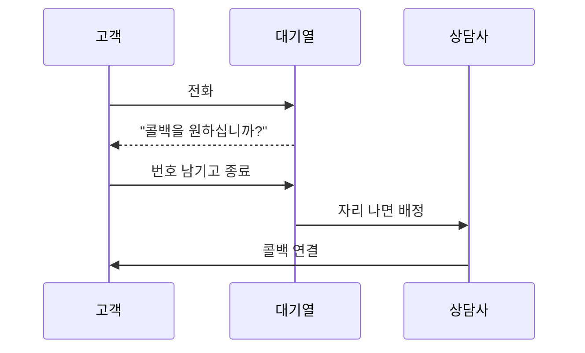

# 콜백 옵션

> 고객이 큐에서 계속 기다리는 대신 **전화번호를 남기고 끊으면 상담사가 나중에 걸어 주는** 방식이다. 가상 대기열(virtual queuing)이라고도 한다.

## 쉽게 말하면
식당 줄에서 서 있는 대신 번호표와 연락처를 남기고 근처를 돌아다니다가 자리가 나면 문자를 받는 것이다. 줄은 그대로여도 기다리다 포기하는 사람이 줄어든다.

## 자세히
(NICE 용어집과 Geckoboard 문서를 직접 읽었다. 둘 다 콜백 고객이 이탈률 식에서 어떻게 세어지는지는 설명하지 않는다.)
- **효과(NICE)**: 큐 콜백이 이탈을 줄이는 **가장 효과적인 방법**이라고 서술. 긴 대기를 없애고 고객이 일상을 계속하게 한다. 콜백 시간대를 고객이 원하는 때에 맞추면 **통화 불발(no-show)**이 줄어든다.
- **Geckoboard**: 바쁜 시간대에 콜백을 제공하라고 권고. 인력 배치, 실시간 큐 모니터링, IVR 단순화, 대기 안내, 셀프서비스 확대와 함께 쓰는 여러 수단 중 하나.
- **주장 수준**: 한 벤더 블로그가 콜백 도입 후 이탈이 14%에서 4.2%로 줄었다고 전하지만 단일 사례이고 독립 근거가 아니다.
- **측정 주의(이 글의 해석)**: 콜백을 택한 고객은 큐에서 포기한 것이 아니므로 이탈로 세지 않는 경우가 많겠지만 문서가 확인하지 않았다. 지표 정의를 먼저 정한다. 또 이탈률이 낮아져도 콜백에서 연결 실패가 늘 수 있으니 FCR·CSAT를 함께 본다.

## 그림으로 보기

## 예시
- 피크 시간대 이탈이 몰릴 때 대기 예상 5분 이상이면 자동으로 콜백 안내를 켠다(제안).
- 교육 실습: 콜백 도입 전후 이탈률을 같은 분모 정의로 비교([분모](#abandon-rate-denominator)).

## 헷갈리는 것과 비교
| 개념 | 차이 |
|---|---|
| 콜백 | 큐 위치를 유지한 채 고객이 떠남 |
| 이탈 | 큐를 포기하고 연결 안 됨 |
| 재다이얼 | 고객이 다시 직접 전화 |

## 더 읽을거리
- [NICE — Abandonment rate](https://www.nice.com/glossary/abandonment-rate) — 콜백이 가장 효과적(직접 읽음).
- [Geckoboard — Call abandonment rate](https://www.geckoboard.com/best-practice/kpi-examples/call-abandonment-rate/) — 감소 수단 목록(직접 읽음).
