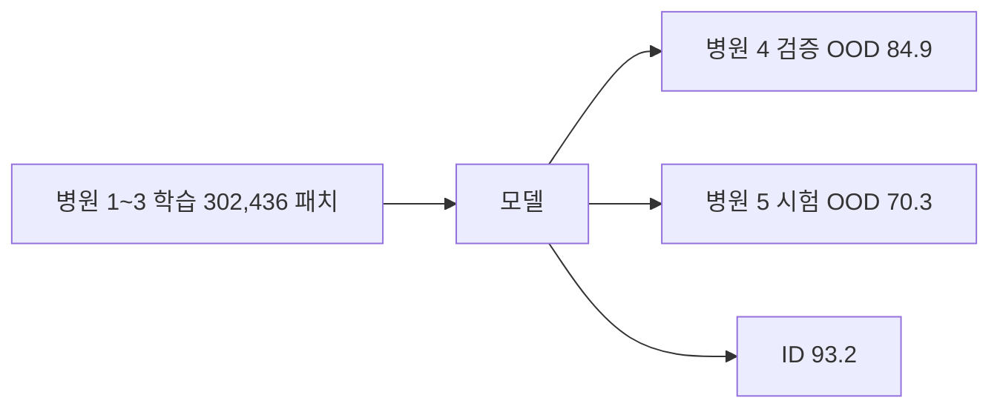
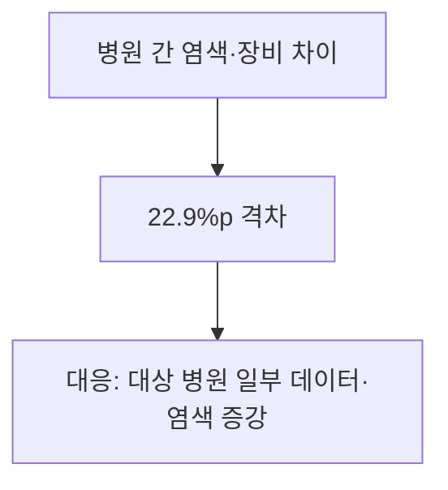

# Camelyon17

> WILDS 벤치마크의 병원 간 분포 변화 과제다. 5개 병원의 림프절 조직 슬라이드 패치에서 종양 유무를 맞히는데, 학습 병원과 다른 병원에서 정확도가 크게 떨어진다.

## 쉽게 말하면
한 병원에서 찍은 사진으로 의사 보조 AI를 배우면 다른 병원의 염색·촬영 차이 때문에 갑자기 못 맞힌다. 이 과제는 그 현상을 숫자로 보여 준다.

## 자세히
(WILDS arXiv 2012.07421 v3 본문을 하위 에이전트가 읽은 노트 기준.)
- **과제**: 입력 x = 전이성 유방암 림프절 전체 슬라이드 이미지(WSI)의 96×96 패치, 라벨 y = 중앙 32×32 영역에 종양 여부(이진), 도메인 d = 병원(5곳, 모두 네덜란드). 클래스 균형 50/50, 지표 평균 정확도. 유형은 **도메인 일반화**.
- **데이터**: 약 450,000 패치(개요 표에는 455,954), 병원당 WSI 10개씩 총 50개. 학습: 병원 1–3의 30개 WSI, **302,436 패치**. 검증(OOD): 병원 4, 34,904. 시험(OOD): 병원 5(시각적으로 가장 다르다고 선택), 85,054. 검증(ID) 33,560.
- **결과(표 5, ERM, 10회 평균)**: ID 93.2(5.2), 검증 OOD 84.9(3.1), **시험 OOD 70.3(6.4)** → 격차 **22.9%p**. 다른 방법의 시험 OOD: CORAL 59.5, IRM 64.2, Group DRO 68.4 — ERM을 안정적으로 이기지 못했다.
- **한 장의 힘(표 6)**: 시험 병원의 슬라이드 1장을 학습에 추가하면 ERM 시험 정확도 71.0 → **82.9**.
- **원인**: 염색·촬영 장비 차이. 선행 연구는 염색 증강이 비슷한 변형 데이터의 격차를 줄일 수 있다고 한다.

## 그림으로 보기

## 예시
- 사내 의료영상 모델을 도입하기 전 우리 병원 데이터 소량으로 성능 재검증.
- 교육 활용: "정확도 93%"가 어느 병원에서 잰 숫자인지 묻는 습관.

## 헷갈리는 것과 비교
| 개념 | 차이 |
|---|---|
| Camelyon17 | 병원 간 도메인 일반화 |
| [도메인 일반화](#domain-generalization) | 새 도메인에서 평균 성능 |
| [소집단 변화](#subpopulation-shift) | 같은 도메인의 비율 변화 |

## 더 읽을거리
- [WILDS (arXiv 2012.07421)](https://arxiv.org/abs/2012.07421) — Camelyon17-WILDS 절·표 5~6.
