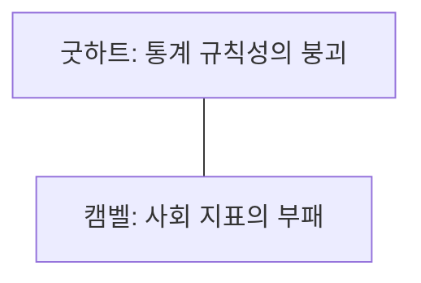

# 캠벨의 법칙

> **정량적 사회 지표가 의사결정에 많이 쓰일수록 그 지표는 부패 압력에 노출되고, 지표가 측정하려던 과정을 왜곡하기 쉽다**는 법칙. [굿하트의 법칙](#goodharts-law)과 짝으로 인용된다.

## 쉽게 말하면
성적으로 교사를 평가하면 교사가 시험 대비만 가르치거나 점수를 후하게 주려는 압력이 생기는 것과 같다. 중요한 지표일수록 그 지표를 올리려는 유혹이 커진다.

## 자세히
(Wikipedia의 굿하트의 법칙 문서 요약, 열람 2026-11-28.)
- 내용: 정량적 사회 지표가 의사결정을 이끌수록 **부패 압력**에 열리게 된다.
- 시기: 굿하트의 법칙보다 앞선 것으로 보이며, 문서는 Jeff Rodamar의 주장으로 정식이 **1969년**까지 거슬러 올라간다고 소개한다.
- 굿하트와의 관계: 굿하트는 통화정책(1975)의 통계적 규칙성이 통제 압력 아래 무너진다는 아이디어, 캠벨은 사회 지표의 부패라는 서술로 서로 닮았지만 출처와 분야가 다르다(해석).
- AI 연결: [보상 과최적화](#reward-overoptimization)처럼 평가 지표가 학습·개선의 목표가 되면 같은 문제가 생긴다(내 해석). 벤치마크 점수를 올리는 일이 목표가 되면 점수와 실력이 어긋난다([평가 포화](#eval-saturation)).
- 한계: 이 글은 위키 요약이며 캠벨의 원문은 열람하지 않았다.

## 그림으로 보기

## 예시
- AI 도입 성과를 "사용 횟수"로 평가하면 불필요한 사용이 늘어남.
- 교육: 지표와 목적이 어긋난 조직 사례를 수강생 사례로 모으기.

## 헷갈리는 것과 비교
| 개념 | 차이 |
|---|---|
| 캠벨의 법칙 | 사회 지표의 부패 압력 |
| [굿하트의 법칙](#goodharts-law) | 지표가 목표가 되면 붕괴 |
| [보상 과최적화](#reward-overoptimization) | AI 학습에서의 구체적 사례 |

## 더 읽을거리
- [Goodhart's law (Wikipedia)](https://en.wikipedia.org/wiki/Goodhart%27s_law) — 캠벨의 법칙 소개(읽음).
