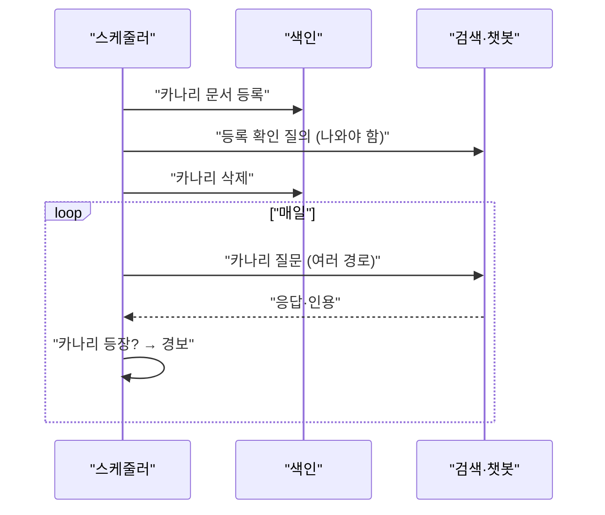
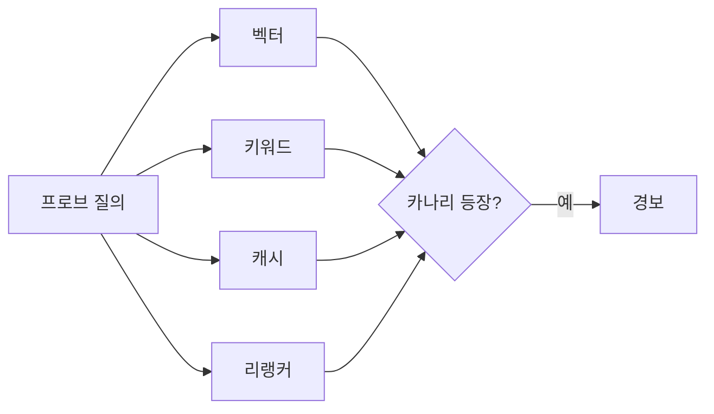

# 카나리 문서 프로브

> 일부러 **가짜 문서(카나리)를 만들어 색인하고 지운 뒤**, 그 문서에만 있는 사실을 정기적으로 질문해 보는 합성 점검이다. 답이나 인용에 나오면 삭제 전파가 실패한 것이므로 경보를 울린다.

## 쉽게 말하면
광산의 카나리아처럼, 사고가 나면 먼저 신호를 주는 감시 장치다. 도서관에 존재하지 않는 책 "가상의 사규 제9조"를 등록했다가 폐기하고, 매일 밤 그 내용을 물어본다. 대답이 나오면 폐기 절차가 어딘가 샌다는 뜻이다. [삭제 감사 표본](#deletion-audit-sampling)은 실제 문서를 사후에 뽑아 보는 점검이고, 이쪽은 가짜 문서로 상시 감시한다.

## 자세히
(실무 블로그 기반이며 표준이 아니다. 아래 두 글을 직접 열어 확인했다. 검색에서 "삭제된 카나리 문서를 정기 프로브로 돌려 경보한다"를 명시한 단일 출처는 찾지 못했다 — 두 글의 요소를 조합한 설계다.)
- **카나리 만들기**: 다른 곳에 없는 고유한 사실(예: 임의의 값 "정책 값 7431")을 담은 합성 문서를 색인하고, 삭제 전에 실제로 검색되는지 먼저 확인한다(QASkills). 안 나오면 이후 "안 나옴"은 의미가 없다.
- **프로브 질의**: 원문 질문, 바꿔 말한 질문, 같은 질문 반복(캐시), 엔티티·관계 질문, 재시작 후 질문. 벡터·키워드·하이브리드·캐시·리랭커 경로를 모두 대상으로 한다(QASkills).
- **경보 조건(QASkills)**: 삭제 확인(약속한 경계 시각) 이후 어느 경로의 후보·프롬프트·답·인용에서든 카나리가 한 번이라도 나오면 알림. 논리 삭제까지 걸린 시간과 물리 제거까지 걸린 시간을 따로 잰다. 로그에는 식별자·프로브 이름·단계만 남기고 카나리 본문은 남기지 않는다.
- **삭제 확인 원칙(Jannik Reinhard 글)**: HTTP 응답만으로 삭제됐다고 보지 않고, 다시 질의해 옛 청크가 안 나오는지 확인한다. 블롭 삭제가 검색 문서 삭제를 보장하지 않고, 캐시 답변·대화 기억·내보낸 보고서에 옛 내용이 남을 수 있다. 이 글은 일회성 인수 테스트를 다루며 상시 경보·지표는 정의하지 않는다.
- **주의(검색 요약, 직접 확인 못 함)**: 복제본에 삭제가 비동기로 전파되면 직후 확인이 "아직 있음"으로 나올 수 있어, 곧바로 경보하지 말고 허용 지연 후 재시도하는 편이 낫다고 한다. 진행 중이던 수집 작업이 삭제 뒤에 문서를 다시 올리는 경합도 점검 대상이다.
- **연구 쪽 "카나리"와 구별**: 논문의 워터마크 카나리(데이터셋 무단 사용 탐지)나 CanaryRAG(추출 공격 탐지)는 보안 목적이며 이 노드와 다르다.

## 그림으로 보기

## 예시
- 사내 챗봇: 매일 새벽 "가짜 휴가 규정 9조"를 등록→검증→삭제하고, 다음 날 질문해 인용에 나오면 슬랙 알림.
- 교육 소재: "지웠다는 걸 어떻게 증명하나?"를 카나리 실습으로.

## 헷갈리는 것과 비교
| 개념 | 차이 |
|---|---|
| 카나리 문서 프로브 | 가짜 문서로 상시 경보 |
| [삭제 감사 표본](#deletion-audit-sampling) | 실제 삭제 문서를 사후 표본 점검 |
| [좀비 문서](#zombie-documents) | 탐지하려는 문제 |

## 더 읽을거리
- [Testing RAG deleted document tombstones (QASkills)](https://qaskills.sh/blog/testing-rag-deleted-document-tombstones) — 카나리·프로브·합격 기준·상시 모니터링.
- [RAG Freshness: Stop Agents Reusing Deleted Documents (Jannik Reinhard)](https://jannikreinhard.com/rag-freshness-deleted-documents-agent-memory/) — 합성 정책으로 삭제를 인수 테스트.
