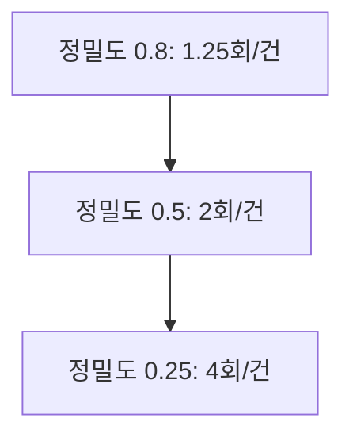

# 후보 정밀도와 검증 비용

> 알고리즘이 뽑은 후보를 사람이 확인하는 구조에서는, 후보의 정밀도가 낮을수록 "진짜 오류 하나를 찾는 데 드는 확인 횟수"가 늘어난다. 검증 비용 = 확인 횟수 × 건당 단가이므로 정밀도는 곧 비용 구조다.

## 쉽게 말하면
금속 탐지기가 울릴 때마다 땅을 파야 한다면, 10번 중 9번이 빈 깡통일 때와 2번이 빈 깡통일 때 발굴 비용이 다르다. 탐지기의 정확도가 사람 노동을 결정한다.

## 자세히
- **기본식(해석)**: 진짜 오류 1건당 확인 횟수 = 1 / 정밀도. 정밀도 0.8이면 1.25회, 0.5면 2회, 0.25면 4회다.
- **직접 실험에서 가져온 수치(cleanlab 2.9.0, 가상 3클래스 2,000개, 실제 오류 309개, 5-fold 로지스틱 회귀 확률)**:

| 설정 | 확인할 후보 수 | 찾는 진짜 오류(약) | 오류 1건당 확인 횟수 |
| --- | --- | --- | --- |
| frac_noise 0.5 | 181 | 159 | 1.14 |
| prune_by_noise_rate(기본) | 346 | 267 | 1.30 |
| predicted_neq_given | 464 | 290 | 1.60 |

  기본에서 `predicted_neq_given`으로 넓히면 확인 횟수가 118건 늘고 진짜 오류는 약 23건만 더 찾아, 추가 오류 1건당 약 5회 확인이 든다. 반대로 `frac_noise` 0.5에서 기본으로 넓히면 확인 165건을 더 써서 약 108건을 더 찾는다(약 1.5회/건). 즉 후보를 넓힐수록 한계 비용이 올라간다. (표의 "찾는 오류"는 정밀도×표시 수에서 계산한 근사치이며 한 번의 가상 실험이다.)
- **크라우드 검증에 연결(해석)**: 한 후보를 여러 사람이 확인하면([과반 판정 임계값](#majority-vote-threshold)) 비용은 후보 수 × 검증자 수가 된다. 정밀도가 낮은 알고리즘일수록 검증자를 줄이는 대신 [작업자 품질 관리](#worker-quality-control)가 중요해진다.
- **의사결정(해석)**: ① 건당 단가와 놓친 오류의 피해를 비교해 한계 비용이 피해보다 큰 지점에서 멈춘다([검수 정지 규칙](#review-stopping-rule)) ② 점수 상위부터 확인해 정밀도가 높은 구간을 먼저 쓴다([precision@k](#precision-at-k-review)).

## 그림으로 보기

## 예시
- 확인 단가 500원, 후보 346건이면 약 173,000원에 진짜 오류 약 267건(1건당 약 650원). 464건으로 넓히면 232,000원에 290건(1건당 약 800원)(수치는 가정 단가와 위 실험 기준).
- 교육 활용: 정밀도에 따라 "오류 1건당 확인 횟수"를 계산하는 표를 학습자가 직접 만든다.

## 헷갈리는 것과 비교
| 개념 | 차이 |
| --- | --- |
| 후보 정밀도 | 후보 중 진짜 오류 비율 |
| 검증 비용 | 확인 횟수 × 단가 |
| [정리의 정밀도·재현율 균형](#precision-recall-tradeoff-cleaning) | 넓힘의 이득 vs 비용 |
| [검수 정지 규칙](#review-stopping-rule) | 멈출 지점 |

## 더 읽을거리
- [cleanlab filter 문서](https://docs.cleanlab.ai/stable/cleanlab/filter.html) — filter_by 옵션과 frac_noise
- [cleanlab in-depth tutorial](https://docs.cleanlab.ai/stable/tutorials/indepth_overview.html) — 정밀도·재현율이 method별로 다름
