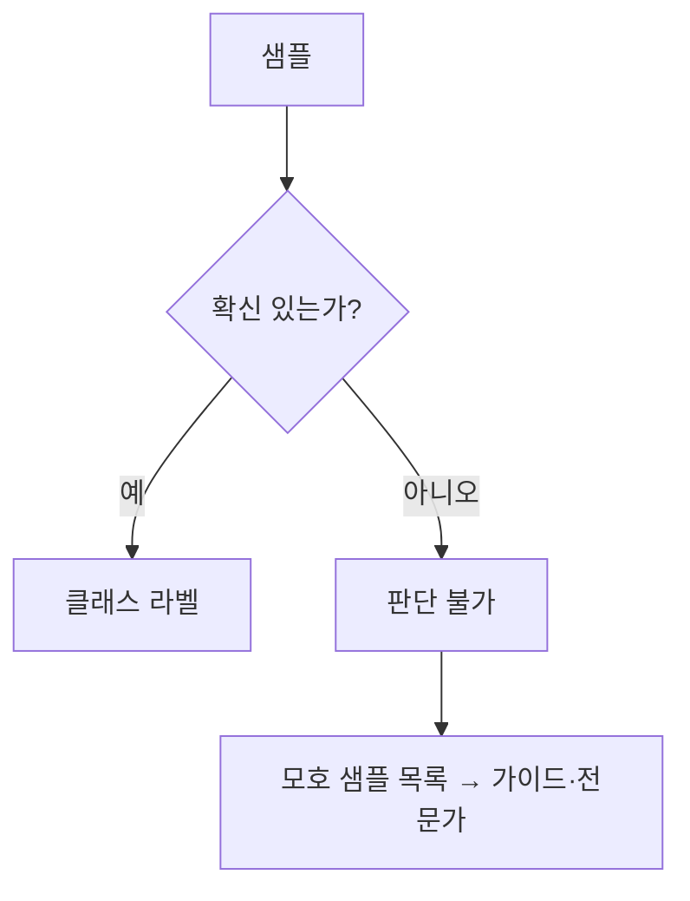
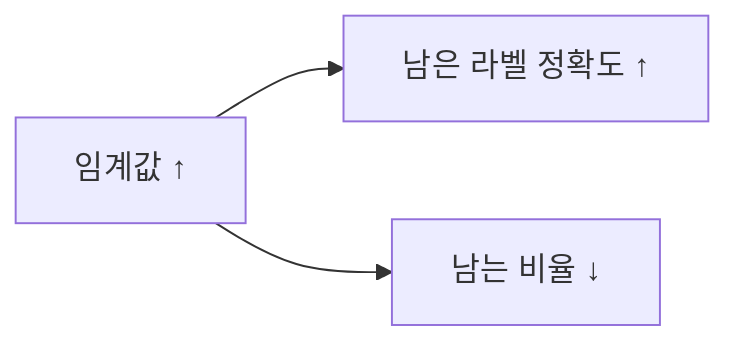

# 판단 불가 선택지

> 판단 불가 선택지("잘 모르겠음", "판단 불가")는 주석자가 확신이 없을 때 억지로 찍지 않고 표시할 수 있게 한 선택지다. 모호한 샘플을 진짜 오류와 구분하고, 억지 추측으로 생기는 오답 라벨을 줄인다.

## 쉽게 말하면
객관식 시험에 "모르겠음"을 넣으면 찍기가 줄지만 "모르겠음"만 고르는 학생이 늘 수도 있다. 그래서 이 선택지는 "얼마나 쓰게 할 것인가"를 함께 설계해야 한다.

## 자세히
- **연구 근거(Ding & Zhou, arXiv 1609.00292, 초록)**: 작업자의 자기 확신은 실제 능력과 대체로 일치하므로, 확신할 때만 답하게 하면 라벨 품질이 오른다. 품질이 높아지면 항목당 필요한 작업자 수가 줄어 총비용이 내려갈 수 있다. 단점은 작업자가 너무 자주 쓰면 예산이 낭비된다는 것이다. 저자들은 비용 절감이 의미 있는 조건과 확신 임계값 설정을 분석하고, 능력 분포를 모를 때 임계값을 정하는 온라인 방식을 제안한다.
- **검색으로 확인한 다른 연구(요약만 확인)**: 능동 학습에 판단 불가 선택지를 더하면 라벨 품질이 좋아졌다는 보고(Zhong 외, IJCAI 2015), 판단 불가 응답이 데이터의 약 10~30%를 차지하므로 버리면 정보 손실이라는 주장(AAAI 2020 논문). 둘 다 본문은 열어 보지 않았다.
- **단순 모델로 직접 계산(가정: 항목마다 작업자가 맞힐 확률 q가 0.5~1.0 균등, 작업자 확신 = q, 확신이 임계값 미만이면 판단 불가)**:

| 임계값 | 남은 라벨 정확도 | 남는 비율(yield) |
| --- | --- | --- |
| 0.5(전부 답) | 0.75 | 100% |
| 0.6 | 0.80 | 80% |
| 0.7 | 0.85 | 60% |
| 0.8 | 0.90 | 40% |

  임계값을 올릴수록 남은 라벨은 정확해지지만 쓸 수 있는 라벨이 줄어든다. 이 표는 위 가정으로 계산한 개념 예시이며 실제 작업자는 확신이 능력과 어긋날 수 있다.
- **운영(해석)**: ① 판단 불가도 보수를 준다(안 주면 작업자가 찍는다는 위 논문의 지적) ② 비율을 모니터링(예: 10~30% 범위를 넘으면 가이드를 점검) ③ 판단 불가 샘플은 버리지 않고 [모호한 샘플](#ambiguous-vs-wrong-label) 목록으로 모아 가이드 보강·전문가 판정에 쓴다 ④ 선택지 이름을 구체적으로("두 클래스 모두 가능", "정보 부족")로 나누면 원인 분석이 쉽다.

## 그림으로 보기

## 예시
- 감정 라벨링에 "판단 불가(맥락 필요)"를 추가했더니 15%가 선택되었다면, 그 샘플을 모아 규칙을 정한다(예시).
- 교육 활용: 같은 문장 20개를 "판단 불가 있음/없음" 두 방식으로 라벨링해 일치도를 비교한다.

## 헷갈리는 것과 비교
| 개념 | 차이 |
| --- | --- |
| 판단 불가 선택지 | 확신 없음을 명시적으로 표시 |
| 오류 라벨 | 확신하며 틀린 라벨 |
| [모호한 샘플 vs 오류 라벨](#ambiguous-vs-wrong-label) | 원인 구분 |
| [라벨러 간 혼동 행렬](#annotator-confusion-matrix) | 엇갈림을 쌍으로 보기 |

## 더 읽을거리
- [Crowdsourcing with Unsure Option (Ding & Zhou, arXiv 1609.00292)](https://arxiv.org/abs/1609.00292) — 판단 불가의 비용 분석
- [Active Learning from Crowds with Unsure Option (IJCAI 2015)](https://ijcai.org/proceedings/2015/154) — 검색 결과로 확인, 본문 미정독
