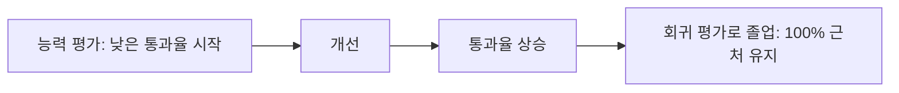
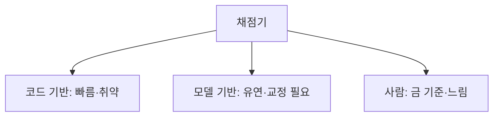

# 능력 평가

> **"이 에이전트·모델이 무엇을 잘할 수 있나"**를 재는 평가. 처음에는 통과율이 낮게 시작해 개선 목표가 되며, 통과율이 높아지면 회귀 평가로 "졸업"한다. (Anthropic 엔지니어링 글 열람 2026-11-28)

## 쉽게 말하면
신입에게 어려운 과제를 주고 "어디까지 가능한가"를 보는 것이 능력 평가다. 이미 할 줄 아는 일을 계속 잘하는지 확인하는 것은 회귀 평가다.

## 자세히
- **능력 평가**: 낮은 통과율로 시작해 팀이 향상시킬 목표를 준다.
- **회귀 평가**: 예전에 되던 과제를 여전히 처리하는가. 통과율이 **100%에 가까워야** 하고, 떨어지면 무언가 깨졌다는 신호.
- **졸업**: 능력 평가의 통과율이 높아지면 지속 실행되는 회귀 스위트로 옮겨 드리프트를 잡는다(글의 표현).
- **채점기 유형(글)**: 코드 기반(문자열 일치, 이진 테스트, 정적 분석, 결과·도구 호출 검증; 빠르고 싸고 객관적이나 취약하고 주관 과제에 제한) / 모델 기반(루브릭, 자연어 단언, 쌍 비교, 참조 기반, 다중 심판 합의; 유연하나 비결정적·비용·사람 대비 교정 필요) / 사람(전문가 검토·크라우드소싱·A/B·평가자 간 일치; 금 기준이나 느리고 비쌈).
- **pass@k vs pass^k**: pass@k는 k번 중 한 번 이상 성공할 확률(한 번이면 충분한 도구), pass^k는 **k번 모두 성공**할 확률(고객 대면 에이전트의 일관성). 예: 시도당 성공률 75%면 pass^3은 약 42%(0.75³≈0.42).
- 한계: 이 글은 에이전트 평가 가이드로, 모델 벤치마크 일반론은 아니다.

## 그림으로 보기

## 예시
- 새 기능("환불 정책 문의 처리")을 능력 평가 20개로 시작 → 통과율 90%가 되면 회귀 스위트에 편입.
- 교육: 시도당 성공률 75%의 pass^3을 계산해 보는 연습(≈42%).

## 헷갈리는 것과 비교
| 개념 | 차이 |
|---|---|
| 능력 평가 | 새로 얼마나 잘하나, 낮게 시작 |
| 회귀 평가 | 예전 능력 유지, 100% 근처 |
| [평가 포화](#eval-saturation) | 능력 평가가 너무 쉬워진 상태 |

## 더 읽을거리
- [Demystifying evals for AI agents (Anthropic)](https://www.anthropic.com/engineering/demystifying-evals-for-ai-agents) — 능력·회귀 평가, 채점기, pass^k(읽음).
