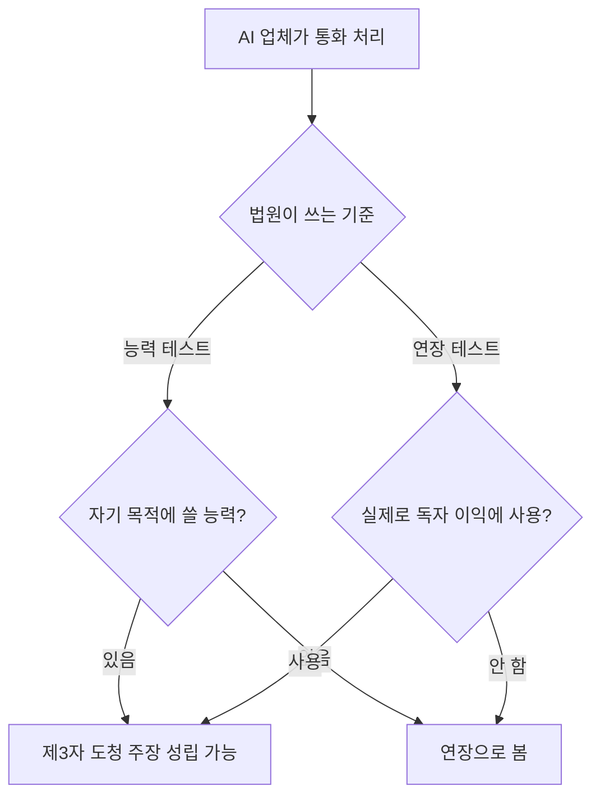

# 능력 테스트

> 캘리포니아 도청 금지법(CIPA §631(a)) 소송에서, AI 업체가 데이터를 자기 목적에 쓸 **능력**이 있기만 해도(실제 사용 여부와 무관) 제3자 도청자로 보는 판단 기준. (법률 자문 아님)

## 쉽게 말하면
식당 종업원이 손님 대화를 옆에서 들었다고 하자. 능력 테스트는 "녹음해서 팔 수 있는 장비를 갖고 있었다"만으로 외부인으로 본다. 반대인 연장 테스트는 "실제로 자기 장사에 썼는가"를 따진다.

## 자세히
- **출처 사건**: Javier v. Assurance IQ. 제9순회는 2022-05-31 약관 동의 버튼 클릭이 제3자 감시에 대한 유효한 동의가 아니라고 했고, 환송심(N.D. Cal.)은 청구가 시효로 막혔어도 업체가 독자 목적으로 쓸 능력이 있어 제3자로 볼 여지가 있다고 판단했다(Epstein Becker 해설).
- **논리(Ambriz v. Google 해설)**: §631(a)의 한 항에 이미 사용 요건이 있으므로 전체에 사용 요건을 추가할 수 없고, Google 약관이 고객 동의 시 통화 데이터를 자사 목적에 쓸 수 있게 한 점이 "기술적 능력"의 근거가 됐다.
- **적용**: Ambriz(2025-02, 콜센터 AI)에서 소송 진행 허용. Taylor v. ConverseNow(N.D. Cal. 2025-08-11)는 능력 틀을 채택하고 업체가 통화 데이터로 자사 서비스를 개선했다는 주장이 그럴듯하다며 기각 신청을 거부했다.
- **반대 흐름**: 연장 테스트(Graham v. Noom, 2021)는 업체가 독립 이익을 얻을 때만 제3자로 본다. 두 틀이 배타적이지 않고 법원마다 갈린다는 해설이 있다. 일리노이 연방법원 Lisota v. Heartland Dental(2026-01-13)은 ECPA 사건으로 "통상 업무" 예외를 받아들였다(CIPA 아님).
- **병원 맥락**: Saucedo v. Sharp HealthCare(2025-11 제기, §632, 계류 중)는 ambient AI 문서 도구가 대상이며 업체가 연장인지 능력이 있는지가 쟁점일 수 있다고 한다.
- **실무**: 계약에서 업체가 고객 데이터를 서비스 제공에만 쓰고 학습에 쓰지 않게 하고, 녹음 전에 업체 이름과 용도를 밝혀 동의를 받는다. 단 능력 테스트에서는 약관에 사용 권한이 없어도 안전하다고 단정하기 어렵다.

## 그림으로 보기

## 예시
- 약관에 "서비스 개선을 위해 통화 데이터를 사용할 수 있다"가 있으면 실제 사용 증거 없이도 능력 주장이 쉬워진다.
- 계약 문구: "업체는 고객 데이터를 서비스 제공 외 목적, 모델 학습·자체 데이터 보강에 쓰지 않는다."

## 헷갈리는 것과 비교
| 개념 | 차이 |
|---|---|
| [CIPA 소송](#cipa-lawsuits) | 상위 주제 |
| [연장 테스트](#extension-test) | 실제 독자 사용을 요구, 방어에 유리 |
| [BAA와 모델 학습 조항](#baa-model-training) | HIPAA 계약, 같은 학습 제한 발상 |
| [전원 동의](#all-party-consent) | 녹음 동의 규칙 자체 |

## 더 읽을거리
- [Eavesdropping by Algorithm (Epstein Becker Green)](https://www.ebglaw.com/insights/publications/eavesdropping-by-algorithm-how-courts-are-applying-decades-old-privacy-laws-to-ai) — 능력·연장 틀과 사건 정리(열어서 확인)
- [CIPA litigation and the technological capability (FBT Gibbons)](https://fbtgibbons.com/cipa-litigation-and-the-technological-capability-to-violate-californias-privacy-laws/) — Ambriz의 능력 논리(열어서 확인)
