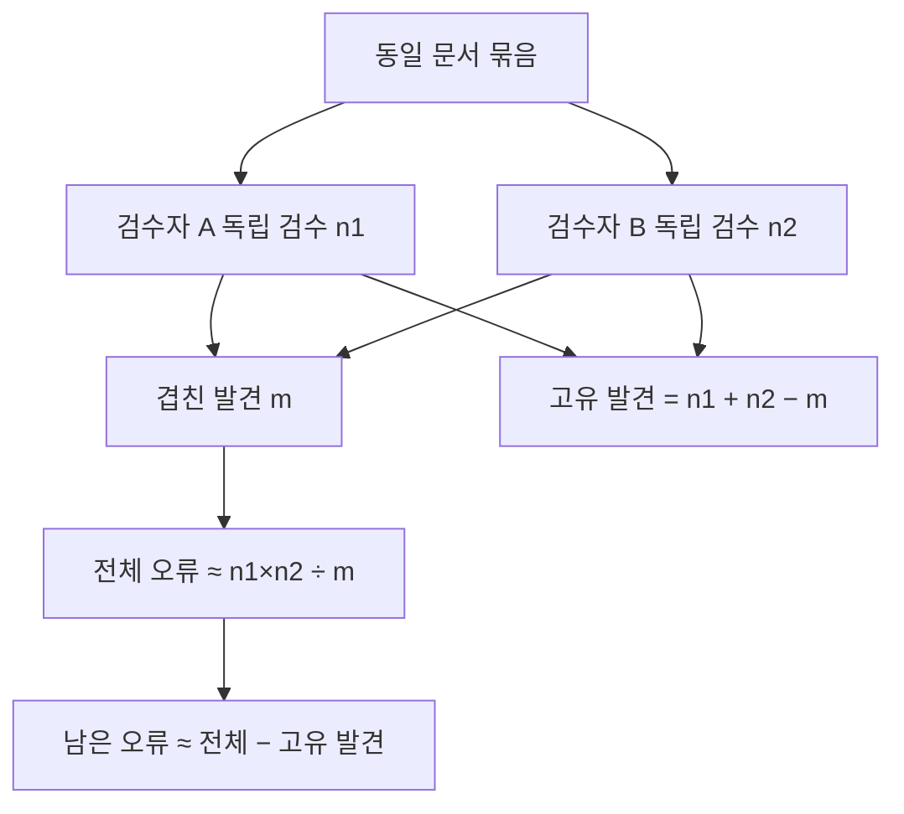

# 포획-재포획 추정 (Capture–Recapture)

> 서로 **독립적으로 같은 대상을 조사한 두 번의 결과**에서 겹친 개수로 전체 개수를 추정하는 방법. 원래는 야생 동물 개체 수 추정에 쓰이지만, 두 검수자가 같은 문서에서 오류를 찾은 결과로 "아직 아무도 못 찾은 오류가 몇 개일지"를 추정하는 데 응용할 수 있다.

## 쉽게 말하면
연못에서 물고기 10마리를 잡아 표시하고 풀어 준다. 다음 날 15마리를 잡았더니 5마리에 표시가 있었다. 15마리 중 3분의 1이 표시된 것이니, 연못 전체의 3분의 1이 표시된 물고기라고 보면 전체는 약 30마리다.

## 자세히
출처: Wikipedia "Mark and recapture"(본문 확인, 2026-11-18). 검수 오류에의 응용과 아래 수치는 직접 계산한 **제안**이다.
- **Lincoln–Petersen 추정(문서)**: `N̂ = n₁·n₂ / m`. 첫 표본에서 표시한 n₁, 두 번째에 잡은 n₂, 그중 표시된 개체 m. 두 번째 표본의 표시 비율 m/n₂가 전체 모집단의 표시 비율 n₁/N과 같다는 가정이다. 문서 예: (10, 15, 5) → 30마리.
- **Chapman 추정(문서)**: `N̂_C = (n₁+1)(n₂+1)/(m+1) − 1`. 표본이 작을 때 편향이 덜하다. 같은 예에서 약 28.3(문서는 내림해 28).
- **가정(문서)**: ①닫힌 모집단(두 조사 사이에 변화 없음) ②표시 손실 없음 ③기록 정확 ④모든 개체의 포획 확률이 같음. 표본이 둘뿐이면 마지막 가정은 직접 검증할 수 없다.
- **검수에의 응용(제안)**: 같은 AI 초안 묶음을 검수자 A와 B가 독립적으로 검수. A가 오류 18개, B가 15개를 찾고 겹친 것이 9개라면 Lincoln–Petersen 추정 전체 오류 ≈ 18×15/9 = 30, Chapman ≈ 29.4. 서로 합쳐 찾은 고유 오류는 18+15−9 = 24개이므로 약 5~6개가 아무도 못 찾은 것으로 추정(직접 계산).
- **겹침이 클수록**: 겹친 오류가 12개면 전체 ≈ 22.5, Chapman ≈ 22.4이고 고유 발견 21개이므로 남은 오류 약 1.4개. 겹침이 작을수록 남은 오류 추정이 커진다.
- **현실적 문제(해석)**: 어려운 오류는 두 사람 모두 놓칠 가능성이 높아 **포획 확률이 같지 않다**(가정 위반). 이 경우 총 오류는 과소 추정된다. 두 검수자가 서로의 결과를 보지 않아야 독립이다.
- **삽입 오류와의 비교**: 오류 삽입은 정답을 알고 검출률을 직접 재지만 삽입 오류의 현실성이 문제이고([오류 삽입 감사](#audit-seeded-errors)), 포획-재포획은 실제 오류만 쓰지만 독립성과 동일 발견 확률 가정이 필요하다. 두 방법을 함께 쓰면 교차 확인이 된다.

## 그림으로 보기


## 예시
```python
def lincoln_petersen(n1, n2, m):
    return n1 * n2 / m
def chapman(n1, n2, m):
    return (n1 + 1) * (n2 + 1) / (m + 1) - 1
n1, n2, m = 18, 15, 9
total = chapman(n1, n2, m)          # 약 29.4
remaining = total - (n1 + n2 - m)   # 약 5.4
```
교육 활용: 두 명이 같은 AI 요약 20건을 독립 검수해 발견 오류 목록을 비교하고 남은 오류를 추정해 보는 실습.

## 헷갈리는 것과 비교
| 개념 | 차이 |
|---|---|
| 포획-재포획 | 두 번의 독립 조사 겹침으로 총수 추정 |
| [오류 삽입 감사](#audit-seeded-errors) | 심어 둔 오류의 발견율로 검출률 추정 |
| 단순 평균 | 겹침 정보를 쓰지 않음 |
| 표본조사 | 일부만 보고 전체를 추정, 오류 목록을 직접 비교하지 않음 |

## 더 읽을거리
- [Wikipedia: Mark and recapture](https://en.wikipedia.org/wiki/Mark_and_recapture) — Lincoln–Petersen·Chapman 추정과 가정
