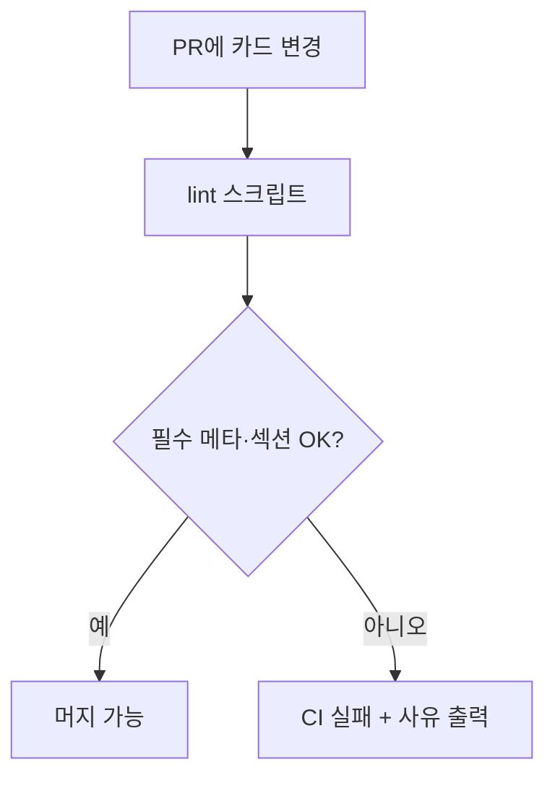
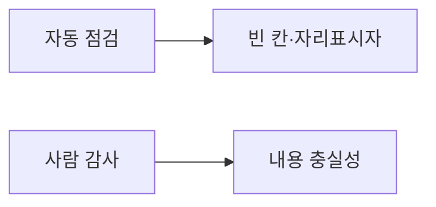

# 카드 필수 칸 자동 점검

> 데이터 카드의 **필수 메타데이터와 필수 섹션이 비어 있거나 자리표시자(TODO)로 남았는지** 스크립트로 검사해, 비어 있으면 CI(자동 검증)를 실패시키는 장치다. 사람 감사가 보기 전에 기계적 결함을 거른다.

## 쉽게 말하면
서류 접수 창구에서 "이름·주소·서명 칸이 비어 있으면 접수 불가"라고 자동으로 돌려보내는 것이다. 내용이 좋은지는 사람이 보지만, 칸이 비었는지는 기계가 즉시 알 수 있다.

## 자세히
(Hugging Face Hub 문서의 데이터셋 카드 구조를 직접 읽었고, 점검 스크립트는 이 지도에서 직접 작성해 실행했다. `huggingface_hub`의 카드 API 가이드 페이지는 열리지 않아 그 API는 쓰지 않았다.)
- **카드의 구조(HF 문서)**: 데이터셋 카드는 저장소의 `README.md`이며 맨 위 `---`로 둘러싼 **YAML 메타데이터**(예: `language`, `pretty_name`, `tags`, `license`, `task_categories`)와 본문으로 이루어진다. 메타데이터는 Hub에서 검색·필터와 라이선스 표시에 쓰이고, 라이선스 키워드를 표의 값으로 쓰면 페이지에 표시된다. 문서는 편향 가능성 같은 책임 있는 사용 정보를 넣으라고 권한다. 어떤 필드가 **필수인지**는 읽은 페이지에 목록이 없다. 아래 필수 목록은 이 지도의 제안 정책이다.
- **점검 항목(제안)**: ① YAML 블록 존재 ② 필수 메타데이터 키(`pretty_name`, `license`, `language`) ③ 필수 섹션 존재(`Dataset Description`, `Dataset Structure`, `Considerations for Using the Data`) ④ 섹션 내용이 비었거나 `TODO`·`TBD`·`N/A` 같은 자리표시자가 아닌지.
- **직접 만든 점검 스크립트와 실행 결과**: 아래 코드를 두 개의 샘플 카드에 돌렸다. 정상 카드는 `OK`, 결함 카드(`license`·`language` 누락, `Dataset Structure` 섹션 없음, 고려사항 칸이 `TODO`)는 `FAIL`과 사유 4줄을 출력하고 종료 코드 1을 돌려 CI를 실패시킨다.
- **오탐의 교훈(직접 겪음)**: 처음엔 "섹션 내용 15자 미만이면 비었다"고 정했더니 정상 카드의 짧은 설명("고객 문의 1만 건.")이 **오탐**으로 걸렸다. 기준을 8자로 낮춰 통과시켰다. 길이 기준은 거친 근사라서 한국어·짧은 설명에서 오탐이 난다. 자동 점검은 "빈 칸"만 잡고 **내용이 충실한지는 판단하지 못한다**.
- **역할 분담**: 자동 점검은 형식을, [카드 분기 샘플 감사](#card-quarterly-audit)는 내용을 본다. "고려사항 칸이 TODO"처럼 가장 필요한 칸이 비는 문제([사용 시 고려사항 칸이 비는 문제](#considerations-section-gap))를 CI가 막을 수 있다.

## 그림으로 보기



## 예시
```python
import re, sys
REQUIRED_META = ["pretty_name", "license", "language"]
REQUIRED_SECTIONS = ["Dataset Description", "Dataset Structure",
                     "Considerations for Using the Data"]
PLACEHOLDER = re.compile(r"^\s*(TODO|TBD|N/A|없음|\.\.\.)?\s*$", re.I)

def lint(text):
    m = re.match(r"^---\n(.*?)\n---\n(.*)$", text, re.S)
    if not m: return ["YAML 메타데이터 블록 없음"]
    meta, body = m.groups()
    keys = {l.split(":")[0].strip() for l in meta.splitlines()
            if re.match(r"^[A-Za-z_]+:", l)}
    errs = [f"메타데이터 누락: {k}" for k in REQUIRED_META if k not in keys]
    parts = re.split(r"^## (.+)$", body, flags=re.M)
    sections = dict(zip(parts[1::2], parts[2::2]))
    for s in REQUIRED_SECTIONS:
        if s not in sections: errs.append(f"섹션 없음: {s}")
        elif PLACEHOLDER.match(sections[s].strip()) or len(sections[s].strip()) < 8:
            errs.append(f"섹션이 비었거나 자리표시자: {s}")
    return errs
```
- CI에서 `python lint.py cards/*.md`가 0이 아닌 종료 코드를 내면 파이프라인이 실패한다.

## 헷갈리는 것과 비교
| 개념 | 차이 |
|---|---|
| 카드 필수 칸 자동 점검 | 빈 칸·형식을 기계가 검사 |
| [카드 분기 샘플 감사](#card-quarterly-audit) | 내용 충실성을 사람이 점검 |
| [카드 없으면 사용 불가 게이트](#card-required-gate) | 사용 신청 때 카드 존재 확인 |
| 스키마 검증 | 메타데이터 값의 형식·허용 값 검사(더 정교) |

## 더 읽을거리
- [Dataset Cards (Hugging Face Hub 문서)](https://huggingface.co/docs/hub/datasets-cards) — README.md·YAML 메타데이터 구조(직접 읽음).
