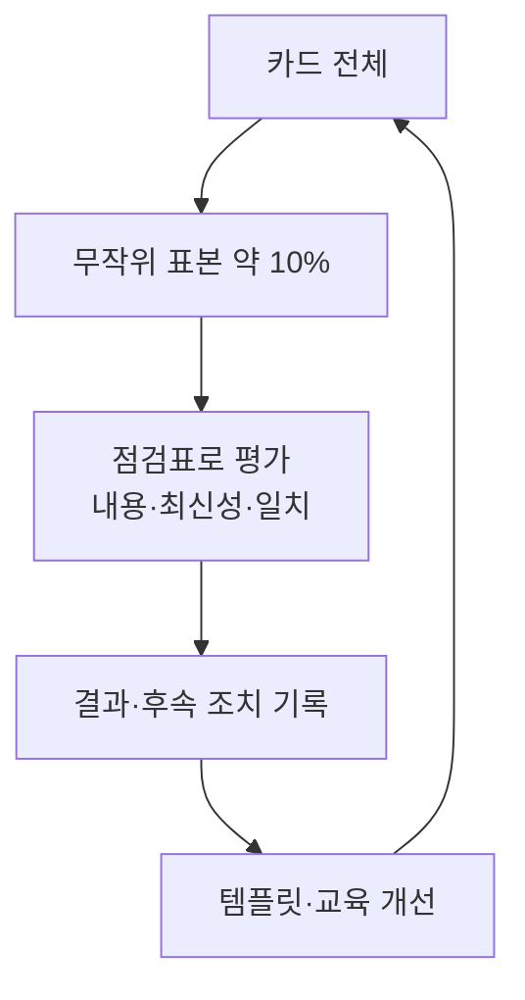
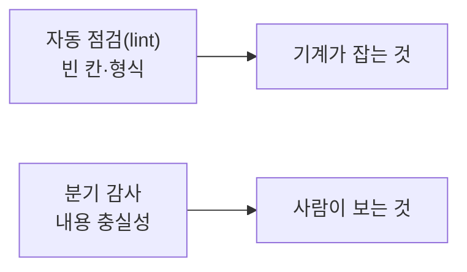

# 카드 분기 샘플 감사

> 데이터 카드를 **분기마다 일부만 뽑아** 실제로 의미 있게 작성됐는지(형식만 채웠는지) 점검하는 운영 장치다. 전수 검사를 하기엔 많을 때 표본으로 품질 수준을 가늠한다.

## 쉽게 말하면
학교에서 모든 학생의 공책을 매일 검사할 수는 없으니 분기마다 몇 권을 뽑아 "글씨만 채웠는지, 내용을 이해하고 썼는지" 본다. 뽑힐 수 있다는 사실 자체가 평소 작성 태도를 바꾼다.

## 자세히
(Google Data Cards Playbook 페이지, 저장소 README, Hugging Face 데이터셋 카드 연구 초록을 직접 읽었다. **"분기 샘플 감사"라는 구체 운영은 이 지도의 제안**이며 위 자료가 요구하거나 규정한 것이 아니다.)
- **Playbook의 Audit 모듈(직접 읽음)**: Playbook은 Ask·Inspect·Answer·**Audit** 네 모듈로 구성되고, Audit은 **공개 전에 완성된 데이터 카드를 평가**하고 **조직 전체에서 투명성 노력을 추적**하는 단계다. 구조화된 평가, 사용자 연구, 조직 목표와 연결한 측정을 제안하며 구체 점수 체계는 제시하지 않는다. Audit 세부 페이지는 열리지 않았고(404), 저장소에도 감사 체크리스트는 없다. 저장소는 2025-08-05에 보관(read-only) 처리됐으며 Playbook은 2022년의 탐색적 사례라고 밝힌다.
- **왜 감사가 필요한가(HF 연구 초록, 직접 읽음)**: 카드 작성은 데이터셋마다 완성도 편차가 크고, 가장 중요한 "사용 시 고려사항" 칸이 가장 비어 있으며, 사람 평가에서 **내용이 포괄적일수록** 카드를 높게 평가한다. 즉 칸이 채워졌는지와 내용이 충실한지는 다르다.
- **분기 표본 감사 설계(제안)**
  1. **표본 추출**: 카드 전체에서 무작위로 약 10%(최소 10개)를 뽑는다. 예: 120개 → 12개를 뽑는다(직접 계산 예시).
  2. **점검표**: 필수 칸이 비어 있지 않은가 / 한계·위험 칸이 실질 내용인가(문장 한 줄 복붙이 아닌가) / 출처·허용 용도가 최신인가 / 담당자·갱신 상태가 유효한가 / 실제 데이터(스키마·분포)와 카드가 일치하는가.
  3. **결과 기록**: 항목별 통과율, 반복되는 결함, 담당자별 후속 조치와 기한을 기록한다.
  4. **환류**: 결함이 많으면 템플릿 질문을 고치고 교육한다. 표본 크기와 점검 항목은 이후 분기에 조정한다.
- **한계(해석)**: 표본 감사는 전체 카드 품질을 추정할 뿐 개별 카드의 모든 오류를 보장하지 않는다. 표본이 작으면 추정이 불안정하고, 점검자의 주관이 개입한다. 인원·비용과 감사 빈도 사이에서 균형을 잡는다.
- **함께 쓰는 장치**: [카드 필수 칸 자동 점검](#card-field-lint)(기계적 점검)은 형식을, 분기 감사는 **내용의 충실성**을 본다. 둘은 역할이 다르다.

## 그림으로 보기



## 예시
```python
import random, math
cards = [f"card-{i:03d}" for i in range(1, 121)]
k = max(10, math.ceil(0.1 * len(cards)))   # 12
sample = random.sample(cards, k)
```
- 교육 소재: 형식만 채운 카드와 내용을 채운 카드를 구별해 점수 매겨 보기.

## 헷갈리는 것과 비교
| 개념 | 차이 |
|---|---|
| 분기 샘플 감사 | 표본으로 카드 품질을 사람이 점검 |
| [카드 필수 칸 자동 점검](#card-field-lint) | 빈 칸·형식을 CI가 자동 검사 |
| [카드 없으면 사용 불가 게이트](#card-required-gate) | 사용 신청 때 카드 존재 확인 |
| [사용 시 고려사항 칸이 비는 문제](#considerations-section-gap) | 감사에서 우선 볼 대표 결함 |

## 더 읽을거리
- [Data Cards Playbook (Google)](https://sites.research.google/datacardsplaybook/) — Audit 모듈 개요(직접 읽음, 2022 탐색적 사례).
- [Dataset cards on Hugging Face study (arXiv 2401.13822)](https://arxiv.org/abs/2401.13822) — 완성도 편차와 품질 인식(초록 직접 읽음).
