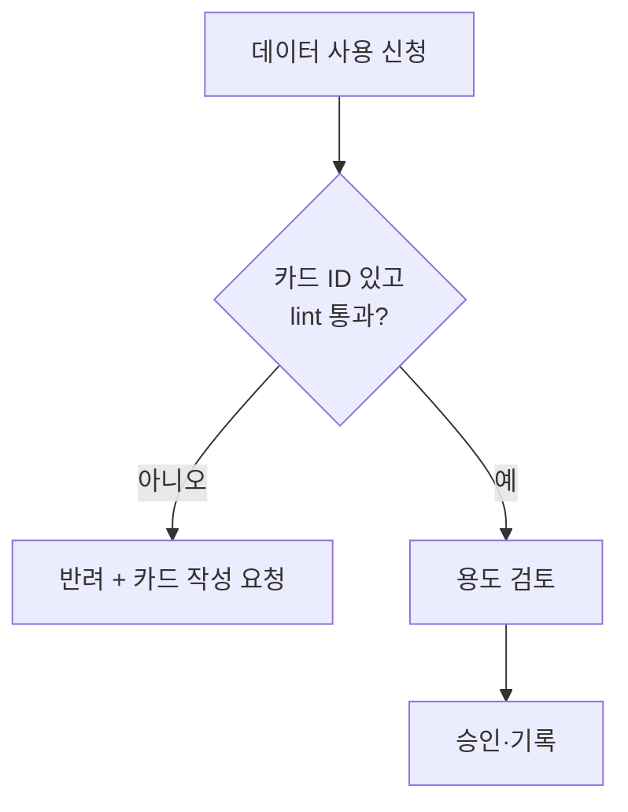
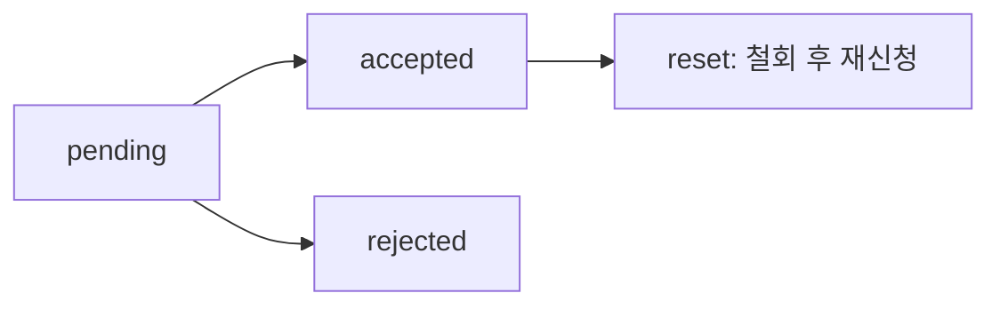

# 카드 없으면 사용 불가 게이트

> 데이터를 쓰겠다는 **사용 신청 단계에서 "이 데이터의 카드가 있는가"를 확인**해, 카드가 없거나 비어 있으면 신청을 통과시키지 않는 규칙이다. 권고가 아니라 관문으로 만들어 카드를 쓰게 한다.

## 쉽게 말하면
공연장 입구에서 표 검사를 하듯, 데이터를 가져가려는 사람에게 "이 데이터의 설명서(카드)가 있는지" 먼저 확인한다. 설명서가 없는 데이터는 문 앞에서 돌려보내고 담당자에게 설명서부터 쓰라고 한다.

## 자세히
(Hugging Face Hub의 gated datasets 문서를 직접 읽었다. 이 문서는 **접근 요청·승인 기능**을 설명하며 "카드가 있어야 접근 가능"이라는 규칙을 요구하지 않는다. 카드 게이트라는 운영 규칙은 이 지도의 제안이고, HF 기능은 그 구현에 쓸 수 있는 **비슷한 메커니즘의 사례**로 든다.)
- **접근 요청 흐름(HF 문서)**: 데이터셋 작성자가 **접근 요청**을 켜면 사용자는 요청을 제출해야 파일에 접근한다(기본은 게이트 없음). 요청은 개별 사용자에게만 허가된다. **자동 승인**(정보를 공유하면 즉시 접근)과 **수동 승인**을 고를 수 있고, 수동일 때는 알림 빈도(하루 한 번/실시간)와 직접 접근 추가 기능이 있다.
- **요청 양식 커스터마이즈(HF 문서)**: 카드 메타데이터의 `extra_gated_fields`로 `text`·`checkbox`·`date_picker`·`country`·`select` 필드를 요청 양식에 추가하고, `extra_gated_prompt`로 안내 문구를 바꾼다. 문서 예시는 회사명·국가·사용 목적(연구/교육/기타) 선택과 "비상업적 용도로만 사용" 체크박스다.
- **승인 관리와 기록(HF 문서)**: 요청 상태는 **pending·accepted·rejected·reset**이다. 거절하면 다시 요청할 수 없고, `reset`은 이전 결정을 철회해 처음부터 다시 신청하게 한다. 거절·초기화 사유(최대 200자)를 사용자에게 보일 수 있다. API로 목록 조회·상태 변경·접근 부여를 자동화할 수 있다. **접근 보고서(JSON)** 로 요청 ID·사용자·상태·요청 시각(`time`)·검토 시각(`reviewedAt`)을 내려받을 수 있다.
- **개인정보 주의(HF 문서)**: 기본으로 사용자 이름·이메일이 작성자에게 공유되며, 작성자가 PII 처리를 책임지고 처리 방침을 공개해야 한다. 이름·이메일 수집 여부를 끌 수 있다.
- **조직 구성원도 게이트 가능(HF 문서)**: 조직 소유 데이터셋에서 조직 구성원에게도 요청을 요구할 수 있고, 조직 관리자 등 일부 역할은 우회한다.
- **카드 게이트를 만드는 방법(제안)**: ① 사용 신청 양식에 **카드 ID(링크)** 필수 필드를 둔다 ② 신청 접수 단계에서 [카드 필수 칸 자동 점검](#card-field-lint)을 호출해 통과해야 접수 ③ 검토자가 용도가 [허용 용도 정책](#allowed-use-policy-data)과 맞는지 확인 ④ 모든 결정과 사유를 로그로 남긴다 ⑤ 카드가 폐기·갱신되면 기존 승인을 재검토한다.
- **한계(해석)**: 게이트가 엄격하면 개발이 느려지고 형식적 카드가 양산될 수 있다. 위험이 큰 데이터에 먼저 적용하고 [분기 샘플 감사](#card-quarterly-audit)로 내용을 보완한다.

## 그림으로 보기



## 예시
```yaml
extra_gated_prompt: "카드(Data Card) 링크를 입력하세요. 카드가 없으면 신청할 수 없습니다."
extra_gated_fields:
  Data card URL: text
  I will use this dataset only for the stated purpose: checkbox
```
(HF의 `extra_gated_fields` 형식을 응용한 예시. 카드 존재 검증 자체는 별도 로직이 필요하다.)
- 교육 소재: "설명서 없는 약은 약국에서 팔 수 있을까?"로 게이트 필요성 토론.

## 헷갈리는 것과 비교
| 개념 | 차이 |
|---|---|
| 카드 게이트 | 사용 신청 시 카드 존재·품질 확인 |
| HF gated dataset | 접근 요청·승인 기능(카드 필수는 아님) |
| [카드 필수 칸 자동 점검](#card-field-lint) | 카드 내용의 빈 칸 검사 |
| [용도 예외 승인 절차](#use-exception-approval) | 정책 밖 용도의 승인 |

## 더 읽을거리
- [Gated datasets (Hugging Face Hub)](https://huggingface.co/docs/hub/datasets-gated) — 접근 요청·승인·보고서·`extra_gated_fields`(직접 읽음).
