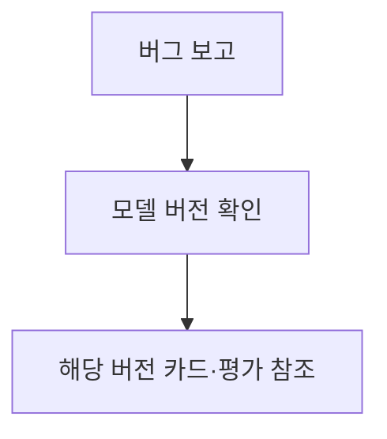

# 카드와 버전 관리

> 모델이 바뀌면 모델·시스템 카드도 다시 써야 한다. 카드에 모델 버전을 적고 변경 이력을 남겨야 이전 버전의 결과와 구분하고 버그를 버전에 연결할 수 있다.

## 쉽게 말하면
제품 설명서가 구형 모델 기준이면 신형 사용자를 오도한다. 설명서에도 개정판 번호와 개정 이유가 있어야 한다.

## 자세히
(Model Cards 논문 arXiv 1810.03993과 Claude Opus 4.1 시스템 카드 부록을 하위 에이전트가 원문으로 읽은 노트 기준.)
- **Model Cards의 "Model version" 항목**: 이전 버전과 어떻게 다른지를 설명해 최신 버전을 추적하고 **버그를 버전에 연결**하도록 한다.
- **실제 카드의 변경 이력**: Opus 4.1 부록은 2025년 8월 문서이며 **2025-09-15 변경 기록**(CBRN 평가 파트너 감사 표기 관련)이 붙어 있다. 문서 자체도 사후에 수정된다는 예다.
- **운영(제안)**: ① 카드 상단에 모델 ID·날짜·버전 ② 변경 로그(무엇이 왜 바뀌었나) ③ 평가 세트·안전장치 설정이 바뀌면 재평가 ④ 사용자 대면 문서에 "이 카드가 적용되는 버전" 명시.

## 그림으로 보기

## 예시
- 사내 모델 레지스트리에 모델 해시·카드 버전·평가 보고서를 함께 저장.
- 교육 활용: 같은 모델의 두 카드 버전을 비교해 달라진 점 찾기.

## 헷갈리는 것과 비교
| 개념 | 차이 |
|---|---|
| 카드 버전 관리 | 문서의 개정 추적 |
| 모델 버전 관리 | 가중치·코드의 버전 |
| [평가 보고서](#evaluation-report) | 카드의 평가 부분 |

## 더 읽을거리
- [Model Cards for Model Reporting (arXiv 1810.03993)](https://arxiv.org/abs/1810.03993) — Model version 항목.
