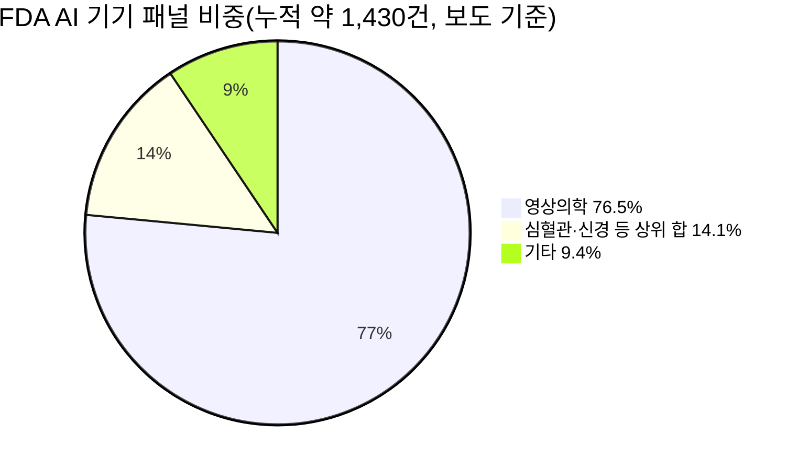

# 심혈관 AI 기기

> FDA 허가 AI 의료기기에서 영상의학 다음으로 많은 분야. 심전도·심초음파·심장 영상 등을 분석하는 소프트웨어가 포함된다.

## 쉽게 말하면
의료 AI 허가 명부에서 영상의학이 1등이고 심혈관이 2등이다. 맥박·전기 신호(ECG)와 심장 초음파처럼 데이터가 풍부한 곳에서 AI가 먼저 상용화됐다.

## 자세히
출처: 검색 결과 요약(AuntMinnie, Innolitics, 보도). FDA 목록 원본으로 재집계하지는 않았다. 집계 기준·시점에 따라 숫자가 다르다.
- **누적 비중(보도)**: 1995-09~2025-12 허가 1,430건 중 영상의학 패널 1,094건(76.5%), 영상의학·심혈관·신경 세 패널이 합쳐 90.6%. 이전 스냅샷에서는 1,247건 중 영상의학 956건(77%), 심혈관 116건(약 9%).
- **2025년만**: Innolitics 검토 295건 중 심혈관 26건(8.8%), 영상의학 211건(71.5%). 같은 매체들은 영상의학 패널에 올라간 심장 영상 AI까지 합치면 심혈관 관련 수가 184건으로 늘어난다고 보도(출처가 다름, 정의 확인 필요).
- **ECG 전용 건수**: 이번 검색에서 확인하지 못함.
- **분류 주의**: FDA는 패널(분야)별로 분류하므로 "심장 CT 판독 AI"가 영상의학 패널에 있을 수 있다([FDA 패널](#fda-panel)). 분야별 비교는 정의를 맞춘 뒤 해야 한다.
- 왜 많은가: 웨어러블·ECG처럼 대량의 구조화 신호 데이터가 있고, 판독 부담이 크며, 승인된 predicate가 풍부한 분야가 510(k)에 유리하다(추정, 출처 없음).

## 그림으로 보기

## 예시
- 부정맥(심방세동) 탐지 ECG 알고리즘, 심장 초음파 박출률 자동 측정, 관상동맥 CT 분석. 허가 목록에서 심혈관 패널 K번호를 검색해 predicate를 찾는다.
- 시장 조사 시 영상의학 패널에 있는 심장 영상 AI까지 포함해 집계.

## 헷갈리는 것과 비교
| 개념 | 차이 |
|---|---|
| 심혈관 패널 AI | 패널 분류 기준 |
| 심장 영상 AI | 영상의학 패널일 수 있음 |
| [영상의학 AI 우위](#radiology-ai-dominance) | 전체 1위 분야 |

## 더 읽을거리
- [AuntMinnie: Radiology dominates thirty years of FDA AI device approvals](https://www.auntminnie.com/imaging-informatics/artificial-intelligence/article/15830219/radiology-dominates-thirty-years-of-fda-ai-device-approvals) — 장기 집계(검색 결과로만 확인)
- [Innolitics: 2025 Year in Review](https://innolitics.com/articles/year-in-review-ai-ml-medical-device-k-clearances/) — 2025년 패널별 건수(검색 결과로만 확인)
