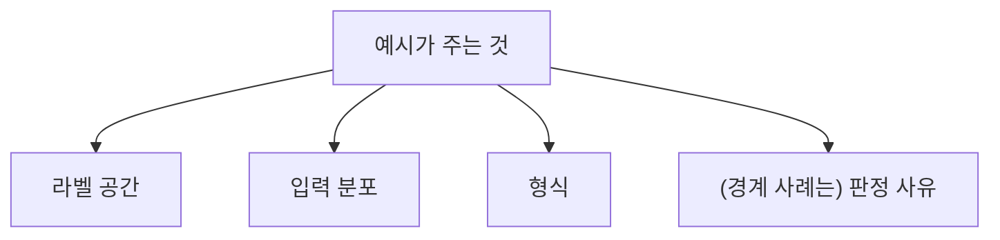

# 경계 사례 → few-shot 예시

> 경계 사례 로그에 쌓인 "판정이 갈렸던 어려운 사례와 그 결론"을 LLM 라벨러의 프롬프트에 few-shot 예시로 넣으면, 사람 라벨러에게 주는 지침 예시와 같은 역할을 해 LLM의 판정 기준을 맞출 수 있다.

## 쉽게 말하면
신입에게 규정집만 주는 대신 "이런 애매한 경우는 이렇게 처리했다"는 사례집을 함께 주는 것이다. 사람이 쌓은 판례를 LLM에게도 보여 주는 셈이다.

## 자세히
- **few-shot의 정의(Brown 외 2020, arXiv 2005.14165 초록)**: 모델이 프롬프트에 주어진 소수의 예시와 지침만으로 과제를 배우며 가중치 갱신이나 파인튜닝이 없다. 모델 규모가 커질수록 적은 예시로 새 과제를 푸는 능력이 좋아지고 때로는 파인튜닝 최고 성능에 근접한다고 한다.
- **예시에서 무엇이 중요한가(Min 외 2022, arXiv 2202.12837 초록, EMNLP 2022)**: 분류·객관식 과제에서 시연 속 라벨을 무작위로 바꿔도 성능이 거의 떨어지지 않는다고 보고한다(GPT-3를 포함한 12개 모델). 예시가 성능에 기여하는 주된 이유는 정답 라벨 자체보다 ① 라벨 공간(가능한 답의 집합) ② 입력 텍스트의 분포 ③ 전체 형식을 보여 주기 때문이라는 결론이다. 이 결과는 해당 논문의 설정(분류·객관식, 지정한 모델들)에서의 것이다.
- **라벨링에 주는 함의(해석)**: 위 논문대로면 "라벨이 맞는지"만 중요하다고 보기 어렵지만, 우리 목적은 경계 사례의 **판정 기준**을 LLM에 전달하는 것이라서 그 논문의 설정(일반 분류)과 다르다. 경계 사례는 라벨 공간·분포·형식 외에 "왜 그 라벨인가"가 핵심이므로 사유를 함께 넣고 실제로 효과를 확인해야 한다. 내가 직접 검증한 것은 아니며 소규모 시험으로 확인한다.
- **승격 절차(해석)**: ① 로그에서 결론이 확정되고 사유가 명확한 사례만 선택([판정 사유 기록](#adjudication-rationale-log)) ② 개인정보 마스킹([로그의 개인정보 마스킹](#pii-masking-in-logs)) ③ 입력-사유-라벨 형식으로 정리(형식 일관) ④ 클래스별로 균형 있게 3~8개 선택, 경계 쌍마다 대비되는 예시 한 쌍 ⑤ 골드 일부로 정확도를 재서 예시 추가 전후를 비교 ⑥ 지침 버전이 바뀌면 예시도 갱신([규칙 변경 전파](#rule-change-propagation)).
- **한계(해석)**: 예시를 많이 넣으면 비용·길이가 늘고, 예시가 오래되면 규칙과 충돌한다.

## 그림으로 보기

## 예시
- 프롬프트 조각: `문장: "대단하군요, 환불이나 해 주세요" / 사유: 요청은 불만 표현이므로 반어 / 라벨: 부정`
- 교육 활용: 경계 사례 로그에서 예시 3개를 고르는 기준을 학습자가 직접 정한다.

## 헷갈리는 것과 비교
| 개념 | 차이 |
| --- | --- |
| few-shot 예시(LLM) | 프롬프트에 사례를 넣어 기준 전달 |
| 파인튜닝 | 가중치를 갱신 |
| [라벨 가이드 예시 추가](#guideline-example-addition) | 사람용 지침에 예시 추가 |
| [판정 사유 기록](#adjudication-rationale-log) | few-shot의 재료 |

## 더 읽을거리
- [Language Models are Few-Shot Learners (arXiv 2005.14165)](https://arxiv.org/abs/2005.14165) — few-shot 정의
- [Rethinking the Role of Demonstrations (arXiv 2202.12837)](https://arxiv.org/abs/2202.12837) — 시연에서 중요한 요소
