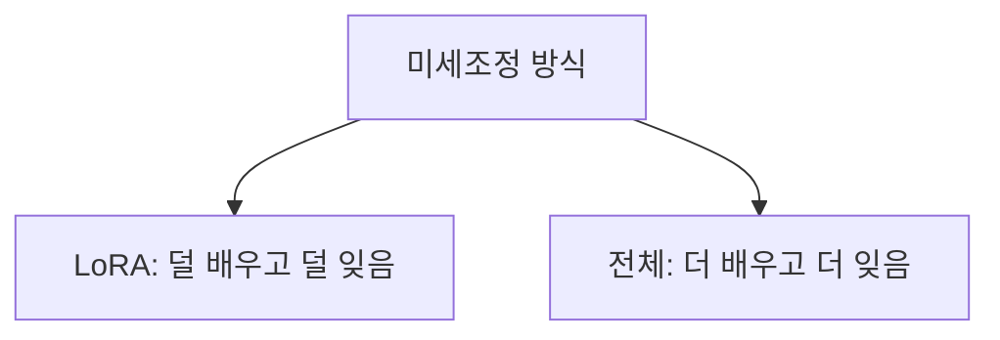

# 파국적 망각

> 신경망이 **새로운 것을 학습하면서 이전에 배운 능력을 급격히 잃는** 현상. LLM을 내 업무에 맞춰 미세조정할 때 일반 능력이 떨어지는 문제로 나타난다.

## 쉽게 말하면
새 언어를 집중해서 배우다가 예전에 잘하던 언어를 잊어버리는 것과 비슷하다. 같은 뇌(가중치)를 새 내용으로 덮어쓰기 때문이다.

## 자세히
- 고전 연구: Kirkpatrick 외 *Overcoming catastrophic forgetting in neural networks*(arXiv 1612.00796, 초록 읽음). 신경망은 일반적으로 과제를 **차례로** 학습하지 못했고 파국적 망각은 연결주의 모델의 피할 수 없는 특성으로 여겨졌다. 저자들은 이전 과제에 **중요한 가중치의 학습을 선택적으로 늦춰** 기억을 유지하는 방법을 제안, MNIST 기반 분류 과제와 아타리 2600 게임 순차 학습에서 보였다(초록에 수치 없음).
- LLM 미세조정 연구: Biderman 외 *LoRA Learns Less and Forgets Less*(arXiv 2405.09673, TMLR 2024; 검색 요약):
  - **학습**: 코드·수학 도메인에서 전체 미세조정이 LoRA보다 낫고, 흔한 저순위 설정에서 LoRA는 크게 뒤처지며 더 오래 학습해야 한다.
  - **망각**: LoRA가 목표 도메인 밖에서 기반 모델의 행동을 **더 잘 보존**한다. 다만 더 많이 배우는 LoRA는 전체 미세조정만큼 잊는 경우도 있고, 코드에서는 비슷하게 배우면서 덜 잊는 사례도 있다고 한다.
  - 원인 가설: 전체 미세조정은 일반적인 LoRA 설정보다 **10~100배 높은 순위**의 변화를 학습한다.
  - 정규화: LoRA가 weight decay·dropout 같은 일반 기법보다 강한 정규화 효과를 보이고 더 다양한 생성을 유지한다.
- 실무 시사점(내 정리): 도메인 미세조정 후 **일반 능력 평가(회귀 평가)**를 반드시 같이 돌려 망각 정도를 측정하고, 필요하면 LoRA·낮은 학습률·일반 데이터 혼합을 고려한다([능력 평가](#capability-eval)).

## 그림으로 보기

## 예시
- 고객응대 데이터로만 미세조정한 모델이 코딩 질문에 답을 못 하게 되는 경우.
- 교육: 미세조정 전후로 일반 질문 20개의 정답률을 비교하는 실습.

## 헷갈리는 것과 비교
| 개념 | 차이 |
|---|---|
| 파국적 망각 | 학습 중 기존 능력 상실 |
| 과적합 | 학습 데이터에만 맞고 일반화 실패 |
| [LoRA](#fine-tuning-open-model) | 망각을 줄이는 경향이 보고된 방법 |

## 더 읽을거리
- [Overcoming catastrophic forgetting (arXiv 1612.00796)](https://arxiv.org/abs/1612.00796) — EWC 초록(읽음).
- [LoRA Learns Less and Forgets Less (arXiv 2405.09673)](https://arxiv.org/abs/2405.09673) — LLM 미세조정 비교(검색 요약).
