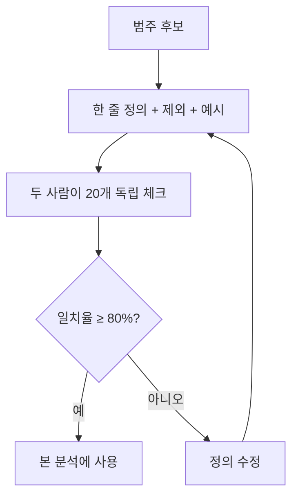

# 범주 정의 한 줄

> 오류 분석 표의 각 범주 열 머리에 **"어떤 예시에 체크하는가"를 한 줄로 못 박아 둔 정의**. 정의가 없으면 같은 예시도 사람·날짜마다 다르게 체크되어 비율이 흔들린다.

## 쉽게 말하면
설문 문항의 "자주"가 사람마다 주 1회도 되고 매일도 되면 집계가 무의미하다. "주 3회 이상"이라고 적어 두면 누가 체크해도 같은 결과가 나온다.

## 자세히
- **왜 필요한가(Ng, Machine Learning Yearning 초안, 본문 확인)**: 분석자가 틀린 예시를 보며 각 범주 열에 체크하는 표에서, "큰 고양이(사자·표범 등)"처럼 **정의가 같이 적힌 범주**는 경계가 분명하다. "흐림"은 "사람도 알아보기 어려울 정도" vs "약간 흐릿함"이 달라질 수 있다. 같은 사람이 다른 날 다시 체크하면 달라지는 범주는 정의가 모호한 것이다.
- **한 줄 정의 서식(제안)**: `<범주>: <무엇이> <어떤 조건이면> 체크한다. 제외: <헷갈리는 경계>. 예: <1개>`
  | 범주 | 정의 한 줄 |
  |---|---|
  | 흐림 | 입력 이미지의 초점이 맞지 않아 대상 윤곽이 불명확하면 체크. 제외: 어두움만 있는 경우 |
  | 큰 고양이 | 모델이 집고양이로 예측했지만 실제 사자·표범 등 야생 고양이과이면 체크 |
  | 수치 오류 | 출력의 숫자·단위가 원문과 다르면 체크(반올림 차이 제외) |
  | 환각 | 원문에 없는 사실·고유명사를 출력에 추가하면 체크 |
- **한 줄로 쓰는 이유**: 표 머리에 그대로 붙여 체크할 때마다 눈에 들어와야 한다. 길면 읽지 않는다. 긴 설명은 별도 가이드에 두고 표에는 요약.
- **정의 검증(권장)**: 같은 예시 20개를 두 사람이 따로 체크해 일치율을 본다. 80% 미만이면 정의를 고친다. 일치율은 κ로 계산해도 된다([라벨러 일치도](#inter-annotator-agreement)).
- **범주가 겹칠 때**: 다중 체크를 허용하는지, 주 원인 하나만 고르는지 정의에 적는다([중복 오류 범주](#overlapping-error-categories)).
- **변경 관리**: 정의를 바꾸면 이미 체크한 예시를 새 정의로 **다시 체크**하고 버전(v1, v2)을 기록한다([메모 먼저 범주화](#memo-first-categorization)).
- **한계**: 정의를 아무리 정교하게 해도 경계 사례는 남는다. 경계 사례 3~5개를 정의 옆 "예시" 칸에 두면 도움이 된다.

## 그림으로 보기

## 예시
- 표 머리: `흐림(초점이 안 맞아 윤곽 불명확; 어두움만은 제외)`.
- 코드로 기록: `categories = {"blurry": {"def": "...", "exclude": "...", "example_id": 17}}`를 JSON으로 저장해 분석 보고서에 함께 첨부.

## 헷갈리는 것과 비교
| 개념 | 설명 |
|---|---|
| 범주 정의 한 줄 | 체크 기준 요약 |
| 라벨링 규칙서 | 긴 정식 지침 |
| 정의 검증 | 두 사람 일치율 확인 |
| [오류 분석 스프레드시트](#error-analysis-spreadsheet) | 정의가 붙는 표 |

## 더 읽을거리
- [Andrew Ng, Machine Learning Yearning(초안 PDF) 15장](https://home-wordpress.deeplearning.ai/wp-content/uploads/2022/03/andrew-ng-machine-learning-yearning.pdf) — 스프레드시트 오류 분석 표(본문 열어 확인; 한 줄 정의 서식과 80% 기준은 이 글의 권장안).
