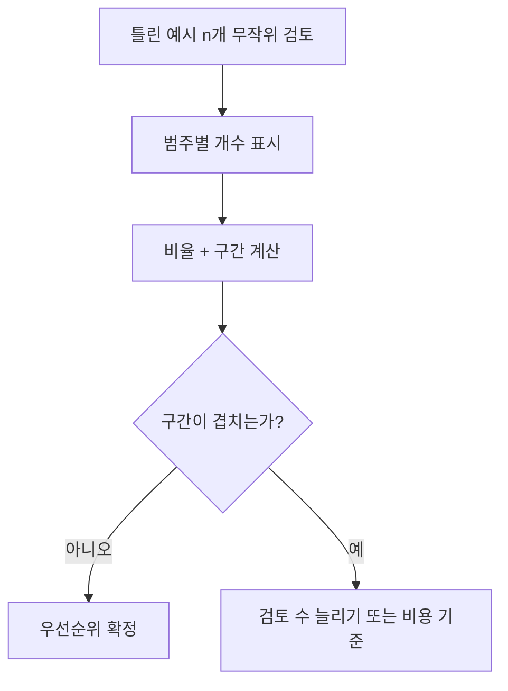
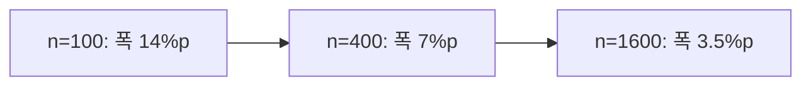

# 범주 비율 신뢰구간

> 오류 분석에서 "틀린 예시 200개 중 30개가 범주 A(15%)"라는 비율은 **작은 표본에서 나온 추정치**다. 비율마다 신뢰구간을 붙여야 "A가 B보다 큰가"를 함부로 단정하지 않는다.

## 쉽게 말하면
교실에서 20명에게 점심 취향을 물어 피자 30%가 나왔다면 전교생 비율이 30%라고 장담할 수 없다. 오류 샘플을 몇 개 봤느냐에 따라 "이 범주가 전체 오류의 몇 %인가"도 같은 식으로 흔들린다.

## 자세히
- **단일 범주**: 범주별로 이항 구간을 쓴다. Wilson 95%(직접 계산)
  | 범주 개수/검토 수 | 비율 | 95% 구간 |
  |---|---|---|
  | 6/50 | 12% | 5.6~23.8% |
  | 15/100 | 15% | 9.3~23.3% |
  | 30/200 | 15% | 10.7~20.6% |
  | 60/200 | 30% | 24.1~36.7% |
  | 150/1000 | 15% | 12.9~17.3% |
  같은 15%라도 검토를 100개에서 1,000개로 늘리면 구간 폭이 14%p에서 4.4%p로 준다. 폭은 대략 1/√n로 줄어 **폭을 절반으로 만들려면 검토 수를 4배**로 해야 한다.
- **여러 범주를 동시에 볼 때(다중성)**: 범주가 5~10개면 하나쯤은 우연히 구간을 벗어난다. 모든 구간이 동시에 맞도록 보정한 **동시 신뢰구간**이 필요하다. statsmodels `multinomial_proportions_confint(counts, alpha, method)`는 `goodman`(기본, 카이제곱 근사, 모든 count ≥ 5 필요)과 `sison-glaz`(덜 보수적, 범주 7개 이상 필요, 구간 폭이 모든 범주에서 같아 비율이 비슷할 때 적합)를 제공한다. 간단히는 본페로니(α를 범주 수로 나눔)로 구간을 넓힌다: 30/200은 단일 10.7~20.6%에서 99% 구간 9.6~22.6%로 넓어진다.
- **우선순위 판단에의 활용**: 범주 A 15%(10.7~20.6)와 B 30%(24.1~36.7)는 구간이 겹치지 않아 B가 더 크다고 말할 수 있다. 12%(5.6~23.8)와 15%(9.3~23.3)처럼 겹치면 구분 불가 → 더 검토하거나 해결 비용으로 정한다([범주별 개선 상한](#error-category-ceiling)).
- **희귀 범주**: count가 5 미만이면 근사가 나쁘다 → Clopper-Pearson·Wilson 개별 구간 + "표본이 작다" 명시([3의 법칙](#rule-of-three): 0건이면 상한 3/n).
- **표본 추출**: 오류를 무작위로 뽑아야 한다. 눈에 띄는 것만 보면 편향된다. 그룹(같은 사용자)이 있으면 [군집 부트스트랩](#cluster-bootstrap).

## 그림으로 보기



## 예시
```python
from statsmodels.stats.proportion import proportion_confint, multinomial_proportions_confint
proportion_confint(30, 200, method="wilson")           # 한 범주
multinomial_proportions_confint([30, 60, 40, 70])      # 동시 구간(goodman)
```
- LLM 응답 오류 200개 검토 → "환각 30%(24~37%), 형식 위반 15%(11~21%)": 환각이 더 크다고 말해도 안전.

## 헷갈리는 것과 비교
| 개념 | 설명 |
|---|---|
| 단일 구간 | 범주 하나만 볼 때 |
| 동시 구간 | 모든 범주가 한꺼번에 맞도록 보정 |
| 구간 겹침 | 차이를 확정할 수 없음(엄밀한 검정은 아님) |
| [독립 시험 세트 구간](#independent-test-ci) | 같은 Wilson 원리 |

## 더 읽을거리
- [statsmodels multinomial_proportions_confint](https://www.statsmodels.org/stable/generated/statsmodels.stats.proportion.multinomial_proportions_confint.html) — goodman·sison-glaz 조건(열어 확인).
- [statsmodels proportion_confint](https://www.statsmodels.org/stable/generated/statsmodels.stats.proportion.proportion_confint.html) — 단일 비율 방법.
