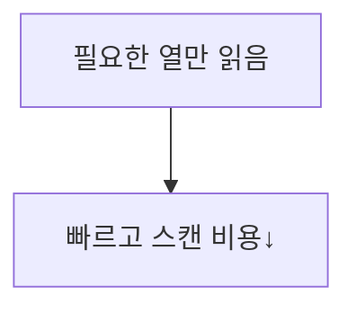

# CC 컬럼형 색인

> Common Crawl의 색인을 Apache Parquet(컬럼 단위 저장) 형식으로 제공한 것이다. SQL(Athena)이나 Spark로 필요한 열만 읽어 넓은 기간·조건의 조회를 빠르게 할 수 있다.

## 쉽게 말하면
엑셀 표에서 "URL 열과 상태 열만" 읽으면 되는데 모든 열을 읽을 필요가 없게 저장한 방식이다. 큰 표에서 일부 열만 볼 때 매우 빠르다.

## 자세히
(Common Crawl 블로그 "Index to WARC Files and URLs in Columnar Format"을 직접 열어 확인.)
- **형식**: Apache Parquet. 컬럼형 배치가 "색인을 효율적으로 질의·처리하고 시간과 컴퓨팅 자원을 아낀다"고 설명.
- **스키마**: `url_surtkey, url, fetch_status, content_mime_type, warc_filename, warc_record_offset, warc_record_length`. **crawl**(월별 크롤)과 **subset**(WARC 하위 집합)으로 파티션되어 하위 디렉터리로 존재.
- **도구**: **AWS Athena**(S3 데이터를 SQL로 분석하는 서버리스, 스캔한 데이터만큼 과금, 출력은 CSV만)와 **Spark**(작은 클러스터에서도 몇 분 안에 결과, Athena보다 느리지만 출력 형식이 유연).
- **위치**: `s3://commoncrawl/cc-index/table/cc-main/warc/`, 리전 us-east-1.
- **CDX 색인과의 비교**: 이 페이지는 직접 비교하지 않는다. "소수의 열만 접근하면 최신 빅데이터 도구가 인상적으로 빠르다"고만 적는다. cdx-toolkit README는 넓은 기간에서 컬럼형 색인이 더 빠르다고 언급한다([cdx-toolkit](#cdx-toolkit)).
- **활용(제안)**: 특정 도메인·MIME·상태 코드의 WARC 위치(파일명·오프셋·길이)를 SQL로 뽑은 뒤 해당 구간만 내려받는다.

## 그림으로 보기



## 예시
```sql
SELECT url, warc_filename, warc_record_offset, warc_record_length
FROM ccindex WHERE crawl='CC-MAIN-2024-33' AND subset='warc' AND url_host_tld='kr' LIMIT 10;
```
- 교육 활용: 컬럼형 vs 행형 저장의 차이를 표로 설명.

## 헷갈리는 것과 비교
| 개념 | 차이 |
|---|---|
| 컬럼형 색인 | Parquet, SQL·Spark 분석 |
| CDX 색인 | 정렬된 텍스트 색인, API 조회 |
| [Wayback CDX API](#wayback-cdx-api) | Internet Archive의 색인 |

## 더 읽을거리
- [Common Crawl: 컬럼형 색인 블로그](https://commoncrawl.org/blog/index-to-warc-files-and-urls-in-columnar-format) — 스키마·도구·위치.
