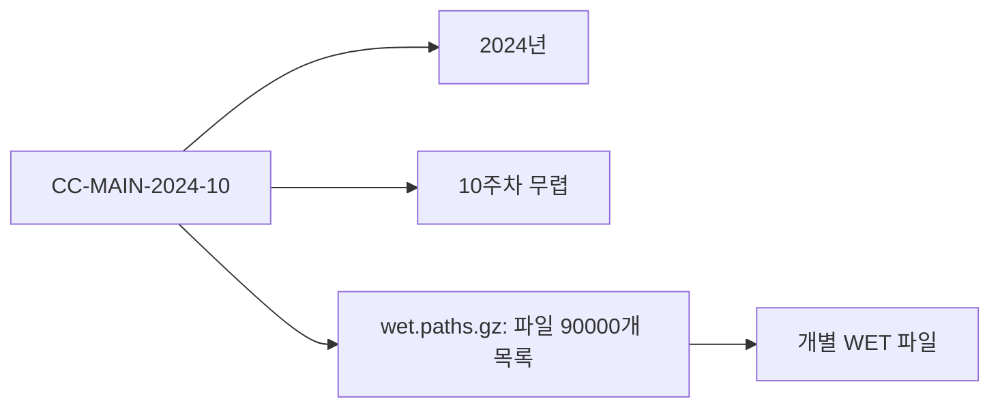
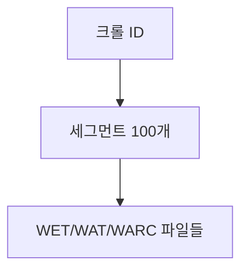

# 크롤 ID 읽기

> Common Crawl의 크롤 이름 `CC-MAIN-2024-10`은 **"메인 크롤 · 2024년 · 10번째 주 무렵"**을 뜻하는 식별자다. 어느 시기의 웹 스냅샷인지 알려 주므로 학습 데이터의 날짜(최신성)를 가늠하는 첫 단서다.

## 쉽게 말하면
신문 보관소의 "2024년 10호"라는 꼬리표처럼, 어느 시점에 찍은 웹 사진첩인지 알려 주는 이름이다. 사진 한 장 한 장은 그 사진첩 안의 수천 개 묶음 파일에 들어 있다.

## 자세히
- 형식: `CC-MAIN-<연도>-<주차>`. Common Crawl 시작 안내 페이지는 `CC-MAIN-2018-17`을 "2018년 4월 크롤"의 한 구간 예로 든다(ISO 17주 = 4월 23~29일과 맞음, 계산 확인).
- 직접 확인(2026-11-27, `CC-MAIN-2024-10`의 `wet.paths.gz`): 줄 수 **90,000개**(WET 파일 수), 경로 구조 `crawl-data/CC-MAIN-2024-10/segments/<세그먼트>/wet/CC-MAIN-<시작시각>-<끝시각>-<번호>.warc.wet.gz`, 세그먼트 디렉터리 100개. 첫 파일 이름의 시각은 2024-02-20 21:10(UTC로 추정), 마지막 파일 시각은 2024-03-05 12:40으로 **크롤 수집에 약 2주가 걸렸다**(ISO 8~10주에 걸침).
- 해석: 주차 숫자는 크롤이 끝나는 쯤의 주(여기서는 10주)를 따른 것으로 보이나 이름 규칙을 설명한 공식 문장은 이번에 확인하지 못했다(추정). 정확한 수집 기간은 파일 이름의 타임스탬프를 본다.
- 파일 종류(공식 안내): **WARC**(원본 응답·요청·메타데이터), **WAT**(메타데이터·링크 JSON), **WET**(추출된 일반 텍스트만). 텍스트 학습용 정제는 보통 WET 또는 WARC에서 시작한다(FineWeb 등은 WARC에서 직접 추출, 제안 수준의 일반론).
- 같은 URL이 여러 크롤에 나타나 크롤 간 **중복**이 생긴다. 여러 크롤을 합칠 때 크롤 ID는 중복 제거 단위(크롤 내/간)를 정하는 기준이다.

## 그림으로 보기

## 예시
- `https://data.commoncrawl.org/crawl-data/CC-MAIN-2024-10/wet.paths.gz`에서 경로를 내려받아 첫 줄을 골라 파일 하나를 받는다([HTTP Range 요청](#http-range-request)으로 일부만).
- 교육: 모델이 알고 있는 세상이 "어느 크롤까지"인지 가르칠 때 쓰는 사례.

## 헷갈리는 것과 비교
| 개념 | 차이 |
|---|---|
| 크롤 ID | 수집 시기 단위(CC-MAIN-연도-주차) |
| 세그먼트 | 한 크롤 안의 수집 묶음(100개) |
| WET 파일 | 세그먼트 안의 개별 텍스트 파일 |

## 더 읽을거리
- [Common Crawl: Get Started](https://commoncrawl.org/get-started) — WARC·WAT·WET 설명(읽음).
- 직접 실행: `wet.paths.gz` 90,000줄 분석.
