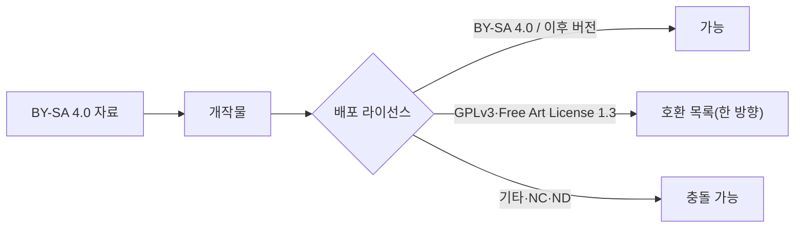
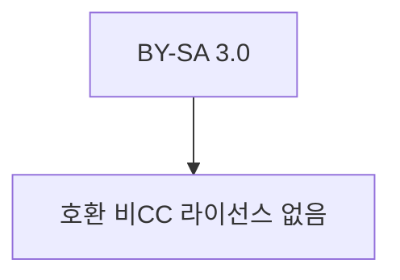

# CC 라이선스 호환성

> Creative Commons ShareAlike(SA) 자료를 합칠 때는 결과물이 어떤 라이선스로 나갈 수 있는지가 정해져 있다. BY-SA 4.0은 GPLv3 등 일부 라이선스와 한 방향으로 호환된다. (교육용 요약, 법률 자문 아님.)

## 쉽게 말하면
레시피를 "같은 조건으로 공유하세요" 조건으로 받았다면, 새 요리책에 넣을 때도 같은 조건으로 내야 한다. 다른 조건을 쓰려면 그 조건이 허용 목록에 있어야 한다.

## 자세히
(CC 공식 호환성 페이지, 라이선스 조항, FAQ를 하위 에이전트가 요약으로 읽은 노트 기준.)
- **BY-SA 4.0 호환 목록**: CC 페이지는 **GPLv3(2015-10-08)**와 **Free Art License 1.3(2014-10-21)** 을 BY-SA 4.0 호환으로 지정한다. GPLv3 호환은 **한 방향**이다.
- **BY-SA 3.0**: 호환되는 비CC 라이선스가 없다.
- **조항**: BY-SA 4.0 §3(b)는 개작자가 쓸 수 있는 라이선스를 ① 같은 요소를 가진 것 ② 이 버전 또는 이후 버전 ③ 호환 목록의 라이선스로 제한한다.
- **합치기 여부**: CC FAQ는 서로 다른 CC 라이선스 자료를 결합할 수 있는지는 그것이 **개작(adaptation)** 인지에 달려 있다고 설명한다.
- **데이터셋 관점(제안)**: SA 자료와 NC·ND·상업 데이터를 섞으면 합친 데이터셋을 어떤 조건으로 배포할지 충돌할 수 있다. 데이터 카드에 출처별 라이선스를 기록한다([데이터 카드에 라이선스 기록](#data-card-license-record)).

## 그림으로 보기

## 예시
- 위키백과(CC BY-SA) 발췌를 포함한 데이터셋은 같은 SA 조건으로 배포하는 것이 안전.
- 교육 활용: 라이선스 조합표를 직접 채우는 활동.

## 헷갈리는 것과 비교
| 개념 | 차이 |
|---|---|
| ShareAlike | 같은 조건으로 공유 |
| NoDerivatives | 개작물 공유 금지 |
| NonCommercial | 상업적 이용 제한 |

## 더 읽을거리
- [CC 호환 라이선스 목록](https://creativecommons.org/compatiblelicenses/) — BY-SA 4.0 호환(이번엔 요약으로 확인).
