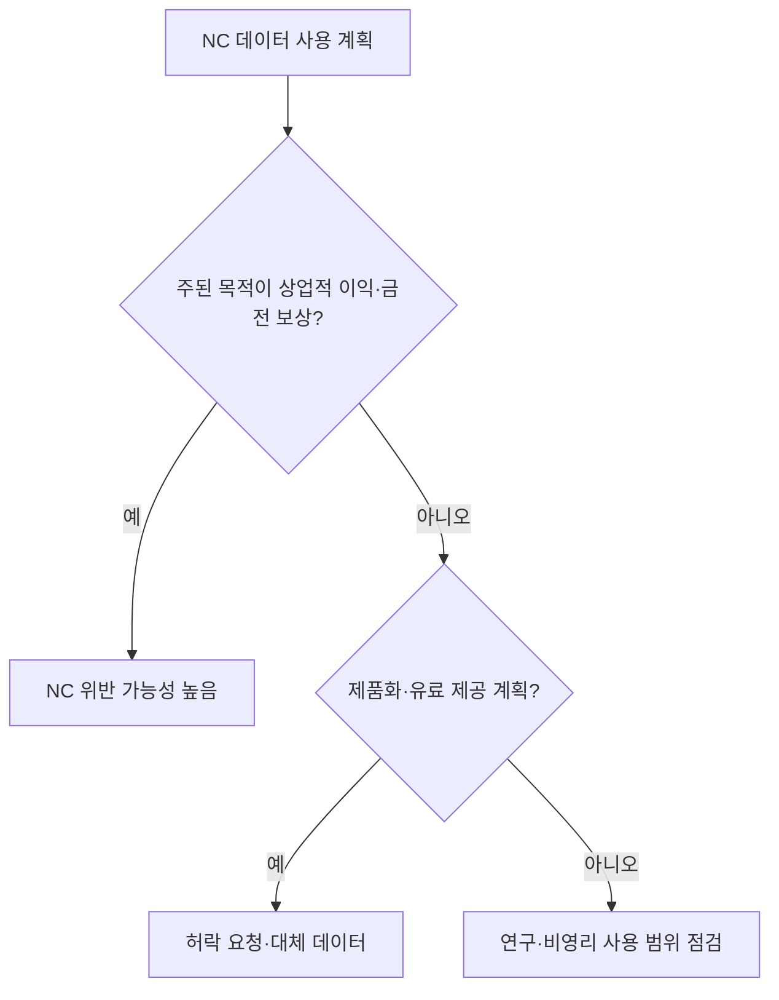
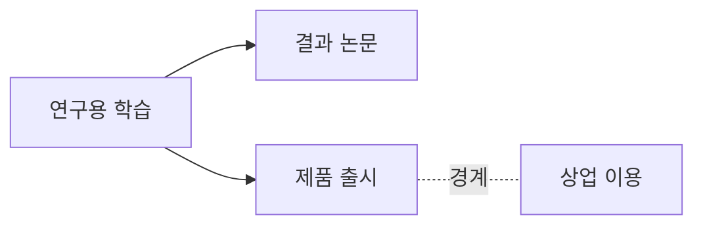

# NC와 연구용 공개

> 데이터를 CC의 NonCommercial(NC) 조건이나 "연구용(research only)"으로 공개했을 때, **무엇이 비영리·연구로 인정되는지가 모호해** 기업 연구소·대학-기업 협업·제품화 단계에서 해석 분쟁이 생기는 문제다.

## 쉽게 말하면
"학교 운동장은 비영리 활동에만 쓰세요"라고 했을 때 동네 무료 축구 교실은 되겠지만, 후원 기업 로고를 붙인 대회나 참가비를 받는 캠프는 애매하다. 연구용 데이터도 "연구실에서 쓰는 것"과 "그 결과를 제품에 넣는 것" 사이 경계가 불분명하다.

## 자세히
(CC BY-NC-ND 4.0 법적 문서의 정의와 CC의 "Defining Noncommercial" 보고서(2009) PDF를 직접 읽어 확인. 법률 자문이 아니다.)
- **조항의 정의(4.0 원문 1항)**: NonCommercial은 **"상업적 이익이나 금전적 보상을 주된 목적으로 하거나 그것을 향하지 않는 것"**이다. 또 금전 지급이 없다면 파일 공유 등으로 자료를 다른 자료와 **교환하는 것은 NC**라고 명시한다. "비영리 기관만"이라는 조건이 아니라 **사용 목적**을 기준으로 삼는 문구다.
- **해석이 갈리는 지점(CC 보고서의 질문 목록에서)**: 보고서는 이용 주체(개인 대 기관, 영리 대 비영리, 아마추어 대 전문가)와 금전 보상·비용 회수 문제에서 다음 같은 사례가 애매하다고 든다 — 큰 영리 기업이 NC 이미지를 학교에 무료로 배포하는 교육 자료에 쓰는 경우, 비영리 대학이 NC 이미지를 넣은 공책을 기념품 가게에서 파는 경우, 광고로 월 50달러를 버는 블로그와 5만 달러를 버는 블로그, 비영리 단체가 비용만 회수하는 가격으로 판매하는 경우, 이익이 1센트라도 남으면 어떤가 등. 이것은 법적 답이 아니라 **질문 목록**이다.
- **설문 결과(같은 보고서, 미국 온라인 인구 조사)**: CC의 NC 정의가 응답자 본인의 정의와 "본질적으로 같다" 또는 "다르지만 양립 가능하다"고 답한 비율이 **창작자 87%(43%+44%), 이용자 85%(42%+43%)**였고, "다르고 양립 불가"는 창작자 7%, 이용자 11%, 모름 6%·4%였다. 이는 2009년 미국 조사이고 **AI 학습·연구소 사용**을 묻지 않았다. 일반 인식이 비슷하다는 것이지 경계 사례의 답이 정해졌다는 뜻이 아니다.
- **AI·연구용 공개에서의 쟁점(제안, 위 문헌으로 확정되지 않은 부분)**
  | 상황 | 쟁점 |
  |---|---|
  | 기업 연구소가 연구 논문 목적으로 학습 | 기업 소속이면 영리 목적 연관인가 |
  | 대학-기업 공동 연구, 기업이 결과를 제품화 | 제품화 시점부터 상업 이용인가 |
  | NC 데이터로 학습한 모델을 무료 공개 | 공개 자체는 비영리인가, 이후 기업이 쓰면? |
  | 모델 API를 유료 제공 | 명백히 상업 이용으로 보이는 쪽 |
  | 내부 도구로 직원 업무에 사용 | 영리 기업의 내부 업무가 "주된 상업적 이익"인가 |
- **실무 원칙(제안)**: 모호하면 **더 엄격하게(상업 이용으로 보고 허락 요청)** 해석하고, 제품화 계획이 있으면 처음부터 상업 가능한 데이터로 대체한다. 연구용으로만 받은 데이터는 접근 범위·산출물 사용 목적을 기록([데이터 카드의 라이선스 기록](#data-card-license-record)). 권리자에게 **별도 상업 라이선스**를 요청하는 방법도 있다.
- **한계**: 판례·국가별 해석은 다루지 않았다. "연구용 공개"가 CC가 아닌 맞춤 약관이면 조건을 약관 원문으로 읽어야 한다.

## 그림으로 보기

## 예시
- 스타트업이 NC 라이선스 음성 데이터로 연구 프로토타입을 만들고 6개월 뒤 유료 서비스로 출시하려는 경우: 출시 전에 상업 이용 가능한 데이터로 재학습하거나 권리자와 상업 라이선스 협의.
- 교육 소재: CC 보고서의 사례 질문(블로그 광고 월 50달러 vs 5만 달러)을 토론용 카드로.

## 헷갈리는 것과 비교
| 개념 | 차이 |
|---|---|
| NC와 연구용 공개 | 비영리·연구의 경계 해석 |
| [비공개 개작의 회색지대](#private-adaptation-gap) | 개작·공유 경계 |
| [데이터 카드의 라이선스 기록](#data-card-license-record) | 판단·근거 기록 |
| [CC NoDerivatives](#cc-noderivatives) | 개작물 공유 금지(ND) |

## 더 읽을거리
- [CC BY-NC-ND 4.0 법적 문서](https://creativecommons.org/licenses/by-nc-nd/4.0/legalcode.en) — NonCommercial 정의(직접 확인).
- [Defining Noncommercial: 전체 보고서(PDF, 2009)](https://mirrors.creativecommons.org/defining-noncommercial/Defining_Noncommercial_fullreport.pdf) — 해석이 갈리는 사례와 설문 결과(직접 확인).
