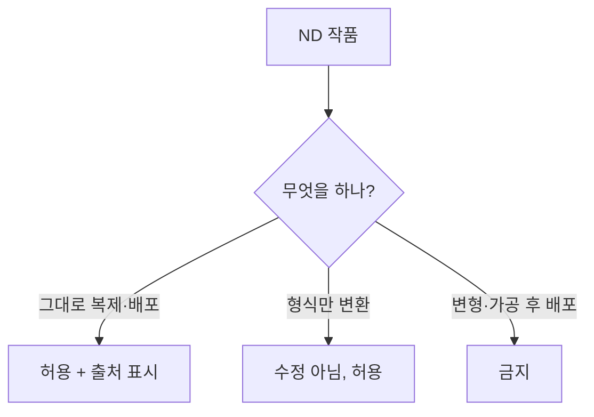
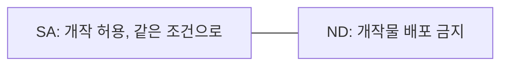

# CC NoDerivatives

> Creative Commons의 ND(NoDerivatives) 조건은 원본은 그대로 복제·배포해도 되지만, **변형·가공한 결과물을 배포하는 것은 금지**하는 조건이다. 데이터를 정제·번역·합성해 공개하려 할 때 걸림돌이 된다.

## 쉽게 말하면
사진 원본을 인쇄해 나눠 주는 건 되지만, 포토샵으로 고친 사진을 나눠 주는 건 안 된다. 크기·형식만 바꾸는 건 "고친 것"이 아니라고 본다. 혼자 보려고 고쳐 보는 것은 deed가 직접 말하지 않아 법률 전문을 봐야 한다.

## 자세히
- **CC BY-ND 4.0 deed(직접 확인)**: 어떤 형식·목적(영리 포함)으로도 복제·재배포 가능. 리믹스·변형·2차 창작한 자료는 배포할 수 없다. 형식만 바꾸는 것은 수정으로 보지 않는다. 출처 표시·라이선스 링크·변경 여부 표시는 필요하다.
- **CC FAQ(직접 열었으나 발췌가 잘려 답변은 확인 못 함)**: ND는 "개작물의 공유를 금지"하며 형식 변환은 제한하지 않는다고 요약된다. "무엇이 개작인가" 상세 답변과 AI 학습 관련 답은 읽지 못했다.
- **데이터 실무에서의 영향**: ND 라이선스 데이터를 정제·라벨 추가·번역·요약해 **공개**하면 위반 소지가 있다. 반면 원본을 그대로 보관·활용(비공개 내부 사용)하는 경우는 deed가 명시하지 않으므로 법률 전문과 관할을 확인한다.
- **AI 학습과의 관계**: CC는 ND·SA·BY 조건이 작업물이나 개작물을 **공개적으로 공유할 때** 발동한다고 안내한다([CC ShareAlike](#cc-sharealike) 참고). 모델 가중치·출력이 개작물인지는 확정된 답이 없다.
- 이 글은 법률 자문이 아니다.

## 그림으로 보기

## 예시
- ND 해설서를 번역한 코퍼스를 공개: 번역도 개작 → 금지 소지.
- ND 이미지를 라벨만 붙여 별도 파일로 공개: 원본을 건드리지 않는 주석 형태인지 개작인지 판단이 갈리므로 저작권자 허락을 받는 편이 안전.
- 교육 소재: SA·ND·NC를 한 표로 놓고 "내 데이터 가공 시나리오"를 분류.

## 헷갈리는 것과 비교
| 개념 | 차이 |
|---|---|
| ND | 개작물 배포 금지 |
| [CC ShareAlike](#cc-sharealike) | 개작 허용, 같은 조건으로 |
| NC | 상업 이용 금지 |
| [데이터셋 라이선스 체크리스트](#dataset-license-checklist) | 사용 전 점검표 |

## 더 읽을거리
- [CC BY-ND 4.0 deed](https://creativecommons.org/licenses/by-nd/4.0/) — 요약 조건(직접 확인).
- [Creative Commons FAQ](https://creativecommons.org/faq/) — ND·개작·AI 질문 목록(발췌만 확인).
