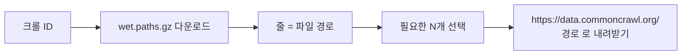
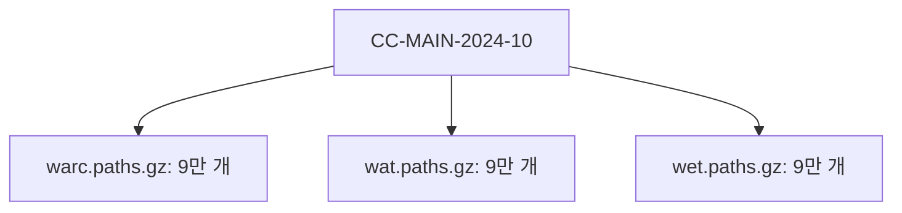

# Common Crawl 경로 파일

> Common Crawl은 크롤 하나(예: `CC-MAIN-2024-10`)마다 **`warc.paths.gz`, `wat.paths.gz`, `wet.paths.gz`** 같은 목록 파일을 공개한다. 한 줄이 한 데이터 파일의 상대 경로이며, 이 목록으로 원하는 파일만 골라 내려받는다.

## 쉽게 말하면
도서관 전체를 가져올 수 없으니 "책 목록표"를 먼저 받아서, 필요한 책 번호만 골라 빌리는 것이다. 경로 파일이 그 목록표다.

## 자세히
(`data.commoncrawl.org`에서 직접 내려받아 확인. 크롤 `CC-MAIN-2024-10`, 2026-11-20 조회)
- 주소 형식: `https://data.commoncrawl.org/crawl-data/<크롤 ID>/<종류>.paths.gz`. 종류는 `warc`(원본 HTTP 응답), `wat`(메타데이터), `wet`(추출 텍스트)([WARC·WAT·WET](#warc-wat-wet)).
- 내용: gzip 텍스트 파일, **줄 하나 = 파일 하나의 상대 경로**. 예: `crawl-data/CC-MAIN-2024-10/segments/1707947473347.0/wet/CC-MAIN-20240220211055-20240221001055-00000.warc.wet.gz`. 앞에 `https://data.commoncrawl.org/`를 붙이면 내려받을 수 있다.
- 직접 센 값: warc·wat·wet 경로 파일 모두 **90,000줄**(파일 9만 개씩). 경로 파일 하나는 약 180KB.
- 파일 하나의 크기: 위 첫 WET 파일(`...-00000.warc.wet.gz`)은 헤더 확인 결과 약 107MB(압축). 9만 개를 곱하면 WET만 수 TB 규모다(계산 추정치이며 파일마다 크기는 다르다).
- 내용 맛보기: 파일 앞부분만 받는 HTTP Range 요청(바이트 0~1999)으로 열어 보면 첫 레코드는 `warcinfo`(크롤 설명, 소프트웨어, `description: Wide crawl of the web for February/March 2024`)이고, 다음 레코드부터 `WARC-Type: conversion`과 `WARC-Target-URI`(원래 주소)가 이어진다.
- 쓰임: 전체를 받지 않고 **파일 몇 개만 샘플링**해 데이터 정제 파이프라인을 시험하거나, 병렬 작업의 입력 목록으로 쓴다(datatrove 같은 도구가 이 목록 기반으로 조각을 나눈다. [FineWeb 예제](#datatrove-fineweb-example)).
- 주의: 크롤 ID마다 파일 수와 경로가 다르다. 위 숫자는 이 크롤의 값이다.

## 그림으로 보기



## 예시
```bash
curl -O https://data.commoncrawl.org/crawl-data/CC-MAIN-2024-10/wet.paths.gz
zcat wet.paths.gz | head -3
curl -r 0-1999 https://data.commoncrawl.org/$(zcat wet.paths.gz | head -1) | zcat | head
```
- 교육: "데이터 소스는 목록표 → 샘플 → 정제" 순서로 접근한다는 실습.

## 헷갈리는 것과 비교
| 개념 | 차이 |
|---|---|
| 경로 파일(.paths.gz) | 파일 목록표 |
| WARC/WAT/WET | 실제 데이터 파일 3종 |
| 크롤 ID | 한 번의 크롤 묶음(예: CC-MAIN-2024-10) |

## 더 읽을거리
- [Common Crawl 데이터 호스트](https://data.commoncrawl.org/) — 경로 파일과 데이터 파일을 직접 내려받은 곳.
