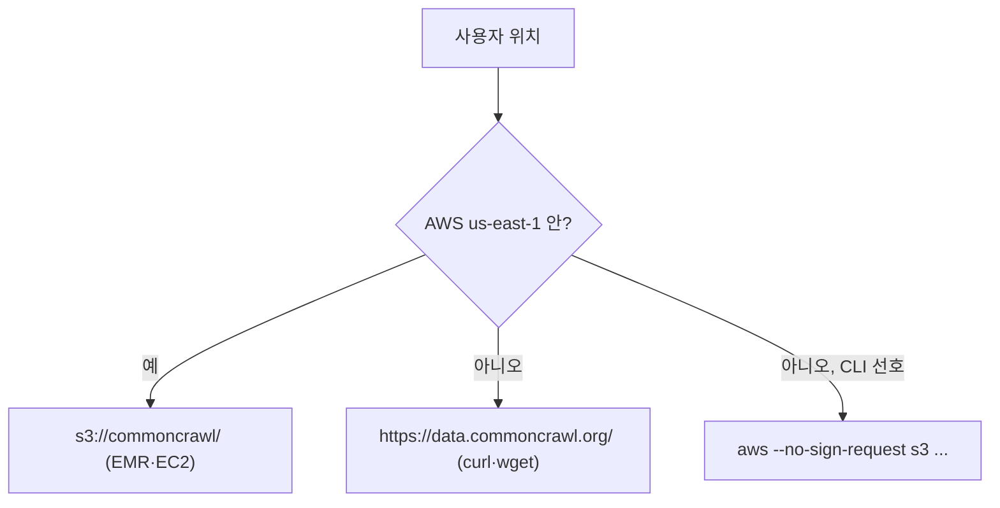
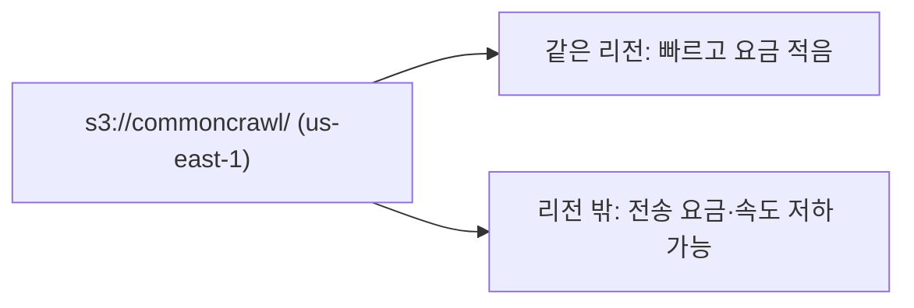

# Common Crawl 접근 방법

> Common Crawl 데이터는 누구나 무료로 접근할 수 있고, 방법은 **AWS 안에서 `s3://commoncrawl/`로**, 또는 **AWS 밖에서 HTTPS(`data.commoncrawl.org`)나 AWS CLI 익명 접근으로** 나뉜다. 어느 쪽인지에 따라 속도·비용·주소 형식이 달라진다.

## 쉽게 말하면
같은 창고에 입구가 세 개다. 창고 옆 건물(AWS 안)은 직통 통로로, 먼 곳 사람은 정문(HTTPS)으로, 서류 가방 없이 창구 신청(CLI 익명)으로 물건을 가져간다.

## 자세히
(commoncrawl.org "Get Started" 페이지를 직접 읽고, `data.commoncrawl.org`로 실제 내려받아 확인, 2026-11-20)
- **저장 위치**: AWS Open Data Sets 후원으로 **`s3://commoncrawl/` 버킷**, **US-East-1(북버지니아)** 리전. "누구나 어디서나 무료로 접근"할 수 있다고 안내한다. 페이지의 크롤 목록 최신 항목은 `CC-MAIN-2026-43`.
- **세 가지 주소 형식**: `s3://commoncrawl/[...]`, `https://ds5q9oxwqwsfj.cloudfront.net/[...]`, `https://data.commoncrawl.org/[...]`. **AWS 밖에서 HTTP(S)로 접근하려면 새 주소 `https://data.commoncrawl.org/`를 써야 한다**고 명시한다.
- **AWS 안에서(권장 방식)**: 데이터와 **같은 리전(us-east-1)에서 접근하는 것이 필수**에 가깝게 안내된다(속도 향상, 리전 간 전송 요금 회피). Elastic IP나 로드 밸런서를 거치면 라우팅된 트래픽 요금이 날 수 있다고 주의한다. EMR 같은 서비스는 `s3://`(하둡에서는 `s3a://`)를 지원한다.
- **AWS 밖에서 HTTPS**: curl·wget 같은 어떤 HTTP 도구든 쓸 수 있고 **AWS 계정이 필요 없다**. 이 글에서 `https://data.commoncrawl.org/crawl-data/CC-MAIN-2024-10/wet.paths.gz`(180KB)와 WET 파일의 일부 바이트를 실제로 받았다([경로 파일](#cc-paths-files), [범위 요청](#http-range-sampling)).
- **AWS CLI 익명 접근**: `aws --no-sign-request s3 cp s3://commoncrawl/path_to_file local_path/` — `--no-sign-request`가 계정 없는 익명 접근을 허용한다(안내 예: 2018년 4월 크롤의 한 세그먼트 WARC 목록 조회). 이 환경에서는 CLI로 시험하지 않았다.
- **실무 팁(제안)**: ① 대량 처리는 us-east-1의 EC2·EMR에서 ② 내 PC에서는 샘플 파일 몇 개만 HTTPS로 ③ 연결이 끊기거나 재설정되면 재시도(이 세션에서도 색인 서버 요청이 몇 번 재설정돼 재시도로 해결) ④ Hugging Face에 정제본(FineWeb 등)이 있으면 원본 대신 사용을 고려.
- 이 글은 Hugging Face 미러의 접근 방법을 직접 확인하지 않았다.

## 그림으로 보기



## 예시
```bash
curl -O https://data.commoncrawl.org/crawl-data/CC-MAIN-2024-10/wet.paths.gz
aws --no-sign-request s3 ls s3://commoncrawl/crawl-data/CC-MAIN-2024-10/
```
- 교육: 오픈 데이터는 "어디서 접근하느냐"가 비용을 좌우한다는 클라우드 기초.

## 헷갈리는 것과 비교
| 방법 | 특징 |
|---|---|
| s3:// (AWS 안) | 대량 처리, 같은 리전 권장 |
| HTTPS data.commoncrawl.org | 계정 불필요, 어디서나 |
| AWS CLI --no-sign-request | 계정 없이 S3 조회·복사 |
| [WARC·WAT·WET](#warc-wat-wet) | 접근 대상 파일 종류 |

## 더 읽을거리
- [Common Crawl Get Started](https://commoncrawl.org/get-started) — 접근 방법·주소 형식(읽음).
