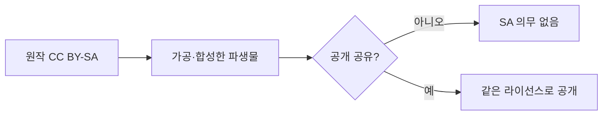
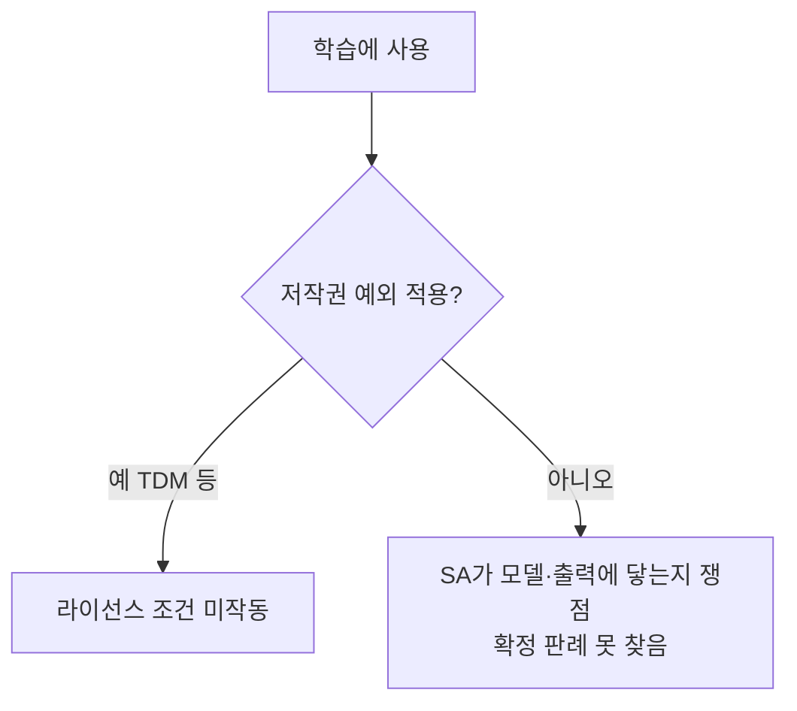

# CC ShareAlike

> Creative Commons의 ShareAlike(SA) 조건은 원작을 가공한 결과물을 공유할 때 **같은 라이선스(또는 CC가 호환된다고 지정한 라이선스)로** 내놓으라는 의무다. 데이터셋 개작·AI 학습 결과물에 SA가 닿는지가 쟁점이다.

## 쉽게 말하면
레시피를 "이 레시피를 고쳐 공유할 거면 너도 같은 조건으로 공유해"라는 조건으로 받은 것과 같다. 혼자 요리해 먹는 건 상관없지만, 고친 레시피를 책으로 내면 같은 조건을 이어 붙여야 한다. 이 조건은 사슬처럼 이어져 "상속"된다.

## 자세히
- **적용 라이선스**: CC BY-SA, CC BY-NC-SA. CC BY-SA 4.0 deed(직접 확인)는 리믹스·변형·가공한 경우 기여분을 같은 라이선스 또는 CC가 호환 목록에 올린 라이선스로 배포해야 한다고 요약한다. deed 자체는 "adapt"를 법률적으로 정의하지 않으며 법률 전문(legal code)을 보라고 안내한다.
- **트리거**: CC의 AI 학습 안내 페이지(직접 확인)는 SA 조건이 작업물이나 그 개작물을 **공개적으로 공유할 때만** 발동한다고 한다. 또 CC 라이선스는 저작권상 허락이 필요한 경우에만 적용되므로 예외·제한(예: 일부 국가의 텍스트·데이터 마이닝 예외)이 적용되면 라이선스 조건이 작동하지 않는다.
- **AI에 적용되나**: CC의 입장은 모델이나 출력이 SA 콘텐츠에 기반하고 공개 공유된다면 SA 준수는 원작과 같은 CC 라이선스를 쓰는 것을 뜻한다는 것. 그러나 **모델 가중치가 개작물인지는 이 페이지가 말하지 않으며**, 확정 판결도 못 찾았다. IVIR·Open Future 보고서는 법제에 따라 답이 달라진다고 분석한다(검색 요약; 원문 PDF는 직접 열지 않음). EU처럼 TDM 예외가 우선하면 SA 의무 없이 학습 가능하다는 해석이 있다.
- **데이터 실무**: SA 데이터를 가공해 만든 파생 데이터셋을 공개하면 같은 라이선스로 내야 한다. 호환되지 않는 SA 데이터끼리 섞으면 하나의 라이선스로 합칠 수 없는 충돌이 생긴다([데이터셋 라이선스 체크리스트](#dataset-license-checklist)).
- 이 글은 법률 자문이 아니다.

## 그림으로 보기

## 예시
- 위키 문서(CC BY-SA)를 요약·정제한 데이터셋을 공개한다 → 같은 BY-SA로 공개해야 하고 출처 표시도 필요.
- 교육 소재: SA 데이터와 상업 제한(NC) 데이터를 섞으면 어떤 문제가 생기는지 토론.

## 헷갈리는 것과 비교
| 개념 | 차이 |
|---|---|
| ShareAlike | 개작 공유 시 같은 조건 상속 |
| [CC NoDerivatives](#cc-noderivatives) | 개작 자체의 공유 금지 |
| Attribution(BY) | 출처 표시만 요구 |
| NC | 상업 이용 제한 |

## 더 읽을거리
- [CC BY-SA 4.0 deed](https://creativecommons.org/licenses/by-sa/4.0/) — 요약 조건(직접 확인).
- [Using CC-licensed works for AI training (Creative Commons)](https://creativecommons.org/using-cc-licensed-works-for-ai-training-2/) — SA·ND·트리거 설명(직접 확인).
- [Share Alike and ML (IVIR)](https://ivir.nl/publicaties/download/Share-Alike-and-ML.pdf) — 법제별 분석(검색 결과로만 확인).
