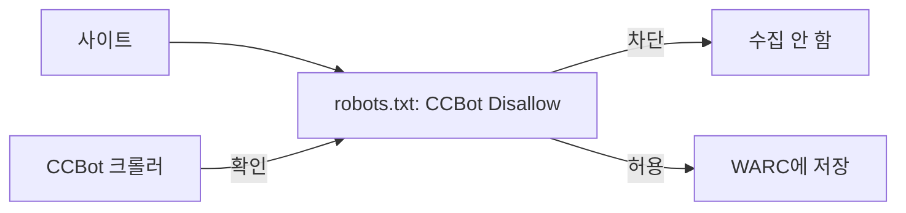
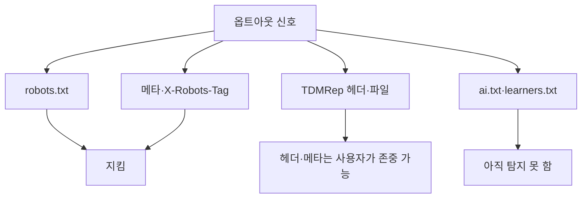

# CCBot과 옵트아웃

> CCBot은 Common Crawl이 웹을 수집할 때 쓰는 크롤러다. 사이트 운영자는 robots.txt로 CCBot을 막을 수 있고, 이 크롤 데이터가 LLM 학습에 널리 쓰이기 때문에 사실상 "AI 학습 데이터 옵트아웃"의 한 수단으로 쓰인다.

## 쉽게 말하면
도서관 사서(CCBot)가 동네 가게들의 간판과 전단을 사진 찍어 가는 상황에서, 가게 문에 "촬영 금지" 팻말(robots.txt)을 붙이면 사서는 촬영을 멈춘다. 이미 찍어 간 사진은 되돌릴 수 없고, 다른 사진사들은 이 팻말을 따를지 스스로 정한다.

## 자세히
(Common Crawl의 CCBot 공식 페이지와 옵트아웃 프로토콜 블로그를 직접 열어 확인하고, robots.txt 규칙은 파이썬으로 직접 실행.)
- **식별**: 사용자 에이전트 `CCBot/2.0 (https://commoncrawl.org/faq/)`.
- **차단**: robots.txt에 `User-agent: CCBot` + `Disallow: /`. 블로그는 robots.txt 차단이 검색 색인에도 영향을 줄 수 있다고 경고하며, ML 전용 사용자 에이전트로 Google-Extended와 GPTBot을 예로 든다.
- **진짜 CCBot 확인**: 전용 IP 대역과 역방향 DNS를 쓴다. 역방향 조회가 `crawl.commoncrawl.org` 아래 호스트명으로 풀리고, 그 호스트명의 정방향 조회가 같은 IP를 줘야 한다. IPv4·IPv6 대역은 `index.commoncrawl.org/ccbot.json`에 JSON으로 공개(IPv6는 아직 역방향 DNS 없음). 일부 크롤러가 CCBot을 사칭한다고 경고한다. 오늘(2026-11-19) 이 URL을 직접 호출했을 때는 응답 본문을 받지 못해 내용은 확인하지 못했다.
- **Common Crawl이 지키는 것(블로그)**: robots.txt와 넉넉한 크롤 지연, 대부분의 옵트아웃 메커니즘. WARC에 HTTP 헤더와 HTML 메타가 남아 있어 사용자가 헤더·메타 기반 프로토콜(TDM 등)을 존중할 수 있다. **아직 못 하는 것**: 파일 기반 프로토콜(learners.txt, ai.txt, tdmrep.json) 탐지 — 최우선 과제라고 밝힌다.
- **다른 옵트아웃 신호(블로그)**: 메타 robots·X-Robots-Tag(페이지 단위), TDM Reservation Protocol(`tdm-reservation` 헤더·메타·`/.well-known/tdmrep.json`), Spawning의 ai.txt, learners.txt(DONOTTRAIN 제안), C2PA 콘텐츠 매니페스트.
- **직접 실행(urllib.robotparser)**: `User-agent: CCBot / Disallow: /` + `User-agent: * / Allow: /` 규칙에서 CCBot의 접근은 False, 다른 봇은 True. `Disallow: /private/`만 두면 `/private/x`는 False, `/public`은 True — 경로 단위 부분 차단도 가능(표준 파서 기준, CCBot 자체 구현의 동작은 페이지에 명시 안 됨).
- **한계**: 옵트아웃은 앞으로의 크롤에만 적용되고 이미 공개된 크롤은 되돌리지 못한다(제3자 가이드의 설명이며 공식 페이지에서 확인 못 함). Common Crawl 옵트아웃 레지스트리의 절차는 이번 자료에서 확인하지 못했다.
- 교육 활용(제안): "내 사이트 글이 AI 학습에 쓰이는 것을 막고 싶다면"의 실무 출발점이자, 저작권·데이터 거버넌스 수업의 사례.

## 그림으로 보기



## 예시
```text
# robots.txt
User-agent: CCBot
Disallow: /
```
- 자사 블로그의 학습 사용을 막고 싶지만 검색 노출은 유지하려면 CCBot·GPTBot·Google-Extended만 막고 검색 봇은 허용하는 식으로 사용자 에이전트별 규칙을 둔다(제안).

## 헷갈리는 것과 비교
| 개념 | 차이 |
|---|---|
| CCBot 차단 | Common Crawl 수집만 막음. 다른 크롤러는 별도 |
| GPTBot·Google-Extended | 특정 회사의 AI용 사용자 에이전트 |
| TDMRep | 텍스트·데이터 마이닝 권리 유보 신호 |
| [WARC·WAT·WET](#warc-wat-wet) | 크롤 결과 형식 |

## 더 읽을거리
- [Common Crawl: CCBot](https://commoncrawl.org/ccbot) — 사용자 에이전트·차단·IP 검증(열어 확인).
- [Common Crawl 블로그: Balancing Discovery and Privacy — opt-out protocols](https://commoncrawl.org/blog/balancing-discovery-and-privacy-a-look-into-opt-out-protocols) — 옵트아웃 프로토콜과 지원 현황(열어 확인).
