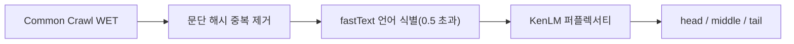
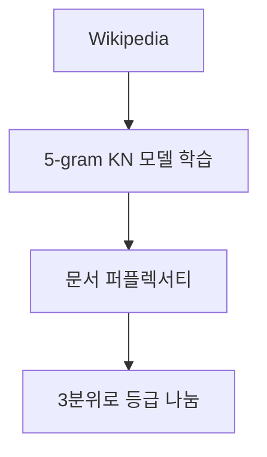

# CCNet

> Facebook AI가 Common Crawl에서 언어별 고품질 단일 언어 데이터를 뽑으려고 만든 자동 파이프라인이다. 문단 중복 제거 → 언어 식별 → 위키백과 기반 언어 모델 퍼플렉서티 점수 매기기의 세 단계로 구성된다.

## 쉽게 말하면
쓰레기와 보물이 섞인 거대한 창고에서 ①같은 물건 중복 치우기 ②언어별로 분류하기 ③"좋은 책(위키백과)과 비슷한 정도"로 등급 매기기를 순서대로 하는 컨베이어 벨트다.

## 자세히
(Wenzek 외, arXiv 1911.00359 초록과 PDF 본문을 직접 열어 확인.)
- **구조**: fastText 방식 전처리(문서 중복 제거·언어 식별)를 따르되, ① 문서 수준 구조를 보존해 BERT 같은 문단 수준 학습이 가능하게 하고 ② 위키백과 같은 고품질 말뭉치에 가까운 문서를 고르는 **선택적 필터**를 더했다.
- **문단 중복 제거**: 문단을 소문자화·숫자를 0으로·유니코드 구두점·악센트 제거로 정규화하고 SHA-1 앞 64비트를 키로 해시 비교. 같은 스냅샷에서 중복 문단이 **텍스트의 70%**. 샤드 1개(5GB)만 대조하면 글자의 42%가 남고, 100개 샤드를 대조하면 28%가 남는다(저자들은 50개 샤드 단위를 절충안으로 사용). 한 스냅샷은 1600개 샤드.
- **언어 식별**: fastText 분류기(Wikipedia·Tatoeba·SETimes로 학습, 문자 n-gram, 176개 언어, 단일 CPU 코어에서 초당 약 1k 문서). 최고 점수가 **0.5 초과**일 때만 그 언어로 분류하고 아니면 버린다.
- **LM 필터**: 위키백과로 학습한 **5-gram Kneser-Ney(KenLM)** 모델과 SentencePiece 토크나이저로 문단별 퍼플렉서티를 계산. 낮을수록 위키에 가깝다. 각 언어를 점수 기준 **head·middle·tail 3등분**한다. 48개 언어용 모델과 3분위 임계값 계산 코드를 공개했다.
- 데이터를 버리기보다 등급을 나눠 쓰는 것이 특징이다(제안: 사용자가 head만 쓸지 정함). 위키 기준이라 위키와 문체가 다른 좋은 글은 낮은 등급을 받을 수 있다.

## 그림으로 보기

## 예시
- 한국어 크롤에서 head 등급만 써서 소형 모델을 학습하고, 전체와 점수 비교.
- 교육 활용: "품질 = 기준 말뭉치와의 닮음"이라는 가정의 장단점 토론.

## 헷갈리는 것과 비교
| 개념 | 차이 |
|---|---|
| CCNet | 중복 제거·언어 식별·LM 등급 파이프라인 |
| [KenLM](#kenlm) | CCNet이 쓰는 N-그램 LM 도구 |
| [Gopher 휴리스틱](#gopher-quality-heuristics) | 규칙 기반 필터(모델 점수 대신) |

## 더 읽을거리
- [CCNet (arXiv 1911.00359)](https://arxiv.org/abs/1911.00359) — 파이프라인·수치.
