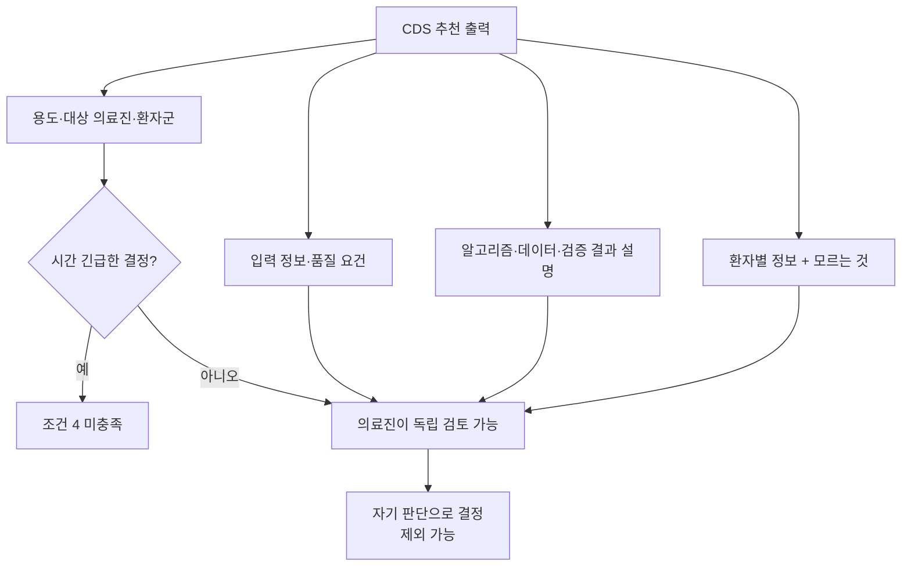

# 조건 4: 근거 제시

> 임상 의사결정 지원(CDS) 소프트웨어가 의료기기 규제에서 제외되려면, 의료진이 추천의 **근거를 독립적으로 검토**할 수 있게 해서 추천에 **주로 의존하지 않고 자기 판단으로** 결정하게 해야 한다는 FD&C Act 520(o)(1)(E)(iii)의 조건.

## 쉽게 말하면
내비게이션이 "여기서 우회전"이라고만 하면 따르기만 하게 된다. 지도, 이유, 불확실한 부분까지 같이 보여 줘야 운전자가 "아, 이 길은 공사 중이니 다르게 가야겠다"라고 스스로 판단할 수 있다. 조건 4는 의료진에게 그 지도를 주라는 요구다.

## 자세히
출처: FDA 지침 "Clinical Decision Support Software"(2026-01-29 발행, PDF 원문 직접 읽음, 비구속 권고). 해당 지침 IV절 조건 4 부분을 읽었다.
- **핵심 문장**: 제외되려면 의료진이 추천의 근거를 독립적으로 검토해 "주로 추천에 의존하지 않고 자기 판단으로" 환자별 결정을 내리게 하려는 의도여야 한다.
- **FDA 권고 4가지(a~d, 대안 방식도 허용)**:
  - (a) 소프트웨어·라벨에 **용도**(대상 의료진, 대상 환자군)를 적는다. **중대하고 시간이 촉박한 과제·결정**용 기능은 의료진이 근거를 검토할 시간이 없으므로 조건 4를 충족하지 못한다고 본다.
  - (b) **필요한 입력 의료 정보**와 얻는 방법, 관련성, 데이터 품질 요건을 쉬운 말로 적는다.
  - (c) **알고리즘 개발·검증**을 쉬운 말로 설명한다: ① 일반 접근법 요약(메타분석, 전문가 패널, 통계 모델링, AI/ML 등), ② 사용 데이터 설명(하위 집단·질환·수집 기관·성별·인종 등 대표성, 독립 개발·검증 데이터셋 같은 모범 사례), ③ 검증 임상 연구 결과(성능과 한계, 성능이 시험 안 됐거나 편차가 큰 하위 집단).
  - (d) 출력에 **환자별 관련 정보와 알려진 것·모르는 것**(누락·손상·예상 밖 입력 값 등)을 함께 보여 판단 근거가 되게 한다.
- **표시 방식**: 알고리즘이 복잡하거나 독점이어도 배경 정보를 쉬운 말로 제공한다. 정보 과부하를 피하도록 결정에 중요한 정보를 우선하고 세부는 추가로 열 수 있게 한다. 지침 버전·날짜가 있는 임상 지침, 발표 문헌 등 출처를 식별 가능하게 한다. 필요하면 **사용성 시험**으로 입증한다.
- **자동화 수준과 긴급성**: FDA는 소프트웨어의 자동화 수준과 결정의 시간 긴급성을 함께 본다. **자동화 편향**은 자동 시스템 제안에 과의존하는 경향으로, 잘못된 조언을 따르는 오류(commission)와 알림이 없어 행동하지 않는 오류(omission)를 낳으며, 긴급 상황에서 커진다고 설명한다.
- **관련**: 조건 3(추천 제공 목적)은 의료진의 판단을 대체하거나 지시하는 기능이 충족하지 못한다고 지침이 구분한다. 전체 4조건은 [CDS 예외 4조건](#cds-exemption).

## 그림으로 보기

## 예시
- 충족하기 쉬운 설계: 약제 선택 보조가 임상 지침 버전, 환자 입력값, 어떤 기준과 일치했는지, 누락된 검사 값을 함께 표시.
- 충족 못하는 설계: 응급 상황에서 단일 처치를 바로 지시하는 화면처럼 검토할 시간이 없는 기능.

## 헷갈리는 것과 비교
| 개념 | 차이 |
|---|---|
| [CDS 예외 4조건](#cds-exemption) | 4조건 전체, 조건 4는 근거 제시 |
| 조건 3 | 의료진용 추천 제공 목적, 판단 대체·지시는 불가 |
| [CDS의 자동화 편향](#automation-bias-cds) | 조건 4 판단 요소가 되는 현상 |
| [사용자 과의존](#user-overreliance) | 설계가 막으려는 행동 문제 |

## 더 읽을거리
- [Clinical Decision Support Software (FDA 지침 PDF, 2026-01-29)](https://www.fda.gov/media/109618/download) — IV절 조건 4와 권고 a~d(내려받아 확인)
