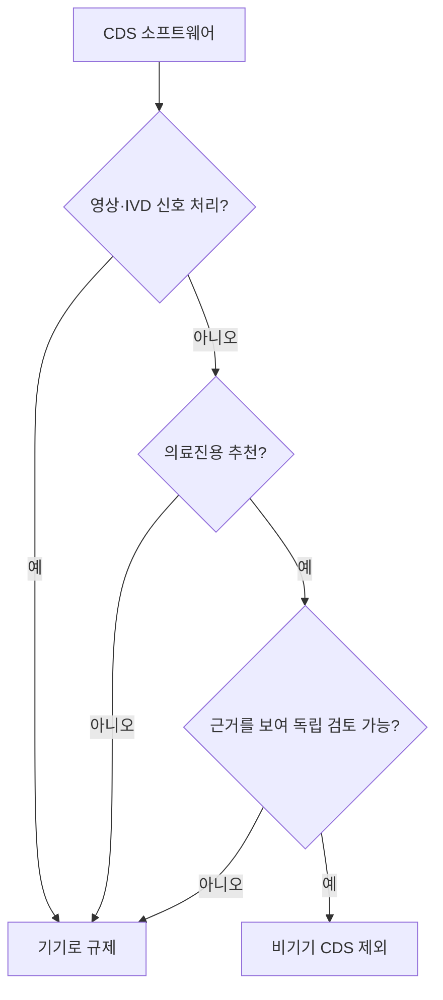

# CDS 예외 4조건

> 임상 의사결정 지원(CDS) 소프트웨어가 의료기기 규제에서 제외되려면 FD&C Act 520(o)(1)(E)의 4가지 조건을 모두 충족해야 한다. 의료진용이고 판단 근거를 보여 줘 의사가 AI 추천에만 의존하지 않게 하는 것이 핵심이다.

## 쉽게 말하면
참고서는 규제하지 않지만, 시험 정답을 대신 써 주는 기계는 규제하는 것과 비슷하다. "근거를 보여 주고 의사가 직접 판단하게 돕는 도구"는 제외, "답을 내리고 따르게 하는 도구"는 기기다.

## 자세히
출처: FDA CDS 지침 PDF 원문(fda.gov/media/109618, 2026-11-15에 직접 읽음). 문서에는 "2026-01-29 발행, 2026-01-06 발행본을 대체"라고 적혀 있다(법률 해설들은 1월 6일로 표기). 비구속적 권고.
- **4조건(모두 충족해야 제외)**
  1. 의료 영상, 체외진단(IVD) 신호, 신호 획득 시스템의 패턴·신호를 획득·처리·분석하지 않는다.
  2. 환자 의료 정보나 기타 의료 정보(예: 동료심사 논문, 임상 지침)를 표시·분석·출력한다.
  3. 의료진(HCP)에게 환자 진료에 관한 **추천**을 제공할 목적이다.
  4. 의료진이 추천의 근거를 독립적으로 검토할 수 있도록 충분한 정보를 제공해, **어떤 추천에도 주로 의존하지 않게** 한다.
- **조건 4 판단 요소**: 소프트웨어 자동화 수준과 의사결정의 시간 긴급성을 함께 본다. 자동화 편향(자동 시스템 제안에 과의존하는 경향, 따르는 오류·안 하는 오류 모두)은 긴급 상황에서 커진다고 지침이 설명한다. 필요하면 사용성 시험으로 입증. 근거 정보 예: 사용한 알고리즘·입력 데이터, 근거 연구의 선택 방식·강도 요약, 우선순위 목록의 기준.
- **2026 변화(지침 문서 확인)**: 조건을 충족하되 임상적으로 적절한 추천이 하나뿐인 기능에는 FDA가 집행 재량(enforcement discretion)을 행사하겠다고 밝힌다. 예: 체중·흡연·혈압·BNP로 심혈관 위험을 예측해 의료진에게 제시. 같은 기능이라도 특정 조건이 더해지면 대상에서 빠지는 하위 예도 있다.
- **범위 밖**: 소비자용 증상 체커·건강 챗봇은 이 지침의 초점이 아니다(해설 요약, 직접 확인 안 함). 영상·신호를 처리하는 AI는 조건 1에 막혀 기기로 규제된다.
- 사용자 과의존 설계와 직결: [사용자 과의존](#user-overreliance).

## 그림으로 보기

## 예시
- 제외 가능: 지침·논문을 환자 상황에 맞춰 보여 주고 근거 링크, 우선순위 기준을 함께 표시하는 약제 선택 보조.
- 기기: 영상에서 병변을 찾는 AI, 시간이 촉박한 상황에서 단일 진단·처치를 지시하는 출력(지침이 조건 3·4 미충족 사례로 든 유형).

## 헷갈리는 것과 비교
| 개념 | 차이 |
|---|---|
| 비기기 CDS | 4조건 충족, FDA 규제 제외 |
| [SaMD](#samd) | 의료 목적 소프트웨어 기기 |
| [510(k)·De Novo·PMA](#fda-510k-de-novo-pma) | 기기로 분류됐을 때의 경로 |

## 더 읽을거리
- [FDA: Clinical Decision Support Software 지침(PDF)](https://www.fda.gov/media/109618/download) — 4조건 해석과 예시(원문 확인)
- [Covington: 5 key takeaways](https://www.cov.com/en/news-and-insights/insights/2026/01/5-key-takeaways-from-fdas-revised-clinical-decision-support-cds-software-guidance) — 개정 요약(검색 결과로만 확인)
