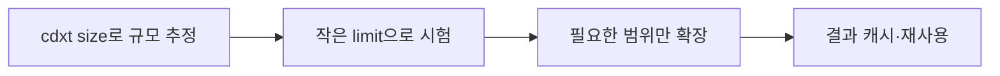
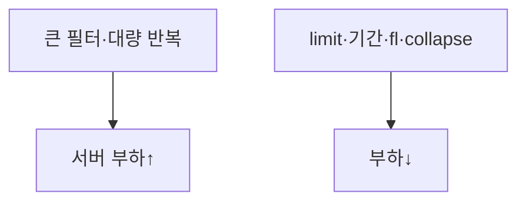

# CDX 서버 부하 예절

> 공공 색인 서버(Internet Archive, Common Crawl)를 조회할 때 서버에 큰 부하를 주지 않도록 요청 범위·필터·반복 횟수를 조절하는 매너다.

## 쉽게 말하면
도서관 사서에게 한 번에 수만 권을 찾아 달라고 하지 말고, 범위를 좁혀 몇 번에 나눠 요청하는 것과 같다. 공용 자원은 모두가 나눠 쓴다.

## 자세히
(cdx-toolkit README와 웨이백 CDX 서버 README를 직접 열어 확인.)
- **README의 경고**: cdx-toolkit은 "걸러 내는 비율이 큰 필터는 CDX 서버에 높은 부하를 준다"고 밝힌다.
- **기본값이 보호 장치**: 레코드 기본 1,000개, Common Crawl은 최근 1년 색인만 조회. `--limit`, `--crawl`, `--from/--to`로 넓히기 전에 `cdxt size`로 규모부터 추정.
- **API 기능으로 범위 줄이기(Wayback CDX)**: `limit`(음수면 마지막 N), `from/to`(기간), `fl`(필요한 필드만), `collapse`(인접 중복 제거), `showResumeKey`/`resumeKey`(재개 키로 이어 받기).
- **대안**: 넓은 기간 분석은 Common Crawl의 컬럼형 색인(Athena/Spark)으로 처리해 서버 API 호출을 줄인다([CC 컬럼형 색인](#cc-columnar-index)).
- **매너(제안)**: ① 작은 표본으로 먼저 시험 ② 결과를 캐시하고 같은 요청 반복 금지 ③ 요청 간 간격 두기 ④ 식별 가능한 User-Agent ⑤ 서버 공지·약관 확인. 구체적인 요청 한도 수치는 이번에 확인하지 못했다.

## 그림으로 보기

## 예시
- 특정 도메인의 2024년 캡처만 `from=2024&to=2024&limit=1000`으로 받고 필요한 만큼만 추가.
- 교육 활용: 공유 자원 사용 매너를 데이터 수집 윤리 수업에 포함.

## 헷갈리는 것과 비교
| 개념 | 차이 |
|---|---|
| 부하 예절 | 서버 부담을 줄이는 이용 방식 |
| robots.txt 준수 | 웹사이트 크롤링 규칙 |
| [cdx-toolkit](#cdx-toolkit) | 이 도구의 기본값이 부하를 제한 |

## 더 읽을거리
- [cocrawler/cdx_toolkit](https://github.com/cocrawler/cdx_toolkit) — 부하 경고·기본 제한.
- [Wayback CDX Server README](https://github.com/internetarchive/wayback/tree/master/wayback-cdx-server) — 범위 줄이는 파라미터.
