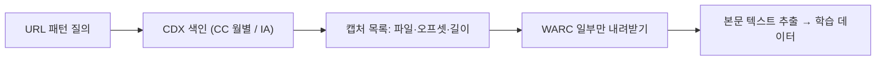
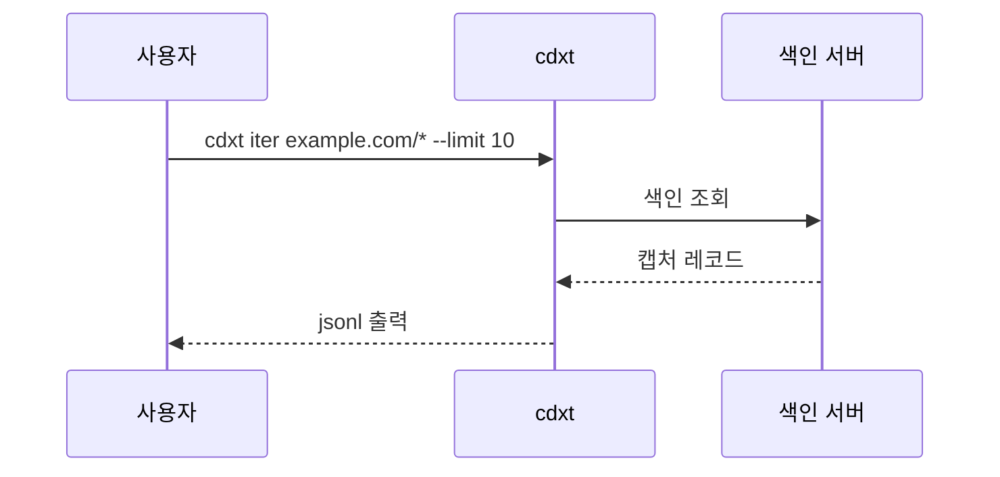

# cdx-toolkit

> Common Crawl과 Internet Archive의 CDX 색인을 같은 방식으로 조회하고, 찾은 페이지를 WARC 파일로 내려받게 해 주는 파이썬 라이브러리 겸 명령줄 도구(`cdxt`)다.

## 쉽게 말하면
도서관 목록 카드(색인)에서 "이 주소의 책이 어느 서가 몇 번째 칸에 있나"를 찾아 그 칸만 복사해 오는 도구다. 웹 전체(수백 TB)를 받지 않고 필요한 페이지만 골라 받는다.

## 자세히
(공식 GitHub README를 직접 열어 확인.)
- **설치**: `pip install cdx_toolkit` (원격 파일시스템은 `[s3]`, 전부는 `[all]`). 베타 단계라고 README가 밝힌다.
- **명령**: `cdxt size`(캡처 수 추정), `cdxt iter`(목록 출력), `cdxt warc`(WARC 저장). 출력은 WARC·jsonl·csv. `--cc`는 Common Crawl, `--ia`는 Internet Archive.
- **기본값**: 레코드 1,000개, CC는 최근 1년 색인만. `--limit`, `--crawl`(예: `CC-MAIN-2024-33`, 숫자 3=최근 3개), `--from/--to`로 넓힌다.
- **CC vs IA**: CC는 크롤마다 색인이 따로이고(대략 월 단위) 이 도구가 하나의 가상 색인으로 합친다. IA는 하나의 연속 색인이라 `--crawl`이 없고 기간으로 고른다.
- **주의**: 걸러 내는 비율이 큰 필터는 CDX 서버에 큰 부하를 준다. 정렬이 오름차순이라 `--limit`은 최신이 아닌 **가장 오래된** 캡처를 돌려줄 수 있다. 인코딩 문제와 revisit 레코드 처리는 미완성.
- Python: `cdx_toolkit.CDXFetcher(source='cc')` → `iter(url, limit=…)`로 딕셔너리, `obj.content`로 본문 바이트.

## 그림으로 보기

## 예시
- `cdxt --cc size 'example.com/*'` 로 규모를 먼저 보고, `cdxt --cc --limit 50 iter 'example.com/*'` 로 샘플을 확인.
- 교육 활용: "웹 데이터 수집은 색인 조회 → 부분 다운로드" 구조를 작은 도메인으로 체험.

## 헷갈리는 것과 비교
| 개념 | 차이 |
|---|---|
| cdx-toolkit | 색인 조회·WARC 추출 도구 |
| [URL 색인(CDX)](#url-index-cdx) | 색인 자체(데이터) |
| 일반 크롤러 | 직접 웹을 방문. 이 도구는 이미 저장된 크롤을 조회 |

## 더 읽을거리
- [cocrawler/cdx_toolkit (GitHub)](https://github.com/cocrawler/cdx_toolkit) — README에서 위 내용 확인.
