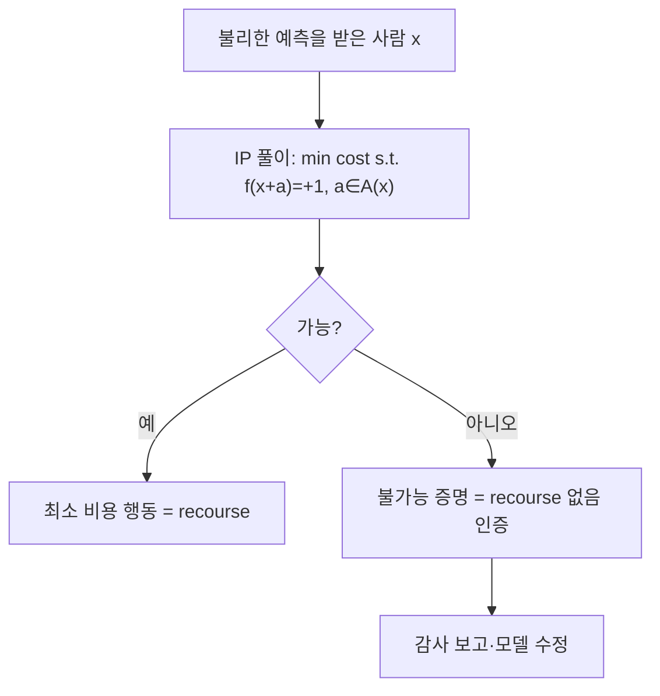
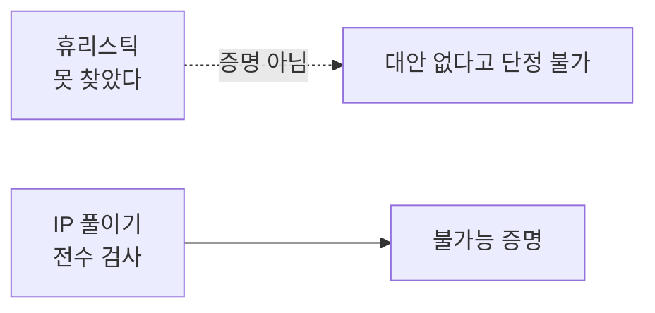

# 불가능 증명

> **불가능 증명(certified infeasibility)**은 "이 사람에게는 어떤 허용된 행동으로도 결정을 뒤집을 방법이 **없다**"는 것을 최적화 풀이가 **수학적으로 확인해 준** 결과다. 대안이 없다고 주장하려면 단순히 못 찾은 것이 아니라 이 증명이 필요하다.

## 쉽게 말하면
미로에서 출구를 못 찾았다고 "출구 없음"이라 단정할 수는 없다. 하지만 미로 지도 전체를 빠짐없이 훑어 보고 막힌 벽만 있음을 확인하면 "출구 없음"을 증명한 것이다. 정수 계획법(IP) 풀이기는 모든 가능성을 체계적으로 검사해 그런 증명을 낸다.

## 자세히
(Ustun·Spangher·Liu, 「Actionable Recourse in Linear Classification」(arXiv 1809.06514) PDF를 직접 읽어 확인.)
- **정의(논문)**: 사람 x에 대해 `min cost(a; x)` 를 `f(x+a)=+1`, `a ∈ A(x)` 아래 푸는 IP가 있다. **IP가 가능하면** 최적해가 최소 비용 행동이고, **IP가 불가능(infeasible)하면** 어떤 행동도 원하는 결과를 못 얻으므로 "모델 f가 x에게 actionable recourse를 주지 않음을 인증했다"고 말한다.
- **왜 중요한가**: 논문은 CPLEX 12.8 같은 풀이기가 **전역 최적해 또는 불가능 증명**을 돌려준다는 점을 도구의 핵심 장점으로 든다. 휴리스틱(국소 선형 근사 등)은 변경을 찾을 수는 있어도 **"recourse가 없다"는 증명은 못 준다**(논문 5.1절, 비선형 모델 확장 논의).
- **가능성의 조건(논문 Remark)**: 모든 특징이 비유계이고 행동 가능 특징이 하나라도 있으면 선형 분류기는 모두에게 recourse를 준다(Remark 2). 모든 특징이 유계이고 immutable 특징이 하나라도 있으면 일부에게 recourse를 주지 못할 수 있다(Remark 3). 그래서 **증명의 타당성은 행동 가능 특징의 범위 설정**에 달려 있다. → [recourse 가능성과 값의 범위](#recourse-feasibility-bounds)
- **주의**: 범위를 너무 빡빡하게 두면 "불가능"이 인위적으로 나온다. 논문은 소득·카드 수 같은 행동 가능 특징에 **느슨한 상한**을 두라고 권한다. 느슨하면 "비현실적으로 큰 변화"로 가능하게 되지만 비용이 커서 감사에서 눈에 띈다.
- **Example 1(논문)**: 모든 특징 합으로 확률이 정해지는 모델에서 임계값 α > d−1이면, immutable 특징이 0인 사람은 recourse가 없다. 예측이 완벽해도 recourse 보장은 못 한다는 예다.
- **활용**: 배포 중 불리한 결정을 받은 사람마다 최적화를 풀어 **불가능 증명이 나오면 recourse 위반을 즉시 탐지**한다. → [플립셋](#flipset)

## 그림으로 보기

## 예시
- 모델이 "나이 ≥ 50" 같은 immutable 특징에 큰 가중치를 두면, 해당 사람은 IP가 불가능으로 나온다 → 모델 설계 변경 사유가 된다.
- 교육 활동: 두 사람의 행동 집합이 다를 때 한 명은 가능, 한 명은 불가능이 되는 장난감 모델을 손으로 풀어 본다.

## 헷갈리는 것과 비교
| 개념 | 차이 |
|---|---|
| 불가능 증명 | 풀이기가 확인한 "대안 없음" |
| 대안을 못 찾음 | 탐색 한계일 수 있음. 증명 아님 |
| [행동 집합 정의](#action-set-definition) | 증명의 전제가 되는 허용 범위 |
| [플립셋](#flipset) | 대안이 있을 때의 통지 형식. 비어 있으면 증명과 연결 |
| [recourse 점검(정수 계획법)](#recourse-audit-integer-programming) | 이 증명을 모집단에 적용한 감사 |

## 더 읽을거리
- [Actionable Recourse in Linear Classification (arXiv 1809.06514)](https://arxiv.org/abs/1809.06514) — recourse 감사의 가능·불가능 인증, Remark 2·3, 비선형 확장 한계(PDF 직접 확인).
