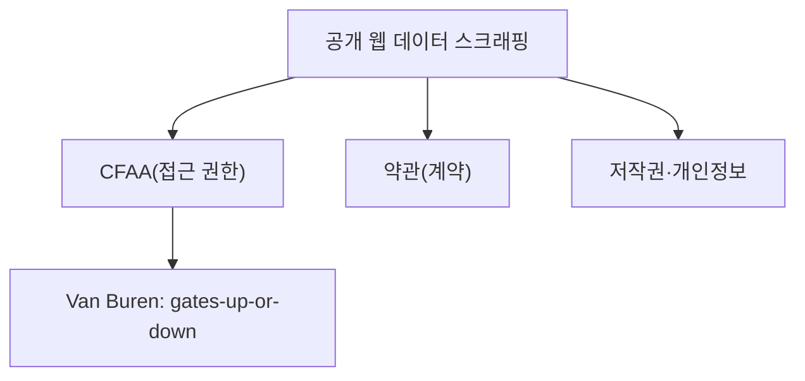
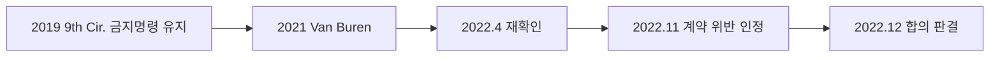

# CFAA와 공개 데이터

> 미국 컴퓨터 사기·남용법(CFAA)이 "로그인 없이 공개된 웹 데이터" 스크래핑에도 적용되는지를 다룬 대표 사건이 hiQ v. LinkedIn이다. 법원 판단과 이후 계약 분쟁을 구분해 읽어야 한다. (교육용 요약이며 법률 자문이 아니다.)

## 쉽게 말하면
"문이 열려 있는 가게에 들어가 진열대를 사진 찍는 것"이 침입죄인지를 두고 다툰 사건이다. 형사·침입 법리(CFAA)와 가게 규정 위반(계약)은 다른 층위다.

## 자세히
(하위 에이전트가 Cornell LII 등과 검색 결과로 확인한 노트 기준. hiQ 세부는 위키백과·법무법인 요약·검색 결과이며 판결문 원문은 미확인.)
- **hiQ v. LinkedIn, 9th Cir. 2019.9.9**: LinkedIn이 공개 프로필 접근을 막지 못하게 한 예비적 금지명령을 "진지한 쟁점(serious questions)" 기준으로 유지.
- **Van Buren v. United States, 2021.6.3(연방대법원)**: CFAA의 "exceeds authorized access"를 "문이 열렸나 닫혔나(gates-up-or-down)" 기준으로 해석. 각주 8에서 접근 제한이 **기술적**이어야 하는지 **계약적**일 수도 있는지는 열어 두었다.
- **후속**: 대법원이 2021.6.14 hiQ 사건을 파기환송, 9th Cir.이 2022.4.18 다시 유지. 2022.11.4 지방법원이 hiQ의 LinkedIn 이용자 계약 위반을 인정. **2022.12.8 합의 판결**: 50만 달러, 영구 금지명령, 데이터·코드 삭제. 합의에 포함된 CFAA 책임은 법원의 사실 인정이 아니다.
- **읽는 법(제안)**: 공개 데이터 스크래핑이 CFAA 위반은 아니라는 흐름이 있었으나, 계약(약관)·저작권·개인정보 등 다른 법적 위험은 남는다. 관할마다 다르다.

## 그림으로 보기

## 예시
- 크롤링 프로젝트 점검표: CFAA만 보지 말고 약관·저작권·개인정보를 따로 점검.
- 교육 활용: 판결 연표를 보고 "공개 = 자유 이용"이 아닌 이유 토론.

## 헷갈리는 것과 비교
| 개념 | 차이 |
|---|---|
| CFAA | 컴퓨터 접근 권한 관련 형사·민사 |
| 약관 위반 | 계약 책임 |
| [요청과 계약](#rep-vs-contract) | robots.txt는 접근 권한이 아님 |

## 더 읽을거리
- [Van Buren v. United States (Cornell LII)](https://www.law.cornell.edu/supremecourt/text/19-783) — 대법원 판결문(요약 확인).
