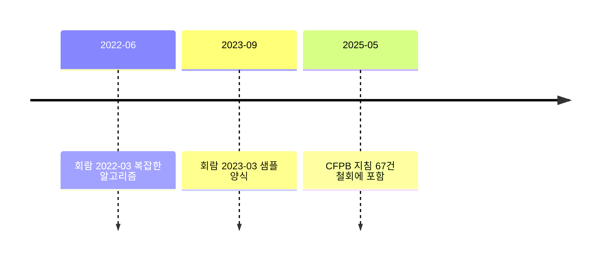

# CFPB 회람 2023-03

> 2023-09-19 게시된 CFPB 회람. 불리한 조치 통지 요건과 Regulation B 샘플 양식의 올바른 사용을 다뤘다. 2025-05-12 철회 목록에 포함돼 현재 CFPB 공식 지침이 아니다.

## 쉽게 말하면
"거절 이유를 서식 체크박스에서 비슷한 걸 고르면 끝"이라고 여기던 관행을 지적한 CFPB의 해설이었고, 이후 철회됐다. 이 노드는 "해설이 있었고 지금은 철회됨"이라는 이력 자체를 기록한다.

## 자세히
출처: CFPB 회람 페이지(제목·게시일·보관 표시만 읽힘), 연방관보 2025-05-12 철회 목록(2023-03 = 89 FR 27361, 2024-04-17 관보 게재, "기타 지침" 7번).
- **제목**: "Adverse action notification requirements and the proper use of the CFPB's sample forms provided in Regulation B."
- **게시일**: 2023-09-19. 페이지에 보관(archived) 표시, 원본 링크 있음. 이 글을 쓸 때 본문은 열리지 않아 세부 내용(AI 관련 설명 포함 여부)은 확인하지 못했다. 그래프의 요약 "AI 신용모델 통지 해설"은 정확하지 않을 수 있으니 본문 확인 필요(2022-03이 복잡 알고리즘을 직접 다룬 문서였음).
- **연관 문서**: 회람 2022-03은 복잡한 알고리즘과 통지 이유를 다뤘고, 샘플 양식에서 가장 가까운 이유에 체크하는 것으로는 부족하다고 밝혔다([불리한 조치 통지](#adverse-action-notice)).
- **철회**: 2025-05-12 효력 철회 목록에 포함. CFPB는 철회가 반드시 최종은 아니라고 밝혔다.
- **의미**: 철회는 ECOA·Reg B 조문 자체의 폐지가 아니다. 통지 의무의 법적 근거는 남아 있고, 해석 문서만 없어진 것이다.

## 그림으로 보기

## 예시
- 컴플라이언스 문서에서 철회된 회람을 근거로 인용하지 않도록 "현재 유효" 여부를 확인하는 체크 단계를 둔다.

## 헷갈리는 것과 비교
| 개념 | 차이 |
|---|---|
| 회람(circular) | 기관 해석 문서, 법 아님 |
| Reg B 조문 | 법적 구속력 |
| 철회 | 해석 문서 폐기, 조문과 별개 |

## 더 읽을거리
- [CFPB Circular 2023-03](https://www.consumerfinance.gov/compliance/circulars/circular-2023-03-adverse-action-notification-requirements-and-the-proper-use-of-the-cfpbs-sample-forms-provided-in-regulation-b/) — 제목·게시일만 확인
- [Federal Register 2025-08286](https://www.govinfo.gov/content/pkg/FR-2025-05-12/html/2025-08286.htm) — 철회 목록
