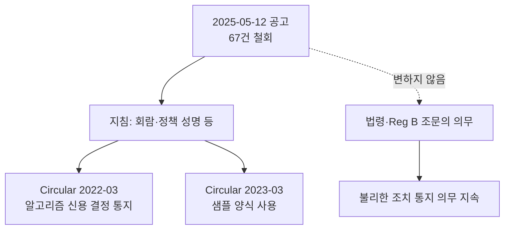

# CFPB 지침 철회 2025

> 2025-05-12 연방관보 공고로 CFPB가 2011년부터 낸 해석 규칙·정책 성명·자문 의견 등 67건을 철회한 조치. 알고리즘 기반 신용 결정의 불리한 조치 통지에 관한 회람(Circular 2022-03, 2023-03)도 목록에 포함됐다는 해설이 있다. 법과 규정 자체는 그대로다. (법률 자문 아님)

## 쉽게 말하면
정부 기관이 "법을 이렇게 읽으라"고 낸 안내문 수십 건을 한꺼번에 거둬들인 것이다. 안내문이 사라졌다고 법의 의무가 사라진 것은 아니다. 다만 기관이 그 해석을 앞세워 단속하지 않겠다는 신호가 되고, 업계는 불확실성이 커진다.

## 자세히
출처: Holland & Knight 해설, Venable 해설(2025-05, 둘 다 열어서 읽음), 검색 요약(연방관보 공고 90 Fed. Reg. 20,084 인용). 연방관보 원문은 접근이 차단돼 열지 못했다.
- **공고**: 90 Fed. Reg. 20,084(2025-05-12). 해설에 따라 2025-05-09 발표·게시, 5-12 공식 게재로 날짜가 갈린다. 건수는 **67건**("거의 70건"이라 쓴 글도 있음). 구성은 검색 요약에 따르면 정책 성명 8, 해석 규칙 7, 자문 의견 13, 회람·공지 등 기타 39.
- **알고리즘 관련(Venable)**: "기타 지침" 목록에 **Circular 2022-03**(복잡한 알고리즘에 근거한 신용 결정의 불리한 조치 통지 요건)과 **Circular 2023-03**(불리한 조치 통지 요건과 Reg B 샘플 양식의 올바른 사용)가 들어 있다고 한다. Holland & Knight 글은 개별 회람을 언급하지 않아 이 부분은 한 해설에만 근거한다.
- **이유(해설)**: Holland & Knight: 법령 문구와 어긋나고 준수 부담을 키우며, 일부는 공지·의견 수렴 없이 외부에 의무를 부과했다. Venable: 정식 규칙 제정으로 복귀, 법과 규정의 우위 재확인, 다른 기관과의 중복 방지, 현장 심사의 오적용 위험 감소, 현 지도부의 우선순위와 정렬, 지침이 과도하게 규정적이라는 인식.
- **법적 효과**: 회람은 규칙이 아닌 지침이어서 **법령과 규정상 의무는 그대로**다(Venable). 공고 자체가 철회는 "반드시 최종은 아니며" 검토를 계속한다고 밝혔다. 철회된 입장도 다른 규제기관·소송 당사자·법원이 참조할 수 있으므로 정책이 법 조문과 어떻게 맞는지 문서화하라는 조언이 있다.
- **AI 실무 의미**: ECOA·Reg B의 불리한 조치 통지 의무(구체적 이유 제시)는 조문에 남아 있으므로, 복잡한 모델로 거절할 때 이유를 설명하는 체계는 여전히 필요하다. 이 부분은 이 지도의 정리이며 구체적 적용은 전문가 확인이 필요하다([불리한 조치 통지](#adverse-action-notice)).

## 그림으로 보기

## 예시
- 은행 컴플라이언스: 회람이 철회됐어도 복잡한 모델의 거절 이유 설명 절차는 유지하고, 근거를 Reg B 조문과 연결해 문서화.
- 점검 질문: 우리 정책의 근거가 철회된 지침인가, 조문인가? 주(州) 법이나 다른 기관의 기준은?

## 헷갈리는 것과 비교
| 개념 | 차이 |
|---|---|
| 지침 철회 | 해석 안내문을 거둠, 법 자체는 유지 |
| [지침과 조문의 차이](#guidance-vs-regulation) | 철회돼도 조문이 남는 이유 |
| [불리한 조치 통지](#adverse-action-notice) | 남아 있는 법적 의무 |
| [Reg B 2026 최종 규칙](#reg-b-2026-final-rule) | 같은 흐름의 별도 규칙 개정 |

## 더 읽을거리
- [CFPB Withdraws Guidance Documents: A Shift Toward Regulatory Restraint (Venable, 2025-05)](https://www.venable.com/insights/publications/2025/05/cfpb-withdraws-guidance-documents-a-shift) — 목록과 이유(열어서 확인)
- [CFPB Rescinds 67 Guidance Documents (Holland & Knight, 2025-05)](https://www.hklaw.com/en/insights/publications/2025/05/cfpb-rescinds-67-guidance-documents) — 이유·건수(열어서 확인)
