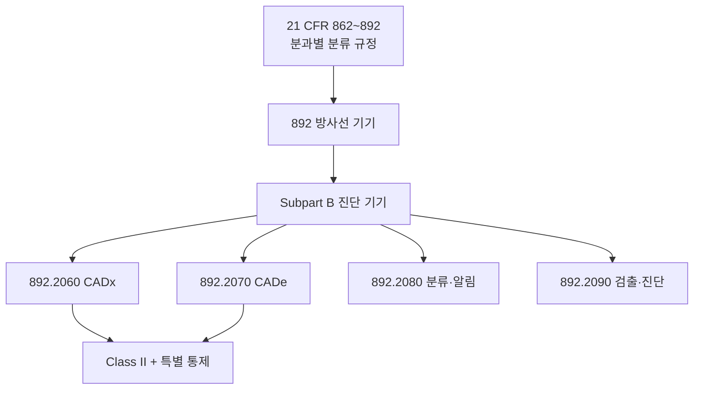

# 21 CFR 862~892

> 미국 연방규정집 21편의 862~892 파트. FDA가 의료기기를 분과(panel)별로 분류한 **기기 분류 규정** 모음으로, 각 기기 유형의 정의(identification), 등급, 특별 통제가 조문으로 적혀 있다.

## 쉽게 말하면
의료기기 종류별 "규정집 목차"다. 영상의학 소프트웨어는 892편, 임상화학 검사기기는 862편처럼 분과별로 나뉘고, 각 조문이 "이 기기는 이런 것이고 Class II이며 이런 시험·표시가 필요하다"를 적는다.

## 자세히
출처: eCFR의 21 CFR Part 892, §892.2060, §892.2070(열어서 읽음, Part 892 전체 텍스트는 앞부분 10만 자만 확인), FDA Product Classification Database 안내(열어서 읽음).
- **역할**: product code는 21 CFR 862~892의 분류에 근거한다. 분류 규정이 등급(Class I·II·III)과 Class II의 **특별 통제**를 정한다([분류 규정](#classification-regulation), [제품 코드](#product-code)).
- **Part 892(방사선 기기) 구조**: Subpart A 일반 조항, Subpart B 진단 기기, Subpart F 치료 기기(C~E는 예약). 읽은 범위에서 확인한 구조이며 이후 구성은 확인하지 못했다.
- **892.2xxx 영상 소프트웨어 조문(제목)**: 892.2050 의료 영상 관리·처리 시스템, 892.2060 암 의심 병변 방사선 컴퓨터 보조 진단 소프트웨어, 892.2070 의료 영상 분석기(CADe), 892.2080 방사선 컴퓨터 보조 분류·알림 소프트웨어, 892.2090 방사선 컴퓨터 보조 검출·진단 소프트웨어.
- **예: 892.2070 (CADe)**: 방사선 영상에서 이상이 있을 수 있는 부위를 식별·표시해 의료진의 주의를 끄는 처방용 기기. 유방촬영·유방 초음파·흉부 방사선(폐 결절)·치과 충치 등. 진단 추천이나 분류용이 아니고 "자격 있는 영상의학과 의사의 판독을 대체하지 않음". **Class II, 특별 통제**.
  - **설계 검증·확인**: 알고리즘의 입력·출력·한계 설명, 사전 지정된 성능 시험, 의도한 집단에서 **판독자 성능 향상**을 보임, 주요 하위 집단 충분한 증례, 위험 분석·추적성·시험·사이버 보안 등 소프트웨어 문서.
  - **표시**: 대상 환자군, 판독 프로토콜, 사용자·교육, 입출력, 호환 영상 장비, 경고와 한계(성능이 떨어질 수 있는 조건), 사용 설명, 하위 집단 결과가 포함된 성능 시험 요약.
- **892.2060 (CADx)**: 암 의심 병변을 특징화해 사용자에게 정보를 주는 영상 처리 기기. 진단·환자 관리 결정은 임상 사용자가 내린다. Class II, 특별 통제. 시험·표시 요건은 위 CADe와 비슷하다.
- **쓰임**: AI 의료기기를 조사할 때 product code로 해당 조문을 찾아 필수 시험(독자 연구 등)과 표시 요건을 확인한다. 현행 조문은 eCFR에서 날짜 기준으로 확인해야 한다.

## 그림으로 보기

## 예시
- 폐 결절을 표시하는 AI: product code 확인 → 892.2070 조문 → 특별 통제에 따라 판독자 성능 향상 시험과 하위 집단 결과, 한계 표시 준비.
- 교육 활동: 조문의 "Identification"과 "Special controls"를 제품 설명서와 대조해 빠진 표시 항목 찾기.

## 헷갈리는 것과 비교
| 개념 | 차이 |
|---|---|
| 21 CFR 862~892 | 기기 유형별 분류 규정 모음 |
| [분류 규정](#classification-regulation) | 개념 노드, 이 노드는 규정 범위와 예 |
| [제품 코드](#product-code) | 조문과 이어진 식별 코드 |
| [MRMC 독자 연구](#mrmc-study) | 특별 통제의 판독자 성능 시험을 충족하는 방법 중 하나 |

## 더 읽을거리
- [21 CFR 892.2070 (eCFR)](https://www.ecfr.gov/current/title-21/chapter-I/subchapter-H/part-892/subpart-B/section-892.2070) — CADe 정의·특별 통제(열어서 확인)
- [21 CFR 892.2060 (eCFR)](https://www.ecfr.gov/current/title-21/chapter-I/subchapter-H/part-892/subpart-B/section-892.2060) — CADx 정의·특별 통제(열어서 확인)
