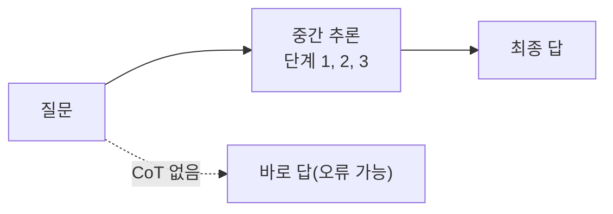
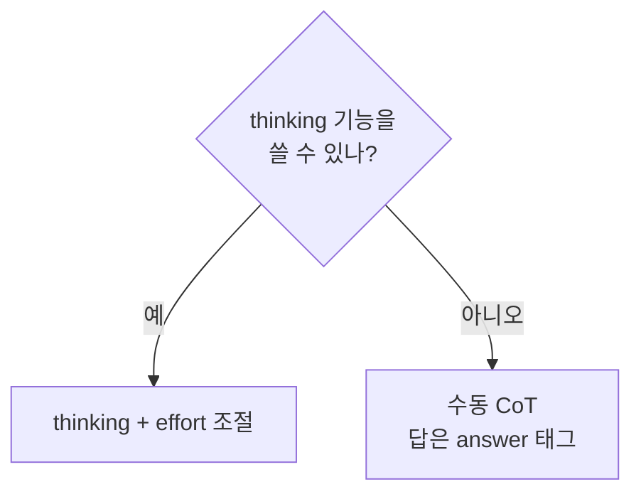

# 생각 사슬 프롬프트 (Chain-of-Thought)

> 답만 내지 말고 중간 추론 단계를 거치게 해서 수학·논리·복잡한 판단의 정확도를 높이는 프롬프트 기법이다.

## 쉽게 말하면
암산으로 바로 답하는 것보다 종이에 풀이 과정을 적으며 푸는 편이 덜 틀린다. 모델도 "생각할 공간"이 주어지면 중간 결과를 쌓으며 더 정확해진다.

## 자세히
- **수동 CoT**: "단계별로 생각한 뒤 답해"라고 요청한다. Anthropic 공식 문서(Prompting best practices, 2026-11 확인)는 thinking 기능이 꺼져 있을 때의 **대체 수단**으로 소개하며, 최종 답을 `<answer>` 태그에 넣게 해 추출하라고 한다.
- **최신 모델의 권고**: Claude Fable 5.1, Opus 5.5, Sonnet 5.5 등에서는 손으로 CoT를 쓰기보다 **thinking 기능**을 쓰고, 비용·지연이 중요하면 effort를 낮추라고 안내한다. 추론을 `<thinking>` 태그로 적게 하는 프롬프트는 거부될 수 있다고 명시한다.
- **일반 지시 > 세세한 절차**: "철저히 생각해라" 같은 일반 지시가 사람이 짠 단계별 계획보다 나은 경우가 많다고 한다.
- 추론 단계는 늘 사실과 일치하지는 않는다(모델이 적은 설명이 실제 계산과 다를 수 있음). 중요한 결과는 [검증](#agent-verification)한다.

## 그림으로 보기



## 예시
```
다음 계약서에서 위험 조항을 찾아라. 먼저 충분히 생각한 뒤,
최종 결과만 <answer> 태그에 불릿으로 넣어라.
```

## 헷갈리는 것과 비교
| 개념 | 차이 |
|---|---|
| CoT 프롬프트 | 프롬프트로 추론을 유도 |
| thinking 기능 | 모델이 내장 추론 블록을 사용 |
| [프롬프트 연쇄](#prompt-chaining) | 작업을 여러 호출로 쪼갬 |
| [few-shot](#few-shot-prompting) | 풀이 예시를 보여 주는 방식과 결합 가능 |

## 더 읽을거리
- [Prompting best practices — Thinking and reasoning](https://platform.claude.com/docs/en/build-with-claude/prompt-engineering/claude-prompting-best-practices) — 수동 CoT는 thinking 꺼짐 시 대체 수단.
