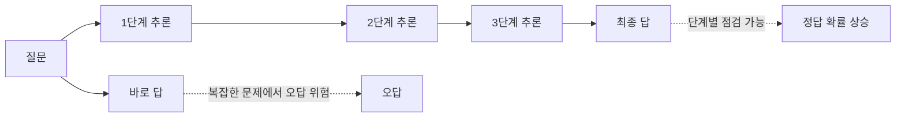
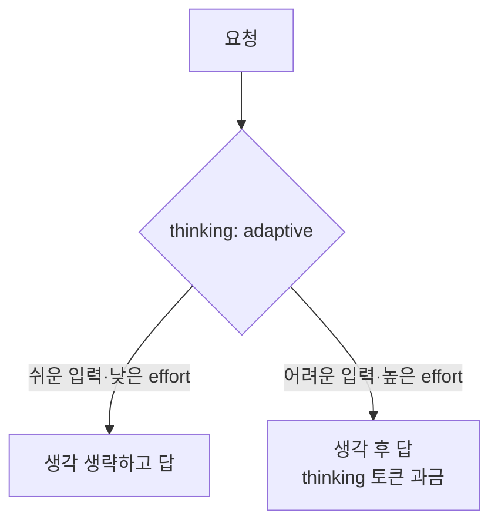

# 사고 사슬(Chain of Thought)

> 답만 바로 내지 않고 중간 추론 단계를 거치게 해 복잡한 문제의 정확도를 높이는 방식. 프롬프트로 유도할 수도 있고, 최신 모델은 "생각하기(thinking)" 기능으로 내장한다.

## 쉽게 말하면
수학 시험에서 암산으로 바로 답을 쓰면 틀리기 쉽지만, 풀이 과정을 한 줄씩 적으면 맞힐 확률이 올라간다. AI도 생각을 글로 풀어 쓰는 단계가 있으면 더 정확해진다. 다만 풀이를 길게 쓸수록 시간과 비용(토큰)이 든다.

## 자세히
- **원 논문**: Wei 외 "Chain-of-Thought Prompting Elicits Reasoning in Large Language Models"(arXiv 2201.11903, 2022년 1월). 프롬프트에 추론 과정이 들어간 예시 몇 개를 보여 주면 대형 모델의 산술·상식·기호 추론 성능이 크게 오른다고 보고했다. 540B 매개변수 모델에 예시 8개를 줘서 수학 문장제 벤치마크 GSM8K에서 당시 최고 정확도를 냈다. 저자들은 이 추론 능력이 "충분히 큰 모델에서 자연스럽게 나타난다(emerge)"고 주장한다.
- **프롬프트 방식**: ①예시에 풀이 과정을 포함(few-shot CoT) ②"단계별로 생각해 봐"처럼 지시 ③최신 모델에선 생각 기능을 켠다.
- **API의 생각 기능(Claude 문서, 2026-11 기준)**
  - 예전의 **확장 사고**(`thinking: {type:"enabled", budget_tokens: N}`)는 **레거시**다. `budget_tokens`는 최소 1,024, `max_tokens`보다 작아야 하며 목표치이지 엄격한 상한이 아니다. Claude 4.7 이상 모델은 이 방식을 지원하지 않고 400 오류를 반환한다.
  - 권장은 **적응형 사고**(`thinking: {type:"adaptive"}`)다. 모델이 요청마다 생각할지, 얼마나 할지 스스로 정하며 `output_config: {effort: ...}`로 깊이를 조절한다. 쉬운 입력에는 낮은 effort에서 생각을 건너뛸 수도 있다. Opus 5.5·Haiku 5.5의 기본 effort는 `medium`이다.
  - 생각에 쓴 토큰은 출력 토큰으로 과금된다(`usage.output_tokens_details.thinking_tokens`로 확인). 응답에는 요약된 생각 블록과 본문 블록이 온다.
  - 생각 설정을 바꾸면 프롬프트 캐시가 무효화된다.
- **한계와 주의**: ①모델이 쓴 추론 과정이 실제 내부 계산과 같다는 보장이 없다([설명의 충실성](#explanation-faithfulness)) ②비용·지연 증가([에이전트 비용·지연](#agent-cost-latency)) ③쉬운 문제에선 이득이 적다 ④틀린 추론이 그럴듯하게 이어질 수 있다.
- **관련 기법**: 여러 번 풀어 다수결(자기 일관성), 도구와 결합, 추론 전용 모델([추론 모델](#reasoning-models)).

## 그림으로 보기




## 예시
- 프롬프트: "다음 계약서의 위험 조항을 찾아 줘. 먼저 조항별로 위험 여부를 판단하는 이유를 적고, 마지막에 표로 정리해."
- API(권장 방식):
```python
response = client.messages.create(
    model="claude-sonnet-5-5", max_tokens=16000,
    thinking={"type": "adaptive"},
    output_config={"effort": "high"},
    messages=[{"role": "user", "content": "..."}],
)
```
- 교육 활용: 수강생에게 "같은 질문을 풀이 없이/풀이와 함께 물어 정답률과 소요 시간을 비교"하는 실습을 시킨다.

## 헷갈리는 것과 비교
| 개념 | 차이 |
|---|---|
| 일반 프롬프트 | 답만 요청 |
| 사고 사슬 프롬프트 | 추론 단계를 쓰게 유도 |
| 확장 사고(`budget_tokens`) | 토큰 예산을 정하는 레거시 방식, 최신 모델은 미지원 |
| 적응형 사고 | 모델이 필요에 따라 생각량을 정함, effort로 조절 |
| [추론 모델](#reasoning-models) | 생각을 내장하도록 학습된 모델 |

## 더 읽을거리
- [Chain-of-Thought Prompting (arXiv 2201.11903)](https://arxiv.org/abs/2201.11903) — 원 논문
- [Extended thinking (Claude 문서)](https://platform.claude.com/docs/en/build-with-claude/extended-thinking) — 레거시 방식과 적응형 사고로의 이전
