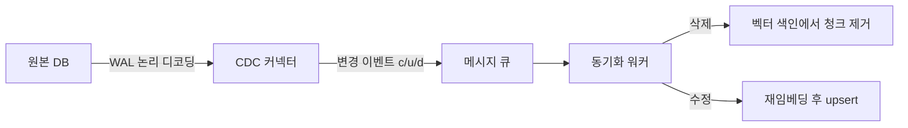
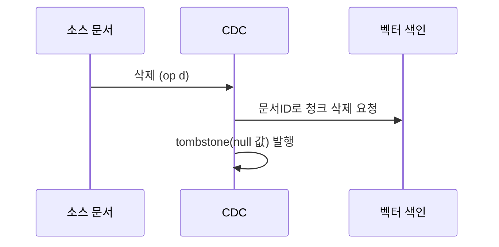

# CDC 동기화

> **CDC(Change Data Capture)**는 원본 DB의 **변경(추가·수정·삭제)을 로그에서 읽어 이벤트로 흘려보내** 다른 시스템(예: RAG 벡터 색인)을 거의 실시간으로 맞추는 방식이다. 야간 배치 대신 쓰면 삭제가 색인에 늦게 반영되는 "좀비 문서"를 줄인다.

## 쉽게 말하면
회사 장부에 변동이 생길 때마다 옆 사무실에 즉시 전화로 알려 주는 것이다. 매일 밤 전체 장부를 복사해 비교하는 방식보다 훨씬 빠르고, 삭제 같은 변동도 놓치지 않는다.

## 자세히
(Debezium PostgreSQL 커넥터 공식 문서를 WebFetch로 앞 20만 자까지 직접 확인(전체 32만 자 중 12만 자 미확인) + dev.to 「Maintaining Index Freshness」 요약을 참고했다.)
- **캡처 방식(Debezium 문서)**: PostgreSQL의 **WAL(write-ahead log)**을 **논리적 디코딩**으로 읽는다. 플러그인은 `decoderbufs`와 내장 `pgoutput`(PostgreSQL 10+, 별도 설치 불필요). 행 단위 insert·update·delete마다 변경 이벤트 하나를 만들고, 각 이벤트의 **WAL 위치**를 기록해 재시작하면 마지막 위치에서 이어 읽는다.
- **스냅샷**: 처음 시작하면 대상 테이블의 일관된 스냅샷을 뜬 뒤 그 위치부터 변경을 스트리밍한다. `snapshot.mode`는 `initial`(기본), `always`, `initial_only`, `no_data`, `when_needed` 등. 차단/증분 스냅샷은 신호로 나중에 실행할 수 있고, 차단 스냅샷은 중복 레코드를 낼 수 있다고 경고한다.
- **이벤트 구조(문서)**: 키는 기본키(또는 replica identity 키), 값은 `before`·`after`·`source`·`op`·타임스탬프를 가진 envelope. `op`: `c` 생성, 스냅샷 읽기 `r`, 삭제 `d`. `source`에는 `lsn`·`txId`·`schema`·`table` 등이 있다.
- **삭제 이벤트(문서)**: `before`에 삭제 전 값(기본 replica identity에서는 **기본키만**), `after`는 `null`. 기본키가 없고 replica identity가 `DEFAULT/NOTHING`이면 `before`가 없다 → 테이블을 `REPLICA IDENTITY FULL`로 설정해야 한다.
- **tombstone 이벤트(문서)**: 삭제 이벤트 뒤에 **같은 키에 값이 `null`인 이벤트**를 하나 더 낸다. Kafka 로그 컴팩션은 해당 키의 최신 메시지가 null일 때만 이전 메시지를 지우기 때문이다. (여기의 tombstone은 Kafka 용어이며, 벡터 DB의 논리 삭제 tombstone과는 다른 층의 개념이다.)
- **RAG 색인에 적용(해석, dev.to 글 요약 기반)**: 변경 이벤트가 문서 ID·연산 유형·소스 타임스탬프·내용 다이제스트를 담아, 삭제면 벡터 DB에서 지우고 수정이면 [내용 해시](#chunk-content-hash)를 비교해 재임베딩한다. **이벤트는 최소 1회 전달**을 전제로 멱등하게 처리하고, 순서가 중요하면 LSN·txn_id를 쓴다.
- **한계**: 이 문서는 PostgreSQL 기준이며 다른 DB는 방식이 다르다. 전달 보장(정확히 한 번) 세부는 읽지 못했다.

## 그림으로 보기

## 예시
- 인사 DB에서 퇴사 처리된 문서를 삭제하면 몇 초 안에 RAG 색인에서 해당 청크가 제거된다(야간 배치는 최대 24시간 지연).
- 교육 활동: 배치 동기화와 CDC를 "택배 하루 한 번 vs 건마다 알림"으로 비교해 지연 시간을 계산.

## 헷갈리는 것과 비교
| 개념 | 차이 |
|---|---|
| CDC | 로그 기반 실시간 변경 이벤트 |
| 야간 배치 | 주기적 전체/차분 복사. 삭제 반영 늦음 |
| [Tombstone 삭제](#tombstone-deletion) | 벡터 DB의 논리 삭제 |
| [좀비 문서](#zombie-documents) | 동기화 실패로 남은 청크 |

## 더 읽을거리
- [Debezium PostgreSQL connector 문서](https://debezium.io/documentation/reference/stable/connectors/postgresql.html) — WAL 논리 디코딩, 이벤트 구조, 삭제·tombstone 이벤트(앞 20만 자 직접 확인).
- [Maintaining Index Freshness (dev.to)](https://dev.to/beefedai/maintaining-index-freshness-incremental-updates-for-vector-databases-16eb) — 벡터 색인 증분 동기화 패턴(직접 확인).
