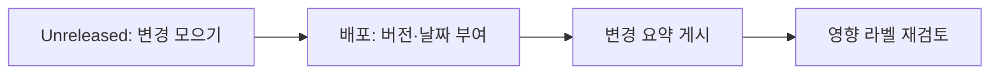
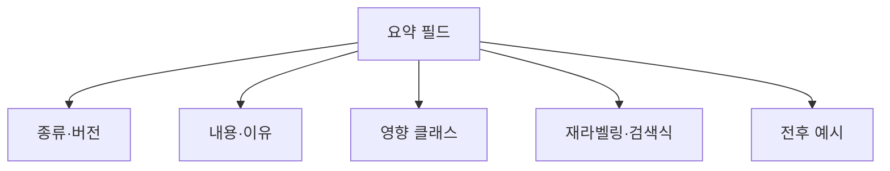

# 규칙 변경 요약 양식

> 규칙 변경 요약 양식은 라벨 규칙서를 고칠 때마다 날짜·버전·변경 내용·이유·영향받는 클래스·재라벨링 필요 여부를 같은 형식으로 남기는 변경 이력(changelog) 틀이다. 라벨러와 검수자가 "무엇이 바뀌었나"를 빠르게 파악한다.

## 쉽게 말하면
앱 업데이트 때 보는 "이번 업데이트 내용"과 같다. 사람이 읽기 쉽게 같은 칸에 적어 두면 변경 이력이 곧 교육 자료가 된다.

## 자세히
- **참고 원칙(Keep a Changelog 1.1.0)**: 변경 이력은 기계가 아닌 사람을 위한 것이다. 모든 버전에 항목을 두고, 같은 종류의 변경을 묶고, 최신 버전을 맨 위에 두며, 날짜를 ISO 8601(YYYY-MM-DD)로 쓰고, 버전 규칙(SemVer 사용 여부)을 밝힌다. 변경 종류는 Added·Changed·Deprecated·Removed·Fixed·Security이고, 맨 위에 `Unreleased` 구역을 두어 곧 나올 변경을 모아 두었다가 출시 때 새 버전 구역으로 옮긴다. 이는 소프트웨어용 관행이며 라벨 규칙서에는 **빌려 쓰는 제안**이다.
- **라벨 규칙서용 양식(제안)**:

```markdown
## [v1.5.0] - 2026-11-25
- 종류: 의미 변경(MINOR) / 표현 보강(PATCH) / 의미 변경(MAJOR)
- 변경 내용: 반어법 문장은 부정으로 판정한다
- 이유: 불일치 샘플 토론에서 사유 "반어" 15건 확인 (E-021~E-035)
- 영향 클래스: 긍정, 부정
- 재라벨링 필요: 예 — 검색식 `guideline_ver<'v1.5' and label='긍정' and (반어 단서)`
- 전/후 예시: "대단하군요, 환불이나 해 주세요" → 긍정 → 부정
- 공지·확인: 2026-11-26 09:00 동시 배포, 확인 문항 5개
```

- **칸의 의미(해석)**: 종류는 [의미 변경 vs 표현 보강 버전](#semantic-vs-patch-version)의 기준을 따르고, 이유는 [판정 사유 기록](#adjudication-rationale-log)·[불일치 샘플 토론](#disagreement-discussion)의 근거를 가리킨다. 재라벨링 칸에는 [재검토 검색식](#relabel-query)을 그대로 붙이면 실행이 빨라진다.
- **운영(해석)**: ① 변경은 먼저 Unreleased에 쓰고 배포 때 버전을 붙인다 ② 라벨러는 새 버전의 요약만 읽고 시작할 수 있어야 한다 ③ 요약과 규칙서 본문, 라벨의 버전 열이 서로 어긋나지 않게 확인([라벨 메타데이터 기록](#annotation-metadata-tracking)).

## 그림으로 보기



## 예시
- 위 양식 코드 블록을 `CHANGELOG.md`에 맨 위에 추가한다.
- 교육 활용: 규칙서 개정안을 하나 정해 이 양식으로 요약을 쓰고, 다른 학습자가 읽고 이해하는지 확인한다.

## 헷갈리는 것과 비교
| 개념 | 차이 |
| --- | --- |
| 변경 요약 | 무엇이 왜 바뀌었는지 설명 |
| 규칙서 본문 | 현재 적용 규칙 전체 |
| [의미 변경 vs 표현 보강 버전](#semantic-vs-patch-version) | 변경 종류 분류 기준 |
| [규칙 변경 전파](#rule-change-propagation) | 요약을 배포하는 절차 |

## 더 읽을거리
- [Keep a Changelog 1.1.0](https://keepachangelog.com/en/1.1.0/) — 변경 이력 작성 원칙과 변경 종류
- [Semantic Versioning 2.0.0](https://semver.org/) — 버전 규칙
