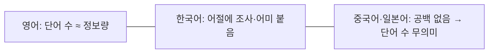
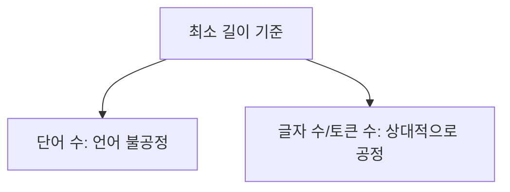

# 글자 수 vs 어절 수

> 줄이나 문서의 **최소 길이 기준**을 단어(공백 단위 어절) 수로 정하면 띄어쓰기 방식이 다른 언어에서 의미가 달라진다. 한국어는 어절이 길어 단어 수가 적게 나오고, 중국어·일본어는 공백이 거의 없어 단어 수 기준이 사실상 무력해진다. 글자 수(또는 토큰 수) 기준이 더 공정하다.

## 쉽게 말하면
"5단어 이상"이라는 규칙은 영어에는 잘 맞는 자(尺)지만, 단어를 붙여 쓰는 언어에는 눈금이 다르다. 같은 길이의 내용도 어떤 언어에서는 2단어, 어떤 언어에서는 1단어로 센다.

## 자세히
- 직접 측정(Common Crawl `CC-MAIN-2024-10` WET 첫 파일의 세 구간(앞·중간·끝 2MB)에서 WET 헤더 언어별로 해당 문자가 들어간 줄만 집계. 영어 97,193줄, 한국어 1,197줄, 중국어 14,454줄, 일본어 23,163줄):
  | 언어 | 줄당 공백 단어 수 중앙값 | 줄당 해당 문자 수 중앙값 | 5단어 미만 줄 비율 | 해당 문자 20자 이상 줄 비율 |
  |---|---|---|---|---|
  | 영어 | 2.0 | 12.0 | 74% | 30% |
  | 한국어 | 2.0 | 6.0 | 67% | 16% |
  | 중국어 | 1.0 | 4.0 | **96%** | 10% |
  | 일본어 | 1.0 | 7.0 | **90%** | 18% |
- 읽는 법:
  - **중국어·일본어는 공백 단어 수 기준(5단어 미만)으로 90~96%의 줄이 걸린다.** 한 줄이 통째로 1단어로 계산되기 때문이다(문장이 길어도). [C4 규칙의 부작용](#c4-side-effects)에서 본 중·일 문서 유실의 한 원인이다.
  - 한국어는 어절 단위로 세어 줄당 중앙값 2로 영어와 같지만 **어절 하나에 담기는 정보가 다르다**(조사·어미가 붙음). 예: `대구mbc교향악단 정기연주회-수성아트피아 용지홀`은 한글이 20자 이상인데 2어절이라 5어절 기준에 걸린다(해당 유형 줄 9개 확인).
  - 글자 수 기준은 언어 간 격차가 더 작다(20자 이상 비율 영어 30%, 한국어 16%, 일본어 18%, 중국어 10% — 같지는 않지만 단어 기준의 90%대 쏠림은 없다). 그래도 영어 1글자와 한자 1글자의 정보량은 다르다.
- 대안(제안): ① **토큰 수**(해당 언어 토크나이저 기준) ② **유니코드 문자 수**를 언어별 기준으로 보정(예: 영어 25자 ≈ 5단어, 한국어 10~15자, 중국어 15자 등 — 값은 데이터로 정해야 함) ③ 형태소·문장 분리기 사용 ④ 언어별로 필터를 따로 설계하고 제거 비율을 보고([언어별 제거율 모니터링](#language-wise-removal-rate)).
- 한계: 한국어 표본이 12문서로 작다. 영어 줄에는 코드·메뉴 줄이 섞여 있고 언어 식별은 WET 헤더 값을 그대로 썼다. 표의 비율은 방법을 보여 주는 대략치다.

## 그림으로 보기



## 예시
```python
n_chars = len(re.findall(r'[가-힣]', line))     # 한국어
ok = n_chars >= 10 and line.endswith(('.', '다', '요', '죠'))
```
- 교육: 같은 문장을 영어·한국어·중국어로 놓고 단어 수와 글자 수를 세어 보는 실습.

## 헷갈리는 것과 비교
| 개념 | 차이 |
|---|---|
| 어절 | 공백으로 나뉜 한국어 덩어리 |
| 형태소 | 의미를 가진 최소 단위 |
| 글자 수 | 유니코드 문자 수 |
| 토큰 수 | 모델 토크나이저가 자른 조각 수 |

## 더 읽을거리
- [Common Crawl: Get Started](https://commoncrawl.org/get-started) — WET 개요(읽음).
- [한국어 종결 표현](#korean-sentence-endings) — 같은 표본의 종결 어미 분석.
- 직접 실행: WET 샘플 언어별 줄·어절·문자 통계.
