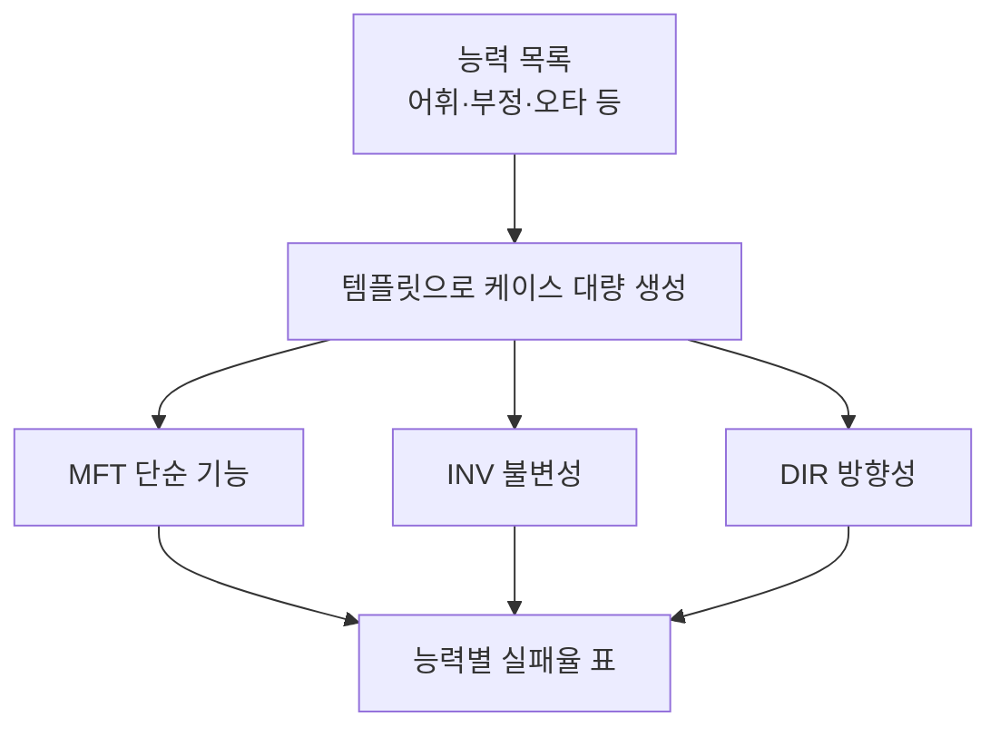
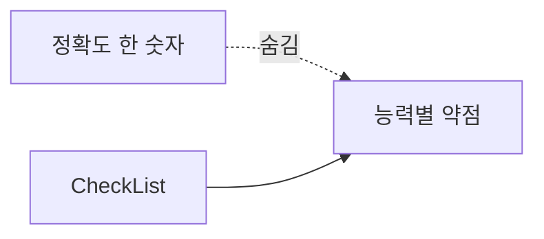

# CheckList 행동 테스트

> CheckList는 NLP 모델을 평균 정확도 하나로 평가하지 않고, **능력(capability)별로 테스트 케이스를 대량 생성해 행동을 점검**하는 방법론과 파이썬 도구다(Ribeiro 외, ACL 2020). 소프트웨어 공학의 행동 테스트에서 영감을 얻었다.

## 쉽게 말하면
운전면허 필기 평균 점수만 보는 대신 "비 오는 날 차선 변경", "급정거" 같은 상황별 실기 항목표를 만들어 하나씩 확인하는 것이다. 모델이 어떤 상황에서 무너지는지 항목별로 드러난다.

## 자세히
- **주장(arXiv 2005.04118, 직접 확인)**: held-out 정확도는 성능을 과대평가하기 쉽다. CheckList는 ① 언어적 능력과 테스트 유형의 **매트릭스** ② 테스트 케이스를 빠르게 만드는 **소프트웨어**로 구성된다.
- **결과(논문 초록)**: 세 과제에서 상용·최신 모델의 치명적 실패를 찾았다. 한 사용자 연구에서 이미 충분히 테스트했다던 상용 감성분석 팀이 새로운 버그를 발견했고, 다른 연구에서 CheckList 사용자는 사용하지 않은 사람보다 약 2배 많은 테스트를 만들고 약 3배 많은 버그를 찾았다.
- **세 가지 테스트 유형(GitHub README, 직접 확인)**
  - **MFT(Minimum Functionality Test)**: 같은 기대 라벨이 나와야 하는 단순 예시 묶음. 예: "This is a great movie"는 긍정.
  - **INV(Invariance)**: 오타 추가처럼 의미를 바꾸지 않는 변형에도 예측이 유지돼야 한다.
  - **DIR(Directional)**: 부정 표현을 덧붙이면 긍정 확률이 줄어드는 식으로 **기대 방향**이 있는 변형.
- **도구**: `pip install checklist`. `Editor.template`으로 `{first_name} is {a:profession} from {country}.` 같은 템플릿에서 문장을 대량 생성. 저장소는 MIT 라이선스, 별 약 2.0k(확인 시점). 릴리스 항목은 없고 최신 환경 호환성은 확인하지 않았다.
- **한계(해석)**: 테스트 기준(기대 행동)을 사람이 정해야 하며, 생성형 LLM 평가에는 별도 설계가 필요하다.

## 그림으로 보기

## 예시
- 고객 리뷰 감성 분류기: 오타·이름 바꾸기에 예측이 흔들리는지 INV로 확인.
- 교육 소재: 상용 번역·분류기를 3개 능력으로 점검하는 미니 프로젝트.

## 헷갈리는 것과 비교
| 개념 | 차이 |
|---|---|
| 정확도 평가 | 평균 한 숫자 |
| CheckList | 능력별 행동 테스트 |
| [Domino 슬라이스 발견](#domino-slice-discovery) | 데이터에서 자동으로 약점 발견 |
| [집단별 성능 보고](#subgroup-performance-report) | 집단별 보고 |

## 더 읽을거리
- [Beyond Accuracy (arXiv 2005.04118)](https://arxiv.org/abs/2005.04118) — 논문 초록 직접 확인.
- [marcotcr/checklist (GitHub)](https://github.com/marcotcr/checklist) — 설치·MFT/INV/DIR 코드 예시(직접 확인).
