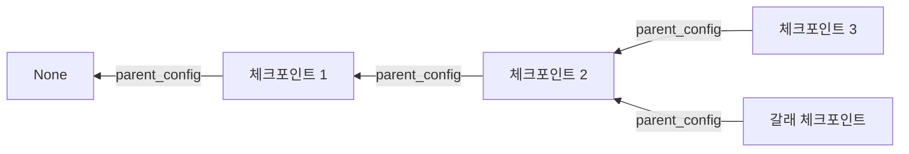

# parent_config 체인

> 각 체크포인트는 `parent_config`로 직전 체크포인트를 가리킨다. 첫 체크포인트는 `None`이라서, 전체가 연결 리스트처럼 이어진다.

## 쉽게 말하면
일기장의 "어제 일기로 가기" 링크다. 오늘 페이지에서 어제로, 어제에서 그제로 거슬러 올라가면 처음까지 닿는다. 그래서 어느 시점에서든 그 이전 전체 경과를 복원할 수 있다.

## 자세히
Checkpointers 문서 기준(확인 2026-11-12).
- `parent_config`(`dict | None`): 직전 체크포인트의 config(`thread_id`·`checkpoint_ns`·`checkpoint_id`).
- 첫 체크포인트(input, step -1)는 `None`.
- `get_state_history`는 이 체인을 최신 → 과거 순으로 풀어 보여 준다.
- `update_state`로 과거 체크포인트에서 상태를 고치면 그 체크포인트를 부모로 하는 새 체크포인트가 생겨 체인이 갈라질 수 있다(갈래). 이 점은 [타임 트래블](#langgraph-time-travel) 문서의 개념에서 온 해석이다.
- 장기 대화에서는 체크포인트가 계속 쌓이므로 정리·보존 정책이 필요하다(Persistence 문서).

## 그림으로 보기


## 예시
```python
snap = graph.get_state(config)
parent = graph.get_state(snap.parent_config) if snap.parent_config else None
```
직전 상태와 현재 `values`를 비교해 한 단계에서 무엇이 바뀌었는지 본다.

## 헷갈리는 것과 비교
| 개념 | 차이 |
|---|---|
| parent_config | 직전 체크포인트 가리키기 |
| thread_id | 같은 대화의 체크포인트 묶음 식별 |
| [리플레이](#langgraph-replay) | 체인 중 한 지점을 골라 다시 실행 |

## 더 읽을거리
- [LangGraph Checkpointers](https://docs.langchain.com/oss/python/langgraph/checkpointers.md) — Parents 설명
- [LangGraph Persistence](https://docs.langchain.com/oss/python/langgraph/persistence) — 체크포인트 누적과 정리
