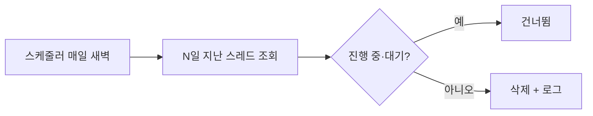

# 체크포인트 정리 작업

> LangGraph가 쌓는 체크포인트 중 오래된 것을 주기적으로 지우는 예약 작업으로, 저장소 비용과 조회 지연을 억제한다.

## 쉽게 말하면
게임 자동 저장이 매 턴 쌓이면 하드가 찬다. 그래서 "30일 지난 자동 저장은 청소부가 밤마다 치운다"는 규칙을 둔다.

## 자세히
LangGraph Persistence 문서 기준:
- 체크포인터는 스레드(`thread_id`)별 상태 스냅샷을 저장한다. `InMemorySaver`는 재시작하면 모두 사라지고, 개발용은 `SqliteSaver`, 운영은 `PostgresSaver`를 권장한다. Postgres는 `setup()`으로 테이블을 만들고 `thread_id`는 255자 미만으로 둔다.
- 긴 대화는 체크포인트가 누적되어 지연과 저장 비용이 늘 수 있다. 문서는 **주기적 정리나 보존 정책**을 권하고, N일 지난 체크포인트를 지우는 스케줄 작업을 예로 든다.
- 이 문서에는 TTL 설정이나 `delete_thread`가 명시돼 있지 않다. 세부는 체크포인터 가이드로 확인한다(확인 못 함).
- 설계 포인트: ① 기준(마지막 갱신 후 N일) ② 진행 중·`interrupt` 대기 스레드 제외 ③ 지우기 전 백업·건수 로깅 ④ 최신 체크포인트는 남기기. [타임 트래블](#langgraph-time-travel)을 쓰는 스레드는 과거 기록이 사라지는 점을 감안한다.
- 기준은 [체크포인트 보존 정책](#langgraph-checkpoint-retention)과 [데이터 보존 정책](#data-retention-policy)에서 정한다.

## 그림으로 보기

## 예시
Postgres 체크포인트 테이블에서 마지막 활동이 30일 지난 `thread_id`를 찾아 삭제하는 cron 스크립트를 두고, 삭제 건수를 슬랙에 보고한다(테이블 구조는 라이브러리 버전별로 다르니 문서로 확인 후 작성).

## 헷갈리는 것과 비교
| 개념 | 차이 |
|---|---|
| 체크포인트 정리 작업 | 실행 수단(스케줄 삭제) |
| [보존 정책](#langgraph-checkpoint-retention) | 얼마나 남길지의 규칙 |
| [체크포인터](#langgraph-checkpointer) | 저장하는 컴포넌트 |

## 더 읽을거리
- [LangGraph Persistence](https://docs.langchain.com/oss/python/langgraph/persistence) — 체크포인터 종류와 정리 권고
