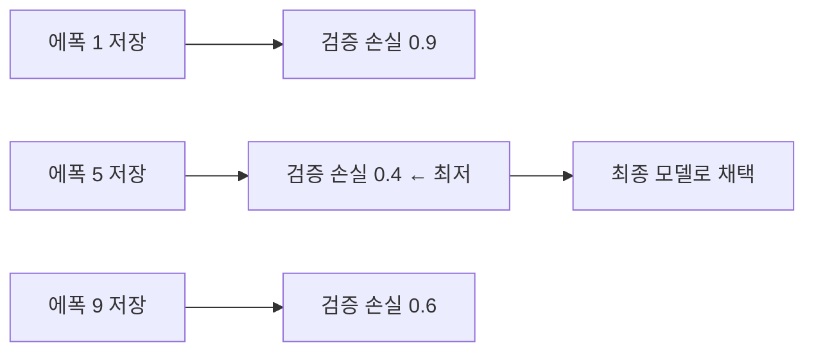

# 최고 체크포인트 선택

> 학습 중 주기적으로 저장한 체크포인트 가운데 검증 성적이 가장 좋은 시점의 것을 최종 모델로 고르는 방법이다.

## 쉽게 말하면
게임에서 자동 저장 파일이 여러 개 있을 때 "가장 점수가 높았던 순간의 저장"으로 되돌아가 계속 하는 것이다. 마지막 저장이 항상 최고는 아니다.

## 자세히
- 학습이 길어지면 학습 손실은 계속 줄어도 검증 손실은 어느 시점부터 오른다([과적합](#overfitting)). 그 직전 체크포인트가 일반화가 가장 좋다(일반 원리).
- **모니터링 지표**: PyTorch Lightning `EarlyStopping`은 `monitor`(예: `"val_loss"`), `mode`(`"min"`/`"max"`), `patience`로 구성된다. patience는 에폭이 아니라 **검증 횟수** 기준이며, `check_val_every_n_epoch=10`, `patience=3`이면 최소 40에폭 후 멈춘다(Lightning 문서, 2026-11 확인). 문서는 이 페이지에서 ModelCheckpoint(`save_top_k` 등)는 다루지 않으므로, 최고 모델 저장 옵션은 해당 문서를 따로 확인해야 한다.
- 선택 기준은 [검증 세트](#validation-set)로 정한다. 테스트 세트로 고르면 누수다.
- 실무 팁(일반): 최고 시점의 가중치만 저장하고, 시드·하이퍼파라미터·데이터 버전을 함께 기록해 재현 가능하게 한다. 검증 점수가 흔들리는 경우 여러 시점을 평균(체크포인트 앙상블)하는 방법도 있다.

## 그림으로 보기


## 예시
```python
EarlyStopping(monitor="val_loss", mode="min", patience=3)
```
검증 손실이 3번 연속 개선되지 않으면 멈추고, 그때까지의 최고 체크포인트를 사용.

## 헷갈리는 것과 비교
| 개념 | 차이 |
|---|---|
| 조기 종료 | 언제 멈출지 |
| 체크포인트 선택 | 어느 저장본을 쓸지 |
| [검증 세트](#validation-set) | 선택 기준이 되는 데이터 |

## 더 읽을거리
- [EarlyStopping (Lightning)](https://lightning.ai/docs/pytorch/stable/common/early_stopping.html) — monitor·mode·patience.
