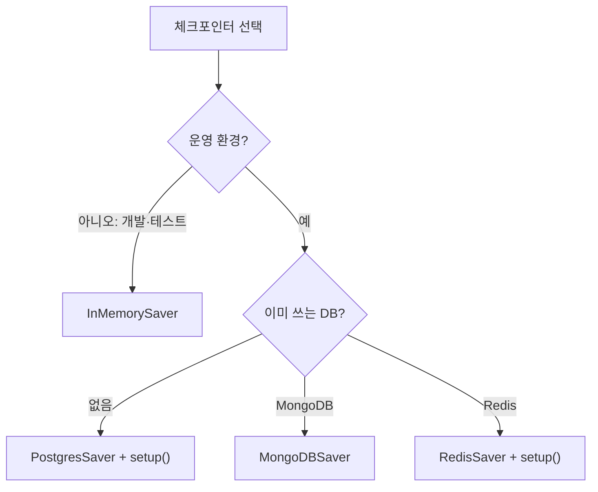
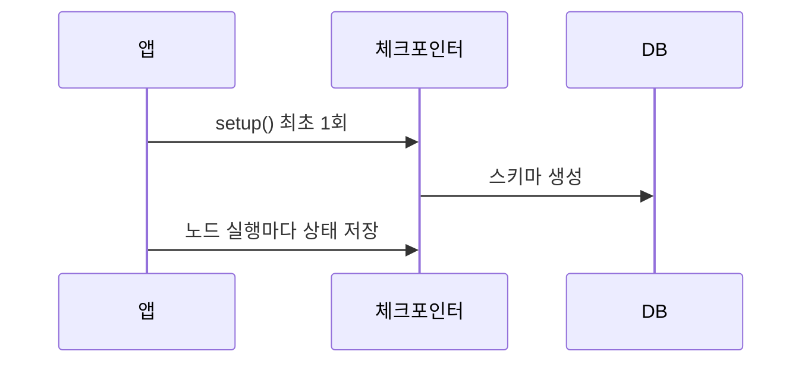

# 체크포인터 저장소 선택

> LangGraph 체크포인터는 그래프 상태 스냅샷을 어디에 저장하느냐에 따라 **InMemory(개발용), Postgres(운영 기본 예시), MongoDB·Redis(이미 쓰는 경우)** 로 고른다.

## 쉽게 말하면
게임 저장을 메모장(메모리)에 해 두면 프로그램을 끄는 순간 사라진다. 계속 이어서 하려면 외장 저장소(데이터베이스)에 저장해야 한다.

## 자세히
(LangGraph 공식 add-memory 문서 확인)
- **InMemorySaver**: 프로세스 메모리에 저장. 문서 예제에서 쓰이며 "운영에서는 데이터베이스 기반 체크포인터를 쓰라"고 한다 → 개발·실험용.
  ```python
  from langgraph.checkpoint.memory import InMemorySaver
  graph = builder.compile(checkpointer=InMemorySaver())
  ```
- **PostgresSaver**: 문서의 대표 운영 예시. `PostgresSaver.from_conn_string(DB_URI)` 컨텍스트 매니저로 만들고 **처음 한 번 `checkpointer.setup()`** 으로 스키마 마이그레이션을 실행한다. 비동기 버전 `AsyncPostgresSaver`는 `await ...setup()`. 마이그레이션은 별도 배포 단계나 서버 시작 시 실행을 권한다. 설치: `pip install -U "psycopg[binary,pool]" langgraph langgraph-checkpoint-postgres`.
- **MongoDBSaver**: 이미 MongoDB를 운영 중일 때. `pip install langgraph-checkpoint-mongodb`.
- **RedisSaver**: 이미 Redis를 쓸 때. Postgres처럼 최초 `setup()`이 필요(비동기는 `asetup()`).
- 문서에는 성능·비용 비교가 없다. SqliteSaver는 이 문서에 나오지 않아 확인하지 않았다(소규모·로컬 용도로 흔히 거론됨, 일반 지식).

## 그림으로 보기



## 예시
```python
from langgraph.checkpoint.postgres import PostgresSaver
with PostgresSaver.from_conn_string(DB_URI) as cp:
    cp.setup()
    graph = builder.compile(checkpointer=cp)
```
- 서버가 재시작돼도 같은 `thread_id`로 대화를 이어서 실행.

## 헷갈리는 것과 비교
| 개념 | 차이 |
|---|---|
| InMemorySaver | 재시작하면 사라짐 |
| PostgresSaver | 영속 저장, 스키마 마이그레이션 필요 |
| [LangGraph 스토어](#langgraph-store) | 스레드 간 장기 메모리 |
| 체크포인터 | 스레드별 상태 기록 |

## 더 읽을거리
- [LangGraph: add memory](https://docs.langchain.com/oss/python/langgraph/add-memory)
