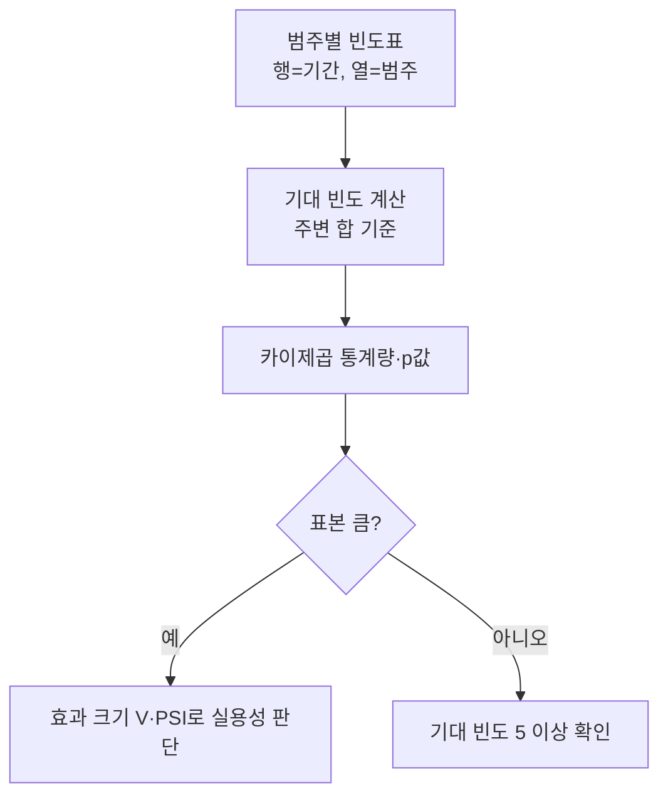

# 카이제곱 드리프트 검정

> **범주형 특성**의 기준 기간과 현재 기간의 빈도 분포가 같은지를 카이제곱 검정으로 확인하는 방법. 두 기간의 범주별 빈도표(분할표)에서 독립성을 검정한다. 큰 표본에서는 사소한 변화도 유의하게 나오므로 효과 크기를 함께 본다.

## 쉽게 말하면
고객 등급(A·B·C·D)이 작년과 올해 얼마나 다르게 분포하는지를, 작년·올해 두 줄 표로 만들어 "기간과 등급이 서로 무관한가"를 따지는 것이다. 무관하지 않다면 분포가 바뀐 것이다.

## 자세히
출처: Evidently AI 가이드(앞서 열어서 읽음: 범주형은 카이제곱, 큰 데이터에서 과민), SciPy 공식 문서 `scipy.stats.chi2_contingency`(열어서 읽음), 이 세션의 직접 실험.
- **검정 구조(SciPy)**: `chi2_contingency(observed)`는 관측 빈도 분할표에서 변수 간 **독립성**을 카이제곱으로 검정한다. 기대 빈도는 주변 합으로 독립을 가정해 계산한다. 반환값은 `statistic`, `pvalue`, `dof`, `expected_freq`. 드리프트에 쓸 때는 행을 기간(기준, 현재), 열을 범주로 두면 "기간과 범주가 독립"이라는 귀무가설이 "두 기간의 분포가 같다"와 같은 뜻이 된다(이 적용은 일반적 사용법이며 문서가 드리프트를 직접 다루지는 않는다).
- **옵션(SciPy)**: `correction=True`가 기본이며 Yates 연속성 보정은 자유도가 1일 때만 적용된다. `method`로 순열·몬테카를로 p값 계산이 가능하다(조건 제한 있음).
- **주의(SciPy)**: 일반적 지침은 모든 칸의 기대 빈도가 5 이상이어야 한다는 것이다. 총 표본이 작으면 점근 p값이 부정확할 수 있고 재표집 방법이 권장된다.
- **직접 실험(합성, 4개 범주, 이 세션)**: 범주 비율이 [0.40, 0.30, 0.20, 0.10]에서 [0.41, 0.30, 0.19, 0.10]으로 **1%p만** 이동. 각 기간 표본 500건: χ²=5.58, p=0.1337. 5,000건: χ²=2.87, p=0.412. **500,000건**: χ²=240.78, p≈0.0. 효과 크기 V(= √(χ²/2n), 이 두 행 표에서 계산)는 각각 0.0747, 0.0169, 0.0155로 **작게 유지**됐다. 표본이 커지면 효과 크기는 그대로인데 p값만 0이 된다. 한 번의 난수 시드 결과이며 5,000건에서 p가 오른 것은 우연의 변동이다.
- **해석**: 매일 수십만 건을 처리하는 서비스는 항상 "유의한 드리프트"가 나온다. 효과 크기와 비즈니스 영향(예: 어느 범주가 얼마나 늘었나)을 임계값으로 둔다([드리프트 통계 검정](#drift-statistical-tests), [PSI](#psi)).
- **한계**: 새 범주가 나타나면 분할표 구조가 바뀌고 기대 빈도가 0이 되는 칸이 생길 수 있다.

## 그림으로 보기


## 예시
```python
from scipy.stats import chi2_contingency
table = [[(ref == c).sum() for c in cats],
         [(cur == c).sum() for c in cats]]
chi2, p, dof, expected = chi2_contingency(table)
```
- 점검: 기대 빈도가 5 미만인 칸이 있는가, 새 범주가 등장했는가, 효과 크기가 임계값을 넘는가.

## 헷갈리는 것과 비교
| 개념 | 차이 |
|---|---|
| 카이제곱 드리프트 검정 | 범주형 빈도 분포 비교 |
| [Kolmogorov-Smirnov 검정](#ks-test) | 수치형 분포 비교 |
| [PSI](#psi) | 구간별 비율 차이의 거리 점수 |
| [드리프트 통계 검정](#drift-statistical-tests) | 표본이 크면 과민한 문제 |

## 더 읽을거리
- [scipy.stats.chi2_contingency (SciPy 문서)](https://docs.scipy.org/doc/scipy/reference/generated/scipy.stats.chi2_contingency.html) — 함수·옵션·기대 빈도 주의(열어서 확인)
- [Data drift (Evidently AI)](https://www.evidentlyai.com/ml-in-production/data-drift) — 범주형 검정과 과민성(열어서 확인)
