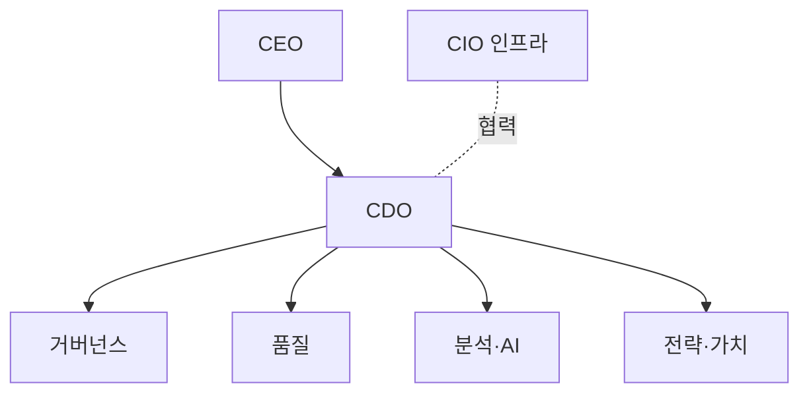

# 최고데이터책임자 (CDO)

> 조직 데이터에서 **최대의 사업 가치를 끌어내는 임원**이다. 데이터 전략을 세우고 거버넌스·품질·분석·보안을 총괄한다.

## 쉽게 말하면
회사의 데이터를 "창고 속 재고"로 볼지 "굴려야 할 자산"으로 볼지 정하는 사람이다. 창고 건물과 장비(IT 인프라)는 CIO가 관리하고, CDO는 그 안의 물건을 어떻게 쓰고 지킬지 책임진다.

## 자세히
(IBM의 CDO 개요 페이지와 MIT Sloan의 2022년 조사 기사를 직접 읽었다. 그 밖의 Deloitte·CIO.com 등은 검색 요약만 봤다.)
- **역할(IBM)**: 데이터 전략 수립, 거버넌스·품질·분석·보안 감독. 21세기 초 **Sarbanes-Oxley 같은 규제 대응**을 위한 거버넌스·컴플라이언스 중심으로 생겼고 지금은 데이터 기반 인사이트로 사업 성과를 내는 전략 역할로 넓어졌다.
- **주요 책임(IBM)**: 거버넌스, 보안(보통 CISO와 협력), 수명주기 정책(수집~삭제), 분석 지원, 전략·로드맵(KPI로 측정).
- **CDO vs CIO(IBM)**: CIO는 데이터를 처리하는 기술 인프라, CDO는 그 데이터를 어떻게 써서 가치를 만드는가. 보고 라인은 IBM 연구상 상위 성과 CDO 다수가 CEO에게 직접 보고, 조직에 따라 COO·CFO·CIO도 있다.
- **MIT Sloan 조사(2022년 조사, 2023-02 보도)**: 심포지엄 참가 데이터 전문가 350명 이상, 그중 CDO급 260명 이상, 25명 심층 인터뷰. 가장 큰 책임으로 **거버넌스 확립 51%, 품질 개선 48%, 고급 분석 42%, BI 36%, 데이터 수익화 21%, 데이터·분석·AI 윤리 21%**. 가장 큰 어려움은 조직 행동·태도 변화(62% 초과), 데이터 중심 문화 부족(55%), 자원 부족(약 52%), 낮은 데이터 리터러시(약 47%).
- **AI 시대(검색 요약, 주장 수준)**: Deloitte 연방 CDO 설문은 CDO·CIO·CAIO의 권한이 겹쳐 명확한 지침을 원한다고 전한다. 본문은 열지 못했다.

## 그림으로 보기

## 예시
- 은행 CDO가 고객 데이터 오너·스튜어드 체계를 정하고 모델 학습에 쓸 수 있는 데이터 등급을 승인한다.
- 교육 소재: "우리 회사에서 CDO·CIO·CAIO의 경계는 어디인가?" 토론.

## 헷갈리는 것과 비교
| 개념 | 초점 |
|---|---|
| CDO | 데이터 전략·거버넌스·가치 |
| CIO | 기술 인프라 |
| [데이터 오너·스튜어드](#data-owner-steward) | 특정 데이터 자산의 책임·일상 관리 |
| [보관 책임자](#data-custodian) | 저장·운영·표준 |

## 더 읽을거리
- [IBM — What is a chief data officer?](https://www.ibm.com/think/topics/chief-data-officer) — 정의·책임·CIO 비교(직접 읽음).
- [MIT Sloan — Survey details data officers' priorities, challenges](https://mitsloan.mit.edu/ideas-made-to-matter/survey-details-data-officers-priorities-challenges-2023) — 수치(직접 읽음).
- [Deloitte Federal CDO Survey 2026](https://www.deloitte.com/us/en/industries/government-public/perspectives/federal-cdo-survey-2026.html) — 검색 요약만, 본문 미열람.
