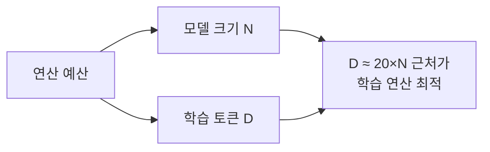
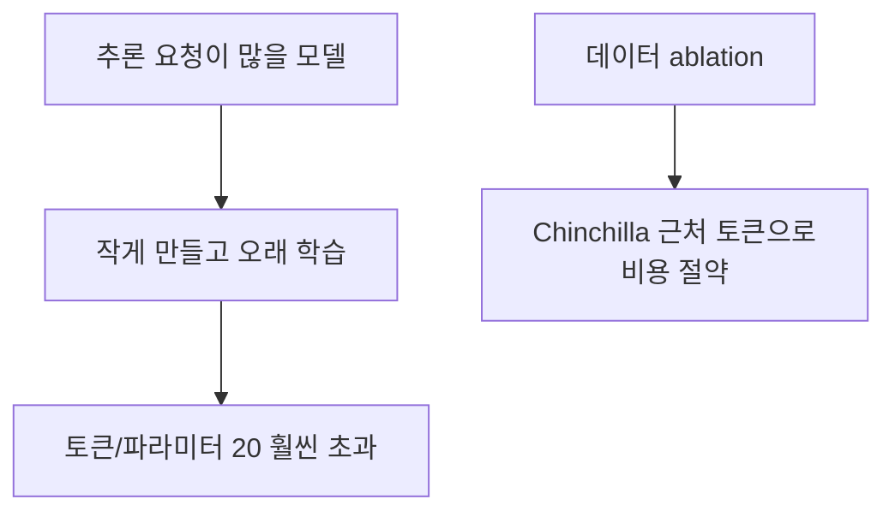

# Chinchilla 최적 학습량 ablation

> 모델 크기에 맞는 **"적정 학습 토큰 수"**(Chinchilla 법칙: 파라미터 1개당 약 20토큰)를 기준으로 소규모 실험의 학습량을 정하는 방법. FineWeb의 필터링 ablation이 이 기준에 가깝게 설계됐다.

## 쉽게 말하면
같은 연료(연산)로 엔진(모델 크기)을 키울지, 주행 거리(학습 토큰)를 늘릴지 정하는 문제다. 엔진만 크고 거의 안 달리면 낭비다. Chinchilla는 "엔진과 거리를 같은 비율로 늘리라"고 했다.

## 자세히
- **원 논문**(Hoffmann 외 2022, arXiv 2203.15556, 초록 직접 읽음): 400개 넘는 모델(7천만~160억+ 파라미터, 50억~5천억 토큰)을 학습해, 당시 대형 모델이 **크게 덜 학습됐다**고 주장했다. 계산 최적에서는 모델 크기를 두 배로 늘릴 때 학습 토큰도 두 배로 늘려야 한다. Chinchilla(70B)는 Gopher(280B)와 같은 연산에 데이터를 4배 써서 Gopher·GPT-3 등을 여러 과제에서 앞섰고 MMLU 평균 67.5%였다.
- **"20토큰/파라미터"는 어림값**: 이 비율은 논문의 정확한 결론이 아니라 이후 널리 퍼진 규칙이다. 70B·1.4조 토큰이 D/N=20이다(검색 요약, 원문 확인 못 함). 복제 시도(Epoch AI)는 논문의 세 번째 접근 적합이 데이터에 잘 안 맞는다고 보고했다.
- **FineWeb ablation에 적용**(arXiv 2406.17557, 직접 읽음): 1.71B 모델의 필터링 실험은 약 280억 토큰으로, 논문이 "대략 Chinchilla 최적 크기"라 밝힌다. 직접 나눠 보면 28B÷1.71B ≈ 16토큰/파라미터, 중복 제거·누적 확인 실험의 3,500억 토큰은 약 205토큰/파라미터로 최적보다 훨씬 길다.
- **왜 최적보다 오래 학습하기도 하나**: Chinchilla 법칙은 학습 연산만 센다. 추론 요청이 많을 모델이면 작은 모델을 더 오래 학습하는 편이 총비용이 낮다. Sardana 외(arXiv 2401.00448, 초록 직접 읽음)는 추론 수요가 약 10억 요청쯤이면 Chinchilla 최적보다 작게·오래 학습하라고 권하고, 47개 모델 실험에서 토큰/파라미터 약 10,000까지 품질이 계속 올랐으나 보통 비율에서 맞춘 법칙은 극단 구간에서 추가 토큰의 이득을 과대평가한다고 밝혔다.
- **ablation 설계 관점**: 같은 학습량에서 데이터 버전만 달리 비교하므로 "최적" 자체가 목적은 아니다. 다만 너무 짧게 학습하면 데이터 차이가 나타나기 전에 끝나고, 너무 길면 비용이 커진다. Chinchilla 근처가 합리적인 기본값이다(제안).

## 그림으로 보기

## 예시
| 설정 | 토큰/파라미터 |
|---|---|
| Chinchilla 70B, 1.4T | 약 20 |
| FineWeb 필터링 ablation 1.71B, 28B | 약 16 |
| FineWeb 중복 제거 ablation 1.71B, 350B | 약 205 |
- 업무 장면: 7억 파라미터 모델을 자체 학습해 데이터 후보를 비교한다면 약 140억 토큰(×20)을 시험용 학습량의 출발점으로 잡는다.

## 헷갈리는 것과 비교
| 개념 | 차이 |
|---|---|
| Chinchilla 최적 | 학습 연산만 고려한 최적 비율 |
| 과학습(overtraining) | 추론 비용을 줄이려 일부러 더 오래 학습 |
| [ablation 연산 예산](#ablation-compute-budget) | 이 학습량을 모델 수만큼 곱한 총비용 |
| [단계별 규모 검증](#staged-validation) | 작은 학습량으로 거르고 큰 학습량에서 확인 |

## 더 읽을거리
- [Training Compute-Optimal Large Language Models (arXiv 2203.15556)](https://arxiv.org/abs/2203.15556) — Chinchilla 원 논문(초록 직접 읽음).
- [Beyond Chinchilla-Optimal (arXiv 2401.00448)](https://arxiv.org/abs/2401.00448) — 추론 수요를 반영한 학습량(초록 직접 읽음).
